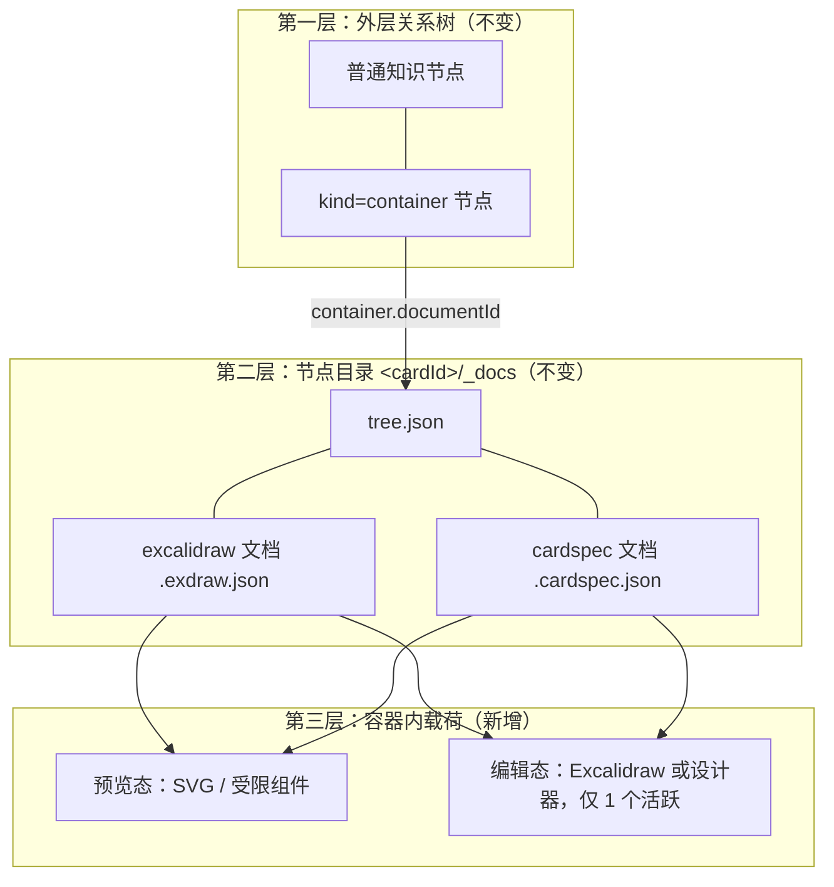

# TopoMind 总体需求方案：从容器节点到 AI 生成知识卡片

- 版本：v1.1
- 日期：2026-11-20（v1.1 补充 2026-11-22 媒体资源与 HTML 逃生舱决策，见 §11）
- 状态：方案已定，待分阶段实现
- 定位：**主需求文档**（贯穿“流程图 → 容器节点 → 自定义节点 → AI 知识卡片”全部讨论）
- 细分子方案：`docs/design/container-node-excalidraw-design.md` 已升级 **v1.1（2026-11-21）**，合并了源码 fact-check 修正；阶段 1-4 的实现口径以该文档 **§12 修正记录**为最终依据
- 本文只描述需求、选型与实施步骤，不含实现代码

---

## 1. 这份方案要解决什么：把整条话题串起来

这次讨论表面上看聊了四件事，实际是同一个目标的四个层次：

1. **起点：在画布上画流程图。** 但外层画布是唯一的关系树，流程图元素不能混进从属关系、不能变成外层边。结论：**流程图必须住在节点内部，节点外仍然只是一个普通树节点。**
2. **第一次收敛：节点升级为容器。** 既然节点本来就是磁盘目录，就让节点可选地“装”一个组件；流程图是第一个组件。结论：**新增 `kind='container'`，载荷放节点自身 `_docs/`，外层架构不动。**
3. **第二次收敛：不造轮子。** 流程图用 Excalidraw（喜欢的 UI / 手绘风、MIT、React 19 兼容、数据开放、能导出 SVG）；原 X6 flowchart 退场。结论：**Excalidraw 是容器里的一个载荷类型，不是新的图引擎。**
4. **第三次收敛：容器要能装“任意东西”。** 用户想拖拽设计节点、嵌入 HTML；再往前一步是让 AI 自动生成节点样式与展示内容。结论：**必须有一个统一、可校验、人机共用的描述模型（CardSpec），AI 和人拖拽都产出它。**

**终局**：节点真正成为一张“知识卡片”——有结构化展示内容、有视觉样式、由 AI 辅助生成、由人确认和修正，并且不破坏现有万级节点关系树的性能与安全边界。

**一句话贯穿**：前面所有改造（容器、Excalidraw、注册表）都不是独立需求，而是为了给 AI 生成一个**受控、可校验、可缩略、可撤销**的知识卡片准备好靶子和渲染器。

---

## 2. 终局定义与成功标准

### 2.1 目标

- 用户可以创建“容器节点”，节点内可放流程图、结构化卡片等组件；容器节点在外层关系树中仍是一个普通节点。
- AI 读取节点上下文（标题、关联文档摘要、子节点、关系、已有样式），生成一张卡片的**结构化描述**，预览确认后应用到节点。
- 用户也可以用拖拽设计器产出**同一种描述**；人机两条路径汇合，不产生两套数据。
- 所有 AI 改动可预览、可撤销、可批量应用；失败时保持原样，不静默覆盖。
- 离线可用，旧数据零迁移，万级节点画布性能不退化。

### 2.2 成功标准

| 维度 | 标准 |
| --- | --- |
| 架构 | 外层关系树、React Flow 画布、graph meta v2 分片结构不改 |
| 数据 | 旧档零迁移；新增字段全链路白名单往返不丢；载荷仍随节点目录搬运 |
| 性能 | 非活跃容器不挂载编辑器实例；万级节点渲染路径不增加常驻实例 |
| 安全 | AI 不产出可执行 HTML；任意 HTML 默认关闭且沙箱隔离 |
| 体验 | 内层滚轮不缩放外层；内层 Delete 不删外层节点；AI 生成先预览后应用 |
| 可维护 | 新增一种容器/卡片组件 = 加注册项，不改外层树、选中、LOD、关系校验 |

### 2.3 明确非目标（v1）

- 不做容器嵌套；不做容器内引用外层节点；不做跨容器连线。
- 不把容器内部元素变成外层边，不修改 `graphHierarchy.ts` 从属校验。
- 不承诺 Excalidraw 的端口、自动布局、拓扑校验（它是白板，不是图引擎）。
- 不把任意 HTML 作为主干能力；不自动转换旧 `.tflow.json`。
- 不索引 `.exdraw.json` / CardSpec 正文到全局搜索（v1 只索引标题与节点名）。

---

## 3. 现有架构评估：地基比预期好，但有两处硬缺口

| 维度 | 现状（已核对源码） | 判断 |
| --- | --- | --- |
| 节点即目录 | `electron/file-service.js:535-546,560-568`：`<cardId>/_docs/tree.json` + `.tdoc/.tmind/.tflow.json` | **强支撑**，载荷天然隔离，跨房间移动/删除/导入导出自动跟随 |
| 关系树与格式 | graph meta v2 的 16 分片；`src/types/graph.ts` 等 7 处字段白名单；两处 `normalizeNodeKind` | **强支撑但需同步**，新增字段漏一处就“画面生效、重开丢失” |
| 节点样式模型 | `KnowledgeNodeStyle` 9 字段（`src/types/graph.ts:184-194`）：字号、字色、底色、字重、斜体、边框色/宽/圆角 | **强支撑**，AI 改标题栏样式是现成闭环 |
| 样式批量写入 | `applyNodeStylePatch` / `clearNodeStyles`（`src/hooks/useGraph/graphBuilder.ts:241,260`）一次遍历 | **强支撑**，AI 批量应用零改造 |
| 装饰一致性 | `titleDecorations.ts` 是标题装饰唯一事实来源，渲染/测量/模型共用 | **强支撑**，避免 AI 改样式后测量错位 |
| 设计护栏 | `tokens.css` 单色制 + 散点断言；取色器允许任意 hex | **半支撑**，AI 侧必须额外约束为 token 或受限色板 |
| 卡片展示内容 | **无独立槽位**：`hasContent?: boolean`（`src/types/graph.ts:155`）在 `graphBuilder.ts:217` 恒 `false`，无读取者；正文全在右栏文档 | **缺口**，这是“知识卡片”最核心的一块，必须补 |
| 节点渲染扩展 | `GraphCanvas.tsx:36` 的 `nodeTypes` 硬编码；`kind` 只做持久化预留；容器无实现 | **缺口但成本低**，开放注册表即可 |
| AI 能力 | 无 SDK、无调用、无 key 配置；`PromptModal` 只是输入弹窗 | **缺口**，需从零引入，但可放在provider 抽象之后 |
| 容器事件 | `GraphCanvas.tsx:302` 捕获阶段滚轮；`useShortcut.ts:83-84` 的 `data-shortcut-scope`；`canvasReadOnly.ts:43`；`graphStore.tsx:285-298` 选中唯一写入点 | **约束明确**，可复用现有闸门做 active-surface 仲裁 |

**总体判断**：对“AI 生成知识卡片”是**局部强支撑、整体需改造**。样式闭环、白名单、token 约束正好是 AI 受控生成需要的护栏；缺的是“卡片内容槽位（CardSpec）”和“AI 接入”。

---

## 4. 关键选型（每个环节只做一个决定）

| # | 决策点 | 选定方案 | 否决方案 | 理由 |
| --- | --- | --- | --- | --- |
| 1 | 外层图架构 | 完全不动：React Flow 唯一关系树 | 换成图引擎 / 把流程图元素纳入关系树 | 保护万级节点基础与从属校验，扩展都收在节点内 |
| 2 | 节点升级方式 | 可选 `kind='container'`，默认节点不变 | 所有节点默认通用容器 | 避免每个知识节点多挂渲染器，事件冲突不扩散 |
| 3 | 流程图引擎 | Excalidraw（0.18.x，MIT，React 19 兼容） | 自造轮子 / 再引 React Flow 做内层 / 保留 X6 | 满足 UI 与手绘风；X6 已决定退场，避免两套图模型 |
| 4 | X6 flowchart | 退场：不新建、不编辑、移除 8 个依赖；旧 `.tflow.json` 不删不转、UI 隐藏 | 双轨长期维护 / 写双向转换器 | 降低维护面；磁盘数据零损失 |
| 5 | 载荷存放 | 节点自身 `_docs/`，meta 只存 `container.documentId` 指针 | 新建 `_container/` 目录 / 改 graph meta 格式 | 复用目录隔离与搬运链路，零存储架构改造 |
| 6 | 渲染策略 | 单活跃实例 + 其余 SVG 缩略图，非活跃**完全不挂载**编辑器 | 所有容器实时挂载 / 统一截图 | 万级节点性能；也是彻底的事件隔离手段 |
| 7 | 卡片描述模型 | **CardSpec：版本化 JSON（布局 / 组件 / 内容绑定 / 样式引用）** | AI 直接写任意 HTML / 直接改 DOM | 可校验、可缩略、可迁移、可索引；安全边界可控 |
| 8 | AI 产出物 | AI 生成 CardSpec 草案 → 预览 → 用户确认 → 落盘 | AI 静默覆盖节点 | 失败回退原样；用户始终有最终决定权 |
| 9 | 样式约束 | CardSpec 只引用 token 或受限色板；走 `applyNodeStylePatch` | AI 输出任意 hex / 自定义 CSS | 不绕过单色制设计系统；天然可撤销 |
| 10 | 人机同源 | 拖拽设计器产出与 AI 相同的 CardSpec | 设计器另存一套格式 | 路线图第 7 步能与第 5、6 步汇合，不重复造模型 |
| 11 | HTML 定位 | 默认关闭的沙箱逃生舱（禁 JS、CSP、无外部资源） | 作为主干渲染方式 | Electron 有 Node 集成，模型输出可执行 HTML 等于本地权限泄露 |
| 12 | LLM 接入 | Provider 无关的 `LLMClient` 抽象，具体厂商可替换 | 一开始绑定单一厂商 SDK | 先跑通“生成 → 校验 → 预览 → 应用”闭环，厂商可后接 |

**最关键的选型是第 7 条**：用户想要的“AI 自己写卡片”，实现上不是让 AI 写 HTML，而是让 AI 写一份**受约束的结构化卡片描述**。这一步决定后面安全、性能、缩略图、迁移、撤销全部能否成立。

---

## 5. 目标架构与数据模型

### 5.1 三层结构



### 5.2 节点 meta（最小新增）

```ts
type GraphNodeKind = 'knowledge' | 'shape' | 'container'

interface ContainerRef {
  type: 'excalidraw' | 'cardspec'
  documentId: string   // doc_<32hex>，指向本节点 _docs/tree.json
}

// GraphChild / KnowledgeNodeData 新增可选字段
container?: ContainerRef
```

- 旧档无 `kind`/`container` 一律按 `knowledge`，零迁移。
- `container.documentId` 必须指向本节点文档中已存在的条目；缺失时显示“载荷缺失”占位，不崩溃、不自动创建。
- `kind='container'` 必须物化目录（与 `shape` 相反）。

### 5.3 CardSpec（枢纽模型）

CardSpec 是 AI 生成、人工拖拽、设计器保存的**同一种东西**，v1 只定义最小可用集：

```ts
interface CardSpec {
  schema: 'topomind.card-spec'
  version: 1
  layout: 'stack' | 'grid'                 // 受限布局，非任意 CSS
  components: Array<{
    id: string
    type: 'title' | 'text' | 'badge' | 'image' | 'audio' | 'video'
        | 'table' | 'progress' | 'flowchart' | 'html'
    props: Record<string, unknown>          // 受各组件 schema 约束
    styleRef?: string                       // 指向 token / 受限色板，不写死 hex
    binding?: { kind: 'title' | 'summary' | 'doc' | 'children' | 'static' }
  }>
  metadata?: { createdAt?: number; updatedAt?: number; generatedBy?: 'ai' | 'user' }
}
```

约束：版本化、未知 version 抛错且不回写；`normalizeCardSpec` 必须是纯函数；渲染器只认注册表里的组件类型，未知类型降级占位。

组件资源规则（2026-11-22 决策，详见 §11）：

- `image` / `audio` / `video` 的 `src` **只允许相对路径**，指向本节点 `_docs/assets/` 下的文件；禁止绝对路径与远程 URL（v1）。
- 资源文件随节点目录搬运（跨房间移动、导入导出自动跟随），复用既有目录链路，不新建存储结构。
- `html` 组件 v1 仅为**占位**：注册类型、数据可保存，渲染为「HTML 组件（默认关闭）」占位卡，不渲染任何 HTML 内容；真正的沙箱渲染在阶段 8 评估。

### 5.4 文档类型

- 新增 `excalidraw / .exdraw.json`（schema `topomind.excalidraw-document` v1）
- 新增 `cardspec / .cardspec.json`（schema `topomind.card-spec` v1）
- 移除 `flowchart / .tflow.json` 的注册与入口；旧文件保留但隐藏。

---

## 6. 一步步实现目标：八阶段路线

每个阶段独立可交付、可验证、可单独提交；后一阶段依赖前一阶段，但不跨阶段大提交。

| 阶段 | 主题 | 做什么 | 交付物 | 核心验收 |
| --- | --- | --- | --- | --- |
| **1** | 容器数据协议 | `kind='container'` + `container` 指针全链路白名单；两处 `normalizeNodeKind`；导入导出往返断言 | 类型与归一化改动，零 UI | 旧档零迁移；往返不丢字段；反向验证通过 |
| **2** | X6 退场 + Excalidraw 文档类型 | 删 3 个编辑器文件、清约 10 处引用、移 8 个依赖；加 `excalidraw` 枚举/扩展名/schema；旧 `.tflow.json` 隐藏不删 | 干净的依赖与文档类型 | 无 flowchart 入口；旧文件仍在；无残留引用 |
| **3** | 容器外壳 + 注册表 | 开放 `nodeTypes`；`ContainerCard`；领域层 `ContainerTypeSpec` 与渲染层注册表；纯 SVG 预览 | 只读容器节点 | 普通节点零回归；预览正确；新增类型只加注册项 |
| **4** | Excalidraw 编辑态闭环 | 动态 import、字体自托管、单活跃实例、滚轮/键盘/选中仲裁、debounce 保存与 flush | 可编辑的流程图容器 | 内层滚轮/删除不误伤外层；缩放 <100% 自动回预览；断网字体正常 |
| **5** | **CardSpec + 受限渲染器（枢纽）** | 定义 CardSpec v1 与纯函数 normalize；实现开发者预置组件（标题/文本/徽标/图片/表格/进度/流程图）；沿用单活跃 + 缩略图 | 数据驱动的卡片渲染能力 | 一份 CardSpec 能稳定渲染成卡片；未知类型降级；普通节点无性能回归 |
| **6** | AI 接入与生成 CardSpec | `LLMClient` 抽象；输入节点上下文；JSON Schema 约束输出；校验 → 预览 → 用户确认 → 落盘；失败回退 | AI 生成卡片草案 | 输出必过 schema；预览可取消；取消后节点零改动 |
| **7** | AI 内容与样式生成 | 生成摘要/要点/emoji/配色建议；配色只引用 token 或受限色板；批量走 `applyNodeStylePatch`；一键撤销 | 可用的 AI 知识卡片 | AI 不产生任意 hex；批量应用可撤销；装饰测量不错位 |
| **8** | 拖拽设计器 + HTML 逃生舱 | 用户拖拽预置组件产出 CardSpec，与 AI 同源；任意 HTML 仅作默认关闭的沙箱兜底（禁 JS、CSP） | 人机汇合的完整能力 | 设计器产物与 AI 产物结构一致；HTML 默认关闭且不可执行脚本 |

**顺序不可颠倒的理由**：1-4 做出“节点能安全承载复杂组件”的壳，5 先立靶子，6-7 才接 AI。若先做 AI 生成 HTML，会同时撞上安全、校验、缩略图、迁移四个问题，且每一步都在推翻上一步。

---

## 7. 贯穿全局的四条硬约束

1. **单活跃 + 缩略图**：任何时刻最多一个容器挂载编辑器；其余用导出 SVG 或受限组件离屏渲染的预览。失焦、Esc、缩放下降、切房间一律 flush 后卸载回预览。
2. **事件仲裁**：活跃容器表面 `onWheelCapture` 用 `stopPropagation()` 阻断事件冒泡到 xyflow 的 d3-zoom（外层 `onWheelCapture` 再加 `[data-tm-container-surface="active"]` 守卫做双保险）；内层 `data-shortcut-scope` 隔离快捷键；内部选中不调用 `graphStore.applySelectionChanges`；**容器内容编辑与 `computeCanvasReadOnly` 解耦**（该闸门是 `!atMaxZoom || hidden > 0`，大房间 LOD 必然 `hidden > 0`，直接复用会导致容器永远不可编辑），它只继续保护外层图结构写操作。
3. **生命周期零改造**：跨房间移动/撤销/删除/导入导出复用现有目录搬运；原地刷新一律 `graph.refreshCurrentRoom()`，禁止传源/目标路径调 `loadRoom`；关闭走 `flushAllTabs`。
4. **安全与回滚**：CardSpec 与 Excalidraw 载荷内禁止绝对路径与可执行脚本；所有 AI 写入走既有 store 写入口，保证可撤销；未知 schema version 抛错且不回写。

---

## 8. 验证门禁（每阶段结束必做）

```text
typecheck
node --check
verify:critical
verify:plugins
vite build --outDir outputs/.tmp-build-N
拷 dist/ 到目标目录
verify:linked:gui
```

- 新增能力属“改能力”：先让旧实现 exit 1，再原子恢复并校验 sha256（反向验证）。
- 纯函数（normalize / serialize / CardSpec 校验）用 esbuild 打包后真跑。
- 必须扩展的断言：节点字段往返、未知 kind 降级、扩展名清单、CardSpec/Excalidraw normalize、跨房间移动载荷、旧 tflow 兼容、插件边界。
- GUI 验收：新建容器 → 预览；100% 激活编辑；内层滚轮/Delete 隔离；99% 回预览；跨房间移动保留；AI 生成预览可取消；断网字体本地加载。

---

## 9. 风险与开放项

| 风险 / 开放项 | 影响 | 默认处理 |
| --- | --- | --- |
| Excalidraw 安装体积约 46.8 MB、31 依赖 | 首开延迟 | 动态 import；不进主 chunk；字体自托管 |
| 手绘配色与单色制冲突 | 视觉一致性 | 接受编辑态原生视觉；预览保留手绘风（选型目的） |
| Excalidraw 无端口/布局/拓扑 | 正式流程图能力退化 | v1 定位“手绘白板”，不承诺图算法；如需再评估独立图组件 |
| 用户已有 `.tflow.json` | 数据损失担忧 | 不删不转不索引，UI 隐藏；将来另立转换方案 |
| AI 输出不可控 | 安全与稳定性 | JSON Schema 约束 + 纯函数校验 + 预览确认 + 失败回退 |
| 任意 HTML | Electron 本地权限 | 默认关闭；沙箱 iframe、禁 JS、CSP、无外部资源，单独门禁 |
| LLM 厂商/密钥 | 落地方式 | Provider 抽象先行；具体接入方式在实现阶段 6 前确认 |

---

## 10. 交接说明

- **实现 agent 请先读** `docs/design/container-node-excalidraw-design.md` **v1.1 的 §12 修正记录**：
  v1.0 的事实基线（白名单处数、扩展名表处数、旧 flowchart 条目保留方式、`DocumentEditorHost` 判空、
  `:2550` 断言、复制节点）已被逐条修正；阶段 1-4 以修正后的口径实现。
- **本文是主需求文档**：阶段 5-8 的 CardSpec、AI 生成、设计器、HTML 逃生舱以本文的第 4、5、6 节为准。
- 每阶段结束按第 8 节门禁验收后再进入下一阶段；不要把阶段 2（删 X6）和阶段 4（接 Excalidraw）合成一次提交，以便回滚。
- 用户原始诉求中的“画布上画流程图”“节点可放任意组件”“AI 自己写卡片”，分别由阶段 4、阶段 5/8、阶段 6/7 交付；三者共用同一套容器与 CardSpec 模型。

---

## 11. 决策补充（2026-11-22）

用户确认了阶段 5 前的四个开放项：

| 开放项 | 确认结果 | 影响 |
| --- | --- | --- |
| 媒体资源策略 | **本地相对路径**：图片/音视频存本节点 `_docs/assets/`，CardSpec 组件只存相对引用；v1 不支持远程 URL | 已并入 §5.3 组件资源规则；实现时需扩展文档落盘链路支持二进制资源文件，并在导入导出、跨房间移动断言中覆盖 |
| HTML 逃生舱 | **v1 占位**：CardSpec 注册 `html` 组件类型，数据可保存但只渲染占位卡；沙箱渲染推迟到阶段 8 再评估 | 已并入 §5.3；决策表第 11 条不变（默认关闭、禁 JS、CSP），只是 v1 连沙箱也不做 |
| 布局自由度 | **暂未定**：v1 仍按 `stack/grid` 起步，实现阶段 5 前再评估是否需要更多布局原语（分栏、头图、时间线等） | 保持开放；组件集实现时布局层预留扩展点即可 |
| AI 生成上下文 | **暂未定**：生成卡片时喂给模型的上下文范围（标题 / 文档摘要 / 子节点 / 关系）在阶段 6 实现前再定 | 保持开放；`LLMClient` 抽象的输入构造器按可配置设计 |

以上为完整需求方案；本次未修改任何业务代码。
