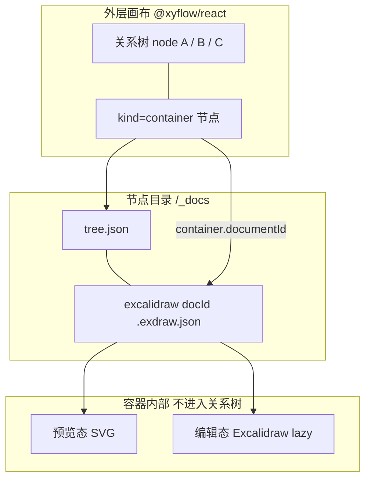

# TopoMind 容器节点 + Excalidraw 技术方案

- 版本：v1.3
- 日期：2026-11-21（fact-check 修正 + P0–P5 全阶段落地完成）
- 状态：已实现；实现清单、门禁结果与对本文的技术偏差见 §13
- 交接对象：实现 agent
- 本文只描述技术方案，不含实现代码
- 口径优先级：**§12「修正记录」是逐条核对当前源码后形成的最终口径**，与前文任何表格、
  行号、判定条件冲突时一律以 §12 为准；v1.0 中已被推翻的结论在 §12 逐条列出。

---

## 0. 决策摘要

已定决策：

1. 外层关系树、React Flow 画布、graph meta v2 分片结构 **全部不动**。
2. 节点从「知识卡片」升级为**可选容器**：新增 `kind: 'container'`，默认节点仍是 `knowledge`。
3. 容器内可挂载组件；**第一个容器类型是 Excalidraw 白板/流程图**。
4. **X6 flowchart 文档类型退场**：不再新建、不再编辑、不再注册为可创建文档类型；`@antv/x6` 及 7 个插件依赖移除。
5. 容器载荷仍存在节点自身的 `<cardId>/_docs/` 目录下，**不新建 `_container/` 目录，不改 graph meta 格式**。
6. 旧 `.tflow.json` 文件**不删、不自动转换**：保留磁盘数据、保留 tree.json 条目，仅在 UI 层隐藏（实现方式见 §4.2，v1.0 的「UI 层过滤即可」已被推翻）。
7. **存储类型与 surface 正交**：落盘格式类型与「右栏文档 / 容器载荷」表面分离，`excalidraw` 标 `containerOnly`，不出现在右栏新建菜单与文档树。
8. **容器内容编辑与画布结构只读解耦**：编辑态不要求 `hiddenNodeCount === 0`（见 §6.2、§12）。

原 §11 的四项开放项已按默认选择闭环，用户于 2026-11-21 确认「可以，按建议默认值推进」：

| 开放项 | 确认结果 |
| --- | --- |
| 容器内插入图片 | **禁止**（`UIOptions.tools.image = false`，normalize 忽略 files），避免附件链路 / 跨房间搬运 / 去重 |
| 预览 SVG 落盘 sidecar | **v1 不落盘**；改为内存 LRU 缓存 + 只对可见节点生成 + 限制并发生成数（见 §6.3） |
| 手绘配色与单色制并存 | **接受**，编辑态与预览态都保留手绘风（这是选型目的） |
| 旧 `.tflow.json` 转换器 | **不做**，将来另立方案 |

另新增两项实现期决策（见 §12）：容器编辑态与 `hidden > 0` 解耦；滚轮守卫改为在活跃容器表面 `stopPropagation()`。

非目标（v1 明确不做）：

- 不做容器嵌套；不做容器内引用外层节点；不做跨容器连线。
- 不改 `graphHierarchy.ts` 的从属校验，不把容器内部元素变成外层边。
- 不索引容器正文到全局搜索。
- 不做多人协作（Excalidraw 的 collab 只在 hosted app，npm 包不含）。
- 不做 Excalidraw ↔ X6 旧格式转换器。
- 不实现「复制节点」：当前代码库没有该功能，v1 生命周期矩阵中移除该行（见 §7.2）。

---

## 1. 现状事实基线（v1.1 校正版）

实现前请以此表为准；v1.0 表格中被修正的项在 §12 标注。

| 主题 | 位置 | 现状 |
| --- | --- | --- |
| 节点种类 | `src/types/graph.ts:24` | `GraphNodeKind = 'knowledge' \| 'shape'`；`shape` 注释明确「永不物化目录、永不下钻」，不可复用为容器 |
| **节点字段白名单（7 处）** | `src/types/graph.ts`、`src/domain/graph/model.ts`、`src/domain/graph/graphMapper.ts`（双向）、`src/domain/graph/normalizeGraphMeta.ts`、`src/core/storage/file.ts`（双向）、**`src/core/fs-backend.ts:46-64`**、`src/hooks/useGraph/graphBuilder.ts`（双向） | 新增字段必须 7 处全链路同步，漏一处即「画面生效、重开丢失」。门禁 `verify-critical-regressions.mts:7402,7407-7417,7434-7449` 逐文件校验 |
| kind 白名单闸 | `src/domain/graph/normalizeGraphMeta.ts:75-77`、`src/core/storage/file.ts:72-74` | 两处 `normalizeNodeKind` 只放行 `knowledge`/`shape`，未知值静默回落 `undefined`（等价 knowledge） |
| 外层画布 | `src/features/graph/GraphCanvas/GraphCanvas.tsx:36` | `nodeTypes` 硬编码为 `{ knowledgeCard: KnowledgeCard }` |
| 节点 type 映射预留 | `src/hooks/useGraph/graphBuilder.ts:203-206` | 源码注释已明确：接流程图节点只需按 `roomNode.kind` 映射 type + 注册 nodeTypes，格式白名单不必再改 |
| 滚轮捕获 | `GraphCanvas.tsx:259-285,302` | `onWheelCapture` 在捕获阶段运行，但 `:265-267` **只对 `target.closest('.react-flow__pane')` 生效**；节点内部 target 走 `if (!pane) return` 直接放行且未 `stopPropagation` |
| 快捷键作用域 | `src/hooks/useShortcut.ts:81-87,100-101` | 取「最近」祖先的 `data-shortcut-scope`；画布为 `canvas`；`global` 在捕获阶段执行且不受 `defaultPrevented` 影响（`Control+f` 仍会穿透） |
| 只读闸门 | `src/domain/graph/canvasReadOnly.ts:43-51` | `readOnly = !atMaxZoom \|\| hidden > 0`（**「或」**）。万级节点房间 LOD 必然 `hidden > 0`，故 100% 缩放也常为只读 |
| 选中唯一写入 | `src/stores/graphStore.tsx:285-298` | `applySelectionChanges` 是选中态专用事务唯一写入点；画布 `deleteKeyCode={null}` |
| 文档类型枚举 | `src/core/topoDocumentTypes.ts:1` | `['smart','mindmap','flowchart']`；`storage/service.ts:46-47` 复用 `isTopoDocumentType` 做创建校验 |
| 文档落盘 | `electron/file-service.js:535-546,560-568,941-980` | `_docs/tree.json` = `{ version: 2, documents: { [docId]: item } }` + `.tdoc/.tmind/.tflow.json` |
| **扩展名表（4 处）** | `electron/file-service.js:537-546`（`TOPO_DOCUMENT_EXTENSIONS` + `SCHEMAS`）、`electron/file-service.js:1658`（注入 roomSummaryService）、`electron/services/document-id-service.js:24-28`（`DOCUMENT_EXTENSIONS`）、`scripts/verify-critical-regressions.mts:9694`（断言夹具） | 另有 2 个隐含消费点：`document-id-service.js:805` 扫描正则、`:510` 导入重映射 `ext` 回落（未知类型回落 `.tdoc.json`） |
| manifest 对账 | `file-service.js:608-664,666-717,719-758,785-795` | 归一化用类型白名单，未知 type 抛错被 `catch{}` 静默丢条目；读 manifest 会自动写回；reconcile 会删掉扫不到的条目 |
| 旧流程图编辑器 | `src/features/documents/FlowchartDocumentEditor/` | 3 个文件，依赖 X6 + 7 插件 |
| **编辑器宿主** | `src/features/documents/DocumentEditorHost.tsx:139-145` | `getDocumentEditorAdapter` **无判空**，`adapter.render` 为 `undefined` 时直接 TypeError |
| 文档保存链路 | `DocumentWorkspaceLayout.tsx:455-468`（1500ms debounce）→ `useDetailDocumentSession.ts:54-117` → `close-guard.ts:17-32,50-53` | `registerTabSaver(tabId, ...)` 按 tab 聚合，同 tab 支持多个 saver；图 tab 已在 `useGraphPageController.ts:58-67` 注册一个 |
| X6 依赖 | `package.json:74-81`、`package-lock.json` | 8 个包（核心 + 7 插件） |
| 测试断言 | `scripts/verify-critical-regressions.mts:24-28,154-249,2517-2550,9694`；`scripts/verify-multi-select-move.mjs:121-168` | `:2550` 断言「nodeTypes 仍统一为 knowledgeCard」；`:9694` 扩展名清单；移动脚本目前**没有**载荷存在性断言 |

---

## 2. 总体架构

外层保持单一关系树语义；容器是树上的一个普通节点，内部载荷与外层解耦。



两套引擎的边界必须清晰：

- `@xyflow/react`：外层关系树，唯一图语义来源，不变。
- `@excalidraw/excalidraw`：容器内编辑器，只在活跃容器激活时动态加载，不参与外层图计算。
- 移除 `@antv/x6`：它此前只服务于右栏 flowchart 文档，没有其他引用。

**第三条边界（v1.1 新增）：存储层与表现层正交。** `_docs/` + tree.json 是「落盘格式」基础设施，
同一份基础设施服务两种 surface：右栏文档（`smart`/`mindmap`）与容器载荷（`excalidraw`）。
两者共用扩展名表、docId 生成、导入重映射，但**注册表面必须分开**，否则右栏会出现没有容器节点承载的孤立白板。

---

## 3. 数据模型

### 3.1 节点 meta 新增字段

```ts
export type GraphNodeKind = 'knowledge' | 'shape' | 'container'

export interface ContainerRef {
  type: string       // v1: 'excalidraw'；后续看板/表格按注册表扩展
  documentId: string // doc_<32hex>，指向该节点 _docs/tree.json 中的条目
}

// GraphChild / KnowledgeNodeData 同时新增：
container?: ContainerRef
```

约束：

- 旧数据没有 `kind`/`container` 时一律按 `knowledge` 处理，**零迁移**。
- `container.documentId` 必须是本文档节点 `_docs/tree.json` 中存在的文档 id；不存在时渲染「载荷缺失」占位，不崩溃、不自动创建、不改写 meta。
- `kind='container'` 的节点**必须物化目录**（与 `shape` 相反）。当前新建节点不建目录，目录由 `_fs_createTopoDocument:947` 的 `_fs_ensureDir(docsDir)` 按需物化，正好满足。
- `ContainerRef.type` 用 `string` 而非字面量联合，保证新增容器类型**不改节点类型定义**。

**必须同步修改的 7 处白名单**（v1.0 漏第 6 处，且第 7 处路径写错）：

1. `src/types/graph.ts` — `GraphNodeKind`、`GraphChild`、`KnowledgeNodeData`
2. `src/domain/graph/model.ts` — `RoomGraphNode`、`KBNode`
3. `src/domain/graph/graphMapper.ts` — 双向 map（`:37` / `:98`）
4. `src/domain/graph/normalizeGraphMeta.ts` — `normalizeContainer` + `normalizeNodeKind` 放行
5. `src/core/storage/file.ts` — `FSBGraphChild`、`convertFSBToGraph` / `convertGraphToFSB` map 本体、第二处 `normalizeNodeKind`
6. **`src/core/fs-backend.ts:46-64`** — `FSBGraphMeta` 内联 `kind?: 'knowledge' | 'shape'`，改为 `GraphNodeKind` 并加 `container?`
7. **`src/hooks/useGraph/graphBuilder.ts`** — `:76` 写盘、`:212` 回读各加 `container`；`:203-206` 按 `roomNode.kind` 映射 `type`
8. `scripts/verify-critical-regressions.mts:2517-2550` — kind + container 端到端往返断言；`:7434-7449` 静态 7 处断言

两处 `normalizeNodeKind` 必须放行 `'container'`，否则新字段被静默吞掉并回落 knowledge。

### 3.2 文档类型与扩展名（surface 分离）

```ts
// 落盘/校验类型全集（不含已退场的 flowchart）
TOPO_DOCUMENT_TYPES = ['smart', 'mindmap', 'excalidraw']

// UI surface：右栏新建菜单与文档树只遍历这个
TOPO_PANEL_DOCUMENT_TYPES = ['smart', 'mindmap']   // excalidraw: containerOnly

DOCUMENT_EXTENSIONS.excalidraw = '.exdraw.json'
TOPO_DOCUMENT_SCHEMAS.excalidraw = 'topomind.excalidraw-document'
```

- `documentTypeRegistry.ts` 的 `DocumentTypeDefinition` 新增 `surface: 'panel' | 'container-only'`；
  `excalidraw` 定义 `containerOnly: true`，提供 `getPanelDocumentTypes()` 供 `DocumentEditorHost.tsx:105` 遍历。
- 统一文档树（`unified-document-tree-service.js` 只透传 `type`）在 UI 侧按 `surface` 过滤 `container-only` 条目，
  **不改写 tree.json**。
- `storage/service.ts:46-47` 的 `isTopoDocumentType` 仍基于全集，`createTopoDocument` 由容器创建路径调用。

**扩展名表 4 处 + 2 个消费点必须全同步**（漏任一处会导致 manifest 条目丢失或导入改名错位）：

| # | 位置 | 改动 |
| --- | --- | --- |
| 1 | `src/core/topoDocumentTypes.ts:1` | 枚举删 flowchart、加 excalidraw |
| 2 | `src/features/documents/services/documentTypeRegistry.ts:11-33` | 删 flowchart 定义，新增 excalidraw（`containerOnly`） |
| 3 | `src/features/documents/services/documentEditorRegistry.tsx:9,14,395-428` | 删 import / lazy / Adapter / REGISTRY.flowchart |
| 4 | `src/features/documents/DocumentEditorHost.tsx:105,139` | 新建菜单改遍历 `getPanelDocumentTypes()`；**新增 adapter 判空 + 下线占位** |
| 5 | `electron/file-service.js:537-546` | 扩展名表 + schema 表（**保留 flowchart 作为 compat，见 §4.2**） |
| 6 | `electron/file-service.js:813-873` | 新增 excalidraw 初始内容分支；flowchart 分支保留但不可达 |
| 7 | `electron/file-service.js:1658` | `roomSummaryService` 的 `documentExtensions` 自动跟随，驱动 `hasDetail` |
| 8 | `electron/services/document-id-service.js:24-28` | `DOCUMENT_EXTENSIONS` |
| 9 | `electron/services/document-id-service.js:805` | 扫描正则改为 `\.(tdoc\|tmind\|exdraw\|tflow)\.json$`（**tflow 仍要保留**，见 §4.2） |
| 10 | `electron/services/document-id-service.js:510` | 导入重映射 `ext` 回落：compat 类型必须有扩展名，否则按 `.tdoc.json` 改名错位 |
| 11 | `scripts/verify-critical-regressions.mts:24-28,154-249,9694` | 删 flowchart 纯函数 import / 断言组，扩展名清单改为 `.exdraw.json` 夹具 |
| 12 | `package.json:74-81` + `package-lock.json` | 删除 8 个 `@antv/x6*` 包 |

自动跟随、无需改：`DocumentContextMenu.tsx:57-71`（基于枚举）、`core/storage/service.ts`、`fs-backend.ts` 通道。

### 3.3 Excalidraw 文档载荷 schema

新建纯领域模块（建议路径）：

- `src/features/documents/ExcalidrawDocument/excalidrawDocumentTypes.ts`
- `src/features/documents/ExcalidrawDocument/excalidrawDocumentContent.ts`（normalize / serialize / version 守卫）

```ts
export interface ExcalidrawDocumentContent {
  schema: 'topomind.excalidraw-document'
  version: 1
  title: string
  scene: {
    elements: ExcalidrawElement[]
    appState: Pick<AppState,
      'viewBackgroundColor' | 'gridSize' | 'theme' | 'scrollX' | 'scrollY' | 'zoom'>
    files?: BinaryFiles
  }
  metadata?: {
    createdAt?: number
    updatedAt?: number
    editor?: 'excalidraw'
  }
}
```

规则：

- 存储用 `serializeAsJSON({ elements, appState })` 的结果反解，天然去掉 deleted 元素与大部分 AppState；**禁止落完整 AppState**。
- `normalizeExcalidrawDocumentContent(raw, fallbackTitle)` 必须是纯函数：缺省/空 → 空场景；已知字段有界归一化（坐标、尺寸、zoom 上下限，参照旧 `flowchartDocumentTypes.ts:51-61`）；**未知 version 抛错**，由适配层捕获后显示「数据版本不受支持」，且**绝不回写**。
- 语义扩展放在 element 的官方 `customData` 字段，不改 Excalidraw 类型：

```ts
customData?: { tm?: { kind?: 'start' | 'process' | 'decision' | 'end' } }
```

v1 只写 `kind`，不写 `ref`，避免跨边界引用。

- `files`（图片）v1 **禁止插入**：`UIOptions.tools.image = false`，normalize 时忽略 files。

---

## 4. X6 flowchart 退场与旧数据策略

### 4.1 移除清单

删除文件：

- `src/features/documents/FlowchartDocumentEditor/FlowchartDocumentEditor.tsx`
- `src/features/documents/FlowchartDocumentEditor/flowchartDocumentTypes.ts`
- `src/features/documents/FlowchartDocumentEditor/flowchartCellSync.ts`
- 整个 `src/features/documents/FlowchartDocumentEditor/` 目录

依赖移除：

- `package.json:74-81` 删除 `@antv/x6` 与 7 个插件，重生成 `package-lock.json`
- 检查 `vite.config.js`、`src/App.tsx` 中 X6 相关的 manualChunks / 注释残留

### 4.2 旧 `.tflow.json` 处理（v1.1 修正）

原则：**磁盘数据零损失、tree.json 条目零丢失、UI 零暴露**。

v1.0 写「只在 UI 层用类型守卫隐藏、不改写 tree.json 条目」，但主进程有两套独立逻辑会主动删条目：

1. `_fs_normalizeTopoDocumentManifest:616,633` 调 `_fs_normalizeTopoDocumentType`（白名单 =
   `TOPO_DOCUMENT_EXTENSIONS`），未知 type 抛错被 `catch {}` **静默丢弃该条目**；随后
   `_fs_readTopoDocumentManifest:789-792` 因 `loaded.normalized` 触发自动写回。
2. `_fs_scanTopoDocumentFiles:690-695` 只认扩展名表，`.tflow.json` 被 `if (!type) return` 忽略；
   `_fs_reconcileTopoDocumentManifest:730-737` 因 `scannedByPath` 找不到该条目而 `removed += 1`。

因此正确实现是**在主进程保留 `flowchart` 为「只索引不渲染」的 compat 类型**：

- `TOPO_DOCUMENT_EXTENSIONS.flowchart` 与 `TOPO_DOCUMENT_SCHEMAS.flowchart` **保留**（供扫描 / 归一化 /
  导入重映射使用），但新增 `TOPO_CREATABLE_DOCUMENT_TYPES`（不含 flowchart），
  `_fs_createTopoDocument:942` 增加 creatable 校验 → 「不再新建」。
- `document-id-service.js:805` 扫描正则**保留 `tflow`**，避免导入副本里的双链引用不被重映射；
  `:510` 的 ext 回落因 compat 类型仍在扩展名表中而正确。
- 渲染层 `TOPO_DOCUMENT_TYPES` **不含 flowchart**：`isTopoDocumentType('flowchart') === false`，
  UI 文档树据此隐藏条目；`DocumentEditorHost.tsx:139` 增加 adapter 判空，旧缓存 / 旧链接打开时
  显示「旧版流程图已下线，文件仍保留在节点目录中」，**不提供重建入口**。
- 物理 `.tflow.json` 与 tree.json 条目都不删、不改写、不转换；`unified-document-tree-service.js`
  保持原样透传 `type: 'flowchart'`。

### 4.3 验证要求

- 构造含 `.tflow.json` 的 tree.json 夹具，验证：文档树不显示该条目、**tree.json 保存后条目仍在**、
  文件仍存在、房间可正常加载。
- 验证 `grep -R "@antv/x6\|flowchart\|tflow" src electron scripts package.json` 只剩 compat 注释与
  compat 扩展名表项。

---

## 5. 容器类型注册表

### 5.1 领域层（纯函数，无 React / Excalidraw import）

建议路径：`src/domain/container/containerTypes.ts`

```ts
export interface ContainerTypeSpec<T = unknown> {
  id: string
  documentType: TopoDocumentType
  schema: string
  version: number
  createEmpty(title: string): T
  normalize(raw: unknown, title: string): T
  serialize(value: T): string
  getSceneVersion?(value: T): number
}

export function registerContainerType(spec: ContainerTypeSpec): void
export function getContainerType(id: string): ContainerTypeSpec | undefined
```

### 5.2 渲染层

建议路径：`src/features/graph/GraphCanvas/containers/containerRenderers.tsx`

```ts
export interface ContainerRendererRegistration {
  type: string
  Preview: React.ComponentType<{ content: unknown; nodeId: string }>
  Editor: React.ComponentType<{
    content: unknown
    onChange: (next: unknown) => void
    active: boolean
  }>
}
```

- `Editor` 必须是 `lazy(() => import(...))`，Excalidraw 不得进入主 chunk。
- `Preview` 同样按注册表查；未知类型显示占位，不抛错。
- v1 注册表在宿主内静态装配，不走插件系统。原因：`src/plugins/host/pluginTypes.ts:8` 的
  `ContributionType` 没有节点渲染器贡献点；`GraphCanvas.tsx:36` 的 `nodeTypes` 硬编码；
  `scripts/verify-plugin-boundaries.mts:17-25` 禁止 builtin 引用 `@/stores/*`。
- 后续开放插件扩展时，新增 `containerTypes` 贡献类型 + 受限 public context，不在本方案范围。

### 5.3 扩展成本（验证「三套四套」诉求）

新增一种容器类型 = 新增 `ContainerTypeSpec` + `Preview/Editor` + 一个文档扩展名/schema + 一行注册。
外层关系树、选中、LOD、从属校验、滚轮仲裁、保存 flush、生命周期搬运**全部零改动**。
`ContainerRef.type` 为 `string` 正是为了让这一步不碰节点类型定义。

---

## 6. 渲染与交互

### 6.1 节点渲染器

- `GraphCanvas.tsx:36` 的 `nodeTypes` 扩展为 `{ knowledgeCard, containerCard }`（模块级常量）。
- `graphBuilder.ts:203-206` 按 `roomNode.kind` 映射 `type`；`shape` 仍回落 `knowledgeCard`。
- `ContainerCard` 根据节点 `container.type` 查注册表；未知类型显示占位，不抛错。
- 容器节点尺寸沿用现有 `widthMode/heightMode/expanded*` 字段；**不新增尺寸字段**。
- 复用 `KnowledgeCard` 的基础设施：`memo`、`onPointerDownCapture={selectNode}`、`Handle`、
  `nodrag nowheel`、`useActiveCanvasReadOnly()`、`detailTierForZoom`、CSS 变量 `--tm-glyph-comp`。

### 6.2 两态模型（v1.1 修正：与画布只读解耦）

| 状态 | 条件 | 渲染 | Excalidraw 实例 |
| --- | --- | --- | --- |
| 预览 | 非活跃 / 缩放 <100% / 节点不可见 / 失焦 / 切房间 | 缓存 SVG | **不挂载** |
| 编辑 | 节点可见 + 用户显式激活 + 缩放达到 100% | 动态 import 的 Excalidraw | 恰好 1 个 |

**关键修正**：v1.0 要求「复用 `computeCanvasReadOnly` 的判定结果作为进入编辑态的前置条件」，
但该判定是 `!atMaxZoom || hidden > 0`：万级节点房间 LOD 必然 `hidden > 0`，即使 100% 缩放也只读，
容器会**永远进不了编辑态**。因此：

- `computeCanvasReadOnly` 继续保护**外层结构写操作**（拖节点、连线、重命名），由 `guardCanvasEdit`
  与 `filterReadOnlyNodeChanges` 执行，语义不变。
- **容器内容编辑独立于该判定**：它是文档内容写入，不是图结构写入；门槛只看节点可见性、
  缩放清晰度（100%）与用户显式激活动作。
- 缩放降到 <100% 仍必须 flush 后切回预览（视觉精度理由），这条不变。
- 全局同时最多一个活跃容器，用 `activeContainerId` 记录在 `GraphCanvas` 局部 state 或小 store。
- `viewModeEnabled={!active}` 作为双保险；活跃容器外部不可切换该值。

### 6.3 预览生成（v1.1 修正）

- 使用官方 `exportToSvg({ elements, appState, exportPadding: 10, files: undefined })`，返回 Promise
  与 **SVG DOM 元素**。
- **挂载方式**：用 `ref` + `replaceChildren(svgElement)` 挂真实 DOM，不要 `dangerouslySetInnerHTML`。
  理由：项目没有内联 SVG 字符串注入的管线，`mathPaste.ts` 的 DOMPurify 配置是 HTML 粘贴白名单，
  不适用于 SVG 文档；用 DOM 挂载可完全绕开净化问题。可参照 `CanvasMiniMap.tsx` 的
  「数据模型 → React SVG 元素」两段式范式。
- **性能护栏**（替代 v1.0 的纯内存 Map）：
  - 只对 `lod.visibleNodes` 中的容器节点生成；不可见节点显示静态占位框。
  - 全局并发生成数上限（建议 2–3），排队执行，避免多容器房间首帧卡死。
  - 内存 LRU 缓存 `${roomId}:${nodeId}`，按 scene version 失效，容量上限（建议 128）后淘汰最久未用。
  - v1 **不落盘**；节点卸载后重新进入时重新生成（由并发上限与 LRU 控制抖动）。
- 生成失败时显示简化占位框，不影响节点本身。

### 6.4 事件仲裁（关键新增复杂度，v1.1 修正）

1. **滚轮（方向已修正）**：`handleWheelCapture:265-267` 只对 `.react-flow__pane` 内 target 生效，
   容器内部 target 会 `if (!pane) return` 直接放行且**未** `stopPropagation`，事件仍会冒泡到
   xyflow 的 d3-zoom 触发外层缩放。正确做法：
   - 在活跃容器表面加 `onWheelCapture` → `event.stopPropagation()`（并带 `nodrag nowheel` 类）；
   - 外层 `handleWheelCapture` 增加 `active-surface` 守卫：
     `event.target.closest('[data-tm-container-surface="active"]')` 存在时直接 return，做双保险。
2. **键盘**：Excalidraw 的 `handleKeyboardGlobally` 保持默认 `false`；容器根元素加
   `data-shortcut-scope="excalidraw"`（`useShortcut.ts:83` 取最近祖先，`scope:'canvas'` 的
   Enter/Tab/Esc/Ctrl+Z 自动失效）。注意 `Control+f` 是 `scope:'global'` 且注册在 **window
   捕获阶段**（`:100-101`），比元素捕获更早，容器内 `stopPropagation` 无效；实现是在
   `useGraphCanvasModel.ts` 的 Ctrl+F 回调里检测活跃容器 surface 主动让位（见 §13.2 第 2 条），
   不做容器 `onKeyDownCapture`。
3. **选中**：点击容器内部仍走 `onPointerDownCapture={selectNode}` 选中外层节点；Excalidraw 内部选中态
   留在自己的 appState，**不镜像到图谱**，不调用 `applySelectionChanges`。
   `GraphCanvas.tsx:403` 已设 `deleteKeyCode={null}`，内层删除键由编辑器自己消费。
4. **只读**：按 §6.2 解耦，不再把 `computeCanvasReadOnly` 作为编辑态前置条件。
5. **保存（挂点已修正）**：容器编辑器不在右栏 `DocumentWorkspaceLayout` 组件树内，拿不到其
   1500ms debounce。实现为：
   - `onChange` 高频触发 → 自建 300–500ms debounce + `getSceneVersion(elements)` 去重；
   - 经 `storage.writeTopoDocument(nodePath, documentId, content)` 落盘（与
     `useDetailDocumentSession.ts:75` 同一通道）；
   - 向 `close-guard.ts` 的 `registerTabSaver(tabId, flushContainerSave, isContainerDirty)` 注册
     （同 tabId 支持多个 saver，图 tab 已注册一个，互不冲突）；
   - 失焦 / Esc / 缩放下降 / 切房间 / 关窗前主动 flush 后再卸载编辑器；
   - 节点 meta（`kind`/`container`）走现有 `saveLater` + `flushCurrentRoomSave`，不要另起链路。

### 6.5 Excalidraw 集成要点

- 安装 `@excalidraw/excalidraw@^0.18.1`。已核实：MIT、peer `react ^17.0.2 || ^18.2.0 || ^19.0.0`
  （React 19 可用）、31 依赖、安装体积约 46.8 MB；0.18 为最新稳定版。
- 0.18 的三个 breaking：必须显式 `import '@excalidraw/excalidraw/index.css'`；
  `ref` 换成 `excalidrawAPI` 回调 prop；类型从 `@excalidraw/excalidraw/types` 与
  `@excalidraw/excalidraw/element/types` 导入。
- **字体自托管**（Electron 离线必须）：把 `node_modules/@excalidraw/excalidraw/dist/prod/fonts`
  复制到 `public/`，并在编辑器加载前设置 `window.EXCALIDRAW_ASSET_PATH = '/'`。
- 容器父元素必须有非零宽高；建议 `absolute inset-0`。
- 固定 `theme="light"`、`langCode="zh-CN"`；`UIOptions.tools.image = false`。
- 视觉冲突已知：Excalidraw 自带配色与手绘线条，与项目「颜色只在 `tokens.css`、单色制」的约束
  不一致。本方案接受其编辑态保持原生视觉；预览 SVG 也保留手绘风（这是选型目的）。
- 官方能力：`initialData`、`onChange`、`excalidrawAPI`、`viewModeEnabled`、`theme`、`UIOptions`、
  `serializeAsJSON`、`exportToSvg`、`getSceneVersion`、`customData`、`EXCALIDRAW_ASSET_PATH`。

---

## 7. 存储与生命周期

### 7.1 创建容器节点

唯一创建路径（避免多入口状态漂移）：

1. 校验当前画布非只读；先 `flushDocumentSave()` / `flushGraphSave()`。
2. `storage.createTopoDocument(nodePath, { type: 'excalidraw', title })` → 得到 `doc_<32hex>`
   （该调用会 `_fs_ensureDir(_docs)`，正好物化节点目录）。
3. 用既有节点更新路径写回 `kind='container'` 与 `container={ type:'excalidraw', documentId }`。
4. `saveNow()`，然后 `graph.refreshCurrentRoom()`。

禁止：`loadRoom`、传源/目标路径、`全量 setNodes(map)`、回灌 `saveNow` 到文档链路。

### 7.2 生命周期矩阵

| 操作 | 行为 | 依据 |
| --- | --- | --- |
| 跨房间移动 | `_fs_moveTopoNodesToRoom` 整目录 `renameSync`，载荷自动跟随；meta 指针用 documentId，不含路径 | `electron/file-service.js:1500,1548-1551` |
| 撤销/前进移动 | 目录被搬回，载荷跟随；`positionsByNode` 语义不变 | `useNodeMoveToRoom.ts:95,125,147` |
| 删除 | 整目录进回收站，载荷跟随 | `_fs_moveToTrash` `file-service.js:143-170` |
| KB 导入 | `copyDirRecursive` 递归复制（`.json` 覆盖 `.exdraw.json`），载荷包含；id 重映射依赖 §3.2 第 9/10 项 | `kb-service.js:113-175` |
| 刷新 | 一律 `graph.refreshCurrentRoom()` | 项目铁律 `MEMORY.md:10,19` |
| 关闭/切页 | `flushAllTabs` 收口（容器 saver 已注册）；预览缓存可丢弃 | `src/core/close-guard.ts:50` |
| 复制节点 | **v1 非目标**：当前代码库无此功能，v1.0 矩阵误列为既有能力；将来实现时需深拷贝载荷并生成新 documentId | — |

载荷内禁止出现绝对路径；所有引用用稳定 id。

另有一处隐性风险：`_fs_readTopoDocumentManifest` 在读任意文档时都会 reconcile 并可能写回 tree.json。
若 `.exdraw.json` 未登记进扩展名表，manifest 条目会被静默移除 → 容器显示「载荷缺失」。
**§3.2 的 4 处扩展名表全同步是硬前提。**

### 7.3 搜索与索引

- v1 全局搜索只索引容器标题与节点名，不读 `.exdraw.json`。
- `documentPresence` 的 TTL 目录级剪枝逻辑保持原样，不因新类型改变。

---

## 8. 验证门禁

每个阶段结束必须按顺序执行：

```text
typecheck
node --check  （改动的 .mjs / .js）
verify:critical
verify:plugins
vite build --outDir outputs/.tmp-build-N
拷 dist/ 到目标目录
verify:linked:gui
```

新增/扩展断言组（v1.1 校正）：

| 断言 | 文件 | 要求 |
| --- | --- | --- |
| kind + container 往返 | `verify-critical-regressions.mts:2517-2550` | `normalizeGraphMeta` 与 `convertFSBToGraph` 往返后 `kind==='container'`、`container.documentId` 不丢 |
| **静态 7 处白名单** | `verify-critical-regressions.mts:7402,7407-7417,7434-7449` | 新增 `fs-backend.ts` 一处，逐文件计数 |
| **`:2550` 旧断言同步** | 同上 | 原断言「nodeTypes 仍统一为 knowledgeCard」，注册 containerCard 后必须改为按 kind 映射，否则门禁 exit 1 |
| 未知 kind 降级 | 同上 | 旧档无 `kind`/`container` 时按 `knowledge`，零迁移 |
| 文档扩展名清单 | `verify-critical-regressions.mts:9694` | 夹具改为含 `.exdraw.json`，覆盖 `hasDetail` |
| Excalidraw normalize 纯函数 | 新增 `verify:containers` 或并入 `verify:critical` | 空值、未知 version、越界坐标、非法元素；esbuild 打包后真跑 |
| 跨房间移动载荷 | `scripts/verify-multi-select-move.mjs:121-168` | **新增**：容器节点移动后 `.exdraw.json` 存在，撤销后仍存在（现状该区间只有 meta/连线/坐标断言） |
| 旧 tflow 兼容 | 新增断言 | tree.json 含 flowchart 条目时房间可加载、**保存后条目仍在**、文件不被删、UI 不显示 |
| 插件边界 | `scripts/verify-plugin-boundaries.mts` 等三处 | 新增渲染层不得引入 `@/stores/*` 许可以外的插件依赖 |

改能力必须做**反向验证**：先让旧实现 exit 1，再原子恢复并校验 sha256。

GUI 验收清单：

- 新建流程图容器 → 节点显示手绘预览；右栏新建文档菜单**不出现** Excalidraw 白板。
- 100% 缩放点击激活 → Excalidraw 可编辑；滚轮只作用于内层，外层不动。
- **大房间（存在 LOD 隐藏节点）下仍可激活编辑**（验证 §6.2 解耦生效）。
- 内层 Delete 不删除外层节点；Esc 退出编辑并回预览。
- 缩放到 99% → 自动回预览且不可编辑。
- 跨房间移动 → 容器内容保留；撤销后仍保留。
- 打开旧 flowchart 文档显示下线占位；tree.json 条目与 `.tflow.json` 均未被删。
- 断网启动 → Excalidraw 字体从本地加载，无 CDN 请求。

---

## 9. 实现阶段拆解

| 阶段 | 内容 | 交付物 | 验收 |
| --- | --- | --- | --- |
| P0 数据协议 | 节点 `kind/container` 7 处白名单 + 两处 kind 闸 + 往返断言 | 类型与归一化改动 | 旧档零迁移，往返断言通过；反向验证通过 |
| P1 X6 退场 | 删编辑器目录、清注册表/引用/依赖、compat type 保旧数据、枚举/扩展名/surface 分离、adapter 判空 | 干净依赖树与 UI | 无 flowchart 入口；旧文件与 tree.json 条目保留；grep 无残留引用 |
| P2 容器外壳 | `containerCard`、`ContainerTypeSpec`、双层注册表、SVG 预览、graphBuilder 映射、创建入口 | 只读容器节点 | 普通节点零回归；预览正确渲染；`:2550` 已同步 |
| P3 Excalidraw 接入 | 动态 import、字体自托管、样式/asset path、单活跃编辑态 | 可编辑容器 | 首次激活明显加载但主 chunk 不增大；断网字体正常 |
| P4 事件与保存闭环 | 滚轮 stopPropagation、快捷键隔离、编辑态解耦、debounce + getSceneVersion、registerTabSaver flush | 无冲突交互 | GUI 清单全过 |
| P5 生命周期与门禁 | 移动/撤销/删除/导入断言、旧 tflow 兼容断言、全套门禁 | 可交接版本 | 全套 verify + GUI 通过 |

建议按阶段提交，不要跨阶段大提交。P1（删 X6）与 P3（接 Excalidraw）分开提交，便于单独回滚。

---

## 10. 风险与回滚

| 风险 | 说明 | 缓解 |
| --- | --- | --- |
| 包体积 | Excalidraw 安装约 46.8 MB、31 依赖；实际 bundle 需实测 | 动态 import；检查 `stats.html` / manualChunks；字体自托管 |
| 视觉冲突 | 手绘配色与单色制不一致 | 明确接受；预览与编辑态都保留手绘风 |
| 事件冲突 | 外层滚轮捕获、全局快捷键、选中写入点 | 非活跃容器完全不挂载；活跃容器表面 `stopPropagation` + 外层 active-surface 守卫 |
| **只读耦合** | v1.0 复用 `computeCanvasReadOnly` 会让大房间容器永远不可编辑 | §6.2 解耦；GUI 增加大房间激活用例 |
| **旧数据条目丢失** | manifest 归一化/reconcile 会主动删 flowchart 条目 | §4.2 主进程 compat type；新增 tree.json 条目保留断言 |
| **预览性能** | `exportToSvg` 异步且重，多容器房间首帧抖动 | 只生成可见节点 + 并发生成上限 + 内存 LRU + 静态占位兜底 |
| 语义能力退化 | Excalidraw 无端口/路由/自动布局 | v1 定位为「手绘流程图/白板」，不承诺图算法能力 |

回滚策略：按阶段提交粒度回滚；P1 与 P3 分开提交，避免一次性回滚丢失旧实现。

---

## 11. 开放项闭环

原 v1.0 §11 的四项开放项已按默认值确认（见 §0 表格），实现期不再阻塞。
另有三项本轮新增决策一并闭环：编辑态与 `hidden > 0` 解耦、`excalidraw` 标 `containerOnly`、
滚轮守卫改为容器表面 `stopPropagation`。若后续产品意见变化，需回到 §0 / §6 / §12 同步修订。

---

## 12. 修正记录（v1.1，最终口径）

2026-11-21 逐条核对当前源码后的 fact-check 结果。v1.0 的以下结论已被推翻或补全：

**A. 事实错误（6 处）**

| # | v1.0 说法 | 实际 / 修正 |
| --- | --- | --- |
| A1 | 白名单列 6 个文件，`graphBuilder.ts` 在 `src/domain/graph/` | 实际 **7 处**，漏 `src/core/fs-backend.ts:46-64`（内联 `kind?: 'knowledge' \| 'shape'`）；`graphBuilder.ts` 实际在 `src/hooks/useGraph/`。`MEMORY.md:10` 与门禁 `:7407,7434-7449` 均为 7 处 |
| A2 | 扩展名表只需改 `file-service.js:537-546` 与 `document-id-service.js:24-28,805`，外加 `:9694` 断言 | 实际 **4 处表 + 2 个消费点**：另有 `file-service.js:1658`（roomSummary → `hasDetail`）、`document-id-service.js:510`（导入重映射 ext 回落，未知类型会按 `.tdoc.json` 改名错位） |
| A3 | 「不改写已有 `_docs/tree.json` 条目」，UI 层过滤即可 | 物理文件不删，但 `_fs_normalizeTopoDocumentManifest:616,633` 静默丢条目 + `_fs_readTopoDocumentManifest:789-792` 自动写回 + `_fs_scanTopoDocumentFiles:690-695` / `_fs_reconcileTopoDocumentManifest:730-737` 会**主动删条目**。必须在主进程保留 flowchart compat 类型（§4.2） |
| A4 | `DocumentEditorHost.tsx` 的「adapter 查找失败分支」可直接用于下线占位 | 当前 `:139` **没有判空分支**，`getDocumentEditorAdapter` 返回 `undefined` 会直接崩；这是必须新增的代码 |
| A5 | `verify-critical-regressions.mts:9694` 改断言即可 | `:2550` 还有一条「nodeTypes 仍统一为 knowledgeCard」断言，注册 containerCard 后必须同步改，否则门禁 exit 1 |
| A6 | 生命周期矩阵含「复制节点」；`verify-multi-select-move.mjs:121-168` 可承载载荷断言 | 当前代码库**没有节点复制功能**；该脚本区间只有 meta/连线/坐标断言，载荷存在性断言需**新增** |

**B. 架构决策修正（3 项）**

| # | 修正 | 理由 |
| --- | --- | --- |
| B1 | 容器编辑态**不**复用 `computeCanvasReadOnly` | `readOnly = !atMaxZoom \|\| hidden > 0`；万级节点房间 LOD 必然 `hidden > 0` → 100% 缩放也只读 → 容器永远不可编辑。画布结构只读与容器内容编辑解耦 |
| B2 | 滚轮守卫方向改为「活跃容器表面 `stopPropagation()`」 | `handleWheelCapture:265-267` 只对 pane 内 target 生效，节点内部 target 直接 return 且未阻断冒泡，事件仍到 d3-zoom 触发外层缩放 |
| B3 | 存储类型与 surface 分离，`excalidraw` 标 `containerOnly` | 直接进 `TOPO_DOCUMENT_TYPES` 会被 `DocumentEditorHost.tsx:105` 渲染进右栏新建菜单，产生没有容器节点承载的孤立白板；这也是后续扩展多种容器不污染右栏的前提 |

**C. 实现挂点修正（2 项）**

| # | 修正 | 理由 |
| --- | --- | --- |
| C1 | 保存挂 `close-guard.ts` 的 `registerTabSaver(tabId, ...)` | 容器编辑器不在右栏 `DocumentWorkspaceLayout` 组件树内，拿不到其 1500ms debounce；close-guard 按 tab 聚合且同 tab 支持多个 saver |
| C2 | 预览用 `replaceChildren(svgElement)` 挂 DOM + 并发上限 + 可见节点过滤 + LRU | `exportToSvg` 返回 SVG DOM 元素；项目无内联 SVG 注入管线，DOMPurify 现有配置是 HTML 粘贴白名单；纯内存 Map 在多容器房间会首帧抖动 |

**D. 已核实的选型事实**：`@excalidraw/excalidraw` 最新稳定 0.18.1，MIT，peer 支持 React 17/18/19，
31 依赖 / 46.8 MB；0.18 起需显式引入 CSS、`excalidrawAPI` 取代 ref、类型路径变更；字体默认 CDN，
离线需自托管 + `EXCALIDRAW_ASSET_PATH`。v1.0 §6.5 结论正确，予以保留并补全 breaking 说明。

---

## 附：关键事实引用索引

- 项目铁律（`topomind/.workbuddy/memory/MEMORY.md`）：字段白名单 7 处；
  `loadRoom` 不改 tab → 原地刷新必须 `graph.refreshCurrentRoom()`，禁传源/目标路径；
  禁止 `loadRoom/saveNow/全量 setNodes(map)`；多选选中态唯一写入 `applySelectionChanges`；
  门禁顺序与反向验证要求。
- 门禁实证：`scripts/verify-critical-regressions.mts:7231-7239`（新建热路径）、`:7309-7323`（删除）、
  `:9290`（selection 不得走全量 setNodes）、`:7402,7434-7449`（7 处白名单）；
  `scripts/verify-multi-select-move.mjs:415-416,427,434,528-529`（撤销/前进/移动禁 `loadRoom`）。
- Excalidraw 官方能力：`initialData`、`onChange`、`excalidrawAPI`、`viewModeEnabled`、`theme`、
  `UIOptions`、`serializeAsJSON`、`exportToSvg`、`getSceneVersion`、`customData`、
  `EXCALIDRAW_ASSET_PATH`。Excalidraw+ 为独立付费产品，不在本方案范围。

---

## 13. 实现落地记录（v1.2）

### 13.1 已交付

| 阶段 | 结果 |
| --- | --- |
| P0 | `GraphNodeKind` + `ContainerRef` 贯通 7 处白名单；`KnowledgeNode.type` 扩为 `'knowledgeCard' \| 'containerCard'`（**实际是第 8 处**，v1.1 清单漏了 `src/types/graph.ts:214`），端到端往返断言 |
| P1 | X6 编辑器目录与 8 个依赖删除；主进程 `flowchart` 保留为只索引不渲染的 compat 类型；`TOPO_CREATABLE_DOCUMENT_TYPES` 拦新建；`DocumentEditorHost` adapter 判空 + 下线占位；`containerOnly` surface 分离 |
| P2 | `src/domain/container/containerTypes.ts` 注册表、`ContainerCard` 两态外壳、`ContainerSvgPreview`（真实 DOM 挂载 + LRU/并发闸门）、右键「新建流程图容器」唯一创建路径 |
| P3 | `@excalidraw/excalidraw@0.18.1`、字体/语言包自托管（构建/开发时由 `sync-excalidraw-assets.mjs` 同步到 `public/excalidraw-assets`，**不入库**）、lazy Editor、`excalidrawAPI`、`viewModeEnabled`、禁图片 |
| P4 | 滚轮内外双保险、`data-shortcut-scope="excalidraw"`、`registerTabSaver` + 400ms debounce + sceneVersion 去重、失焦/切房间/缩放下降先 flush 再卸载、编辑态与 `hidden>0` 解耦 |
| P5 | `verify-critical-regressions.mts` 新增 P1/P2 断言组（纯函数真跑 + 静态接线）；`verify-multi-select-move.mjs` 真跑 `tree.json` 三条索引在移动/撤销后不丢 |
| P6（收尾） | `verify-container-gui.mjs` 16 条 GUI 冒烟；资源改构建时同步、不入库；修掉缩放门槛与 asset path 时机两个运行时 bug；§6.4 口径同步 |

### 13.1.1 门禁结果（2026-11-21）

| 门禁 | 结果 |
| --- | --- |
| `typecheck` / `node --check` | 通过 |
| `verify:critical` / `verify:plugins` / `verify:lint:baseline` | 通过 |
| `build` | 通过；主 chunk 不含 Excalidraw 实现 |
| `verify-multi-select-move` | 通过（含 `.exdraw.json` / `.tflow.json` / `tree.json` 跨房间移动与撤销） |
| `verify:container:gui` | **16/16 通过**。新建 → 激活 → 离线字体 → 真实鼠标画矩形 → 落盘 → 退出编辑 → SVG 预览 → 重开房间，全链路真跑 |
| `verify:linked:gui` | **285/287 通过**。2 条失败均为「阶段 AE」`SmartDocumentEditor` 块侧栏菜单的视口坐标断言（`menuCrossesTopAE=false`、点击点与手柄偏移 235px），与容器链路无交集；多次复跑结果一致。归属结论见 §13.1.2。另有一次因 CDP `Runtime.callFunctionOn` 超时在第 80 条中断（0 条断言失败），复跑即恢复，属环境抖动 |

### 13.1.2 阶段 AE 两条坐标断言归属（已查明，非本次回归）

结论：**既存的测试脚本场景构造缺陷，与容器节点 / Excalidraw 链路无关，业务代码无需改动**。证据：

1. **改动范围**：本轮全部改动中，`verify-linked-documents-gui.mjs` 与
   `src/features/documents/SmartDocumentEditor/` 的断言/业务代码零修改；仅给前者加了一个
   只读的 `TOPOMIND_GUI_VIEWPORT` 诊断开关（未指定时仍为历史基线 1400×900，断言逐字未动）。
2. **多次复跑一致**：1400×900 下连续三次均为 285/287，失败项与数值完全相同；
   中途修完 `main.tsx`、缩放门槛等改动后再跑，结果仍一致 → 本轮修复未影响这两条。
3. **视口实证**：改成 1600×1000 后 `menuTop=144 / scTop=136` **逐值不变**，
   `normalPointAE.y=436 / normalHandleAE.y=201` 也恒定（垂直偏移 235px 固定），
   仅 x 随视口宽度线性 +200。说明失败与视口尺寸无关，不是环境缩放抖动。
4. **业务功能自证**：同一批采样里「短间隔连续操作后块菜单仍稳定显示」通过
   （`quickHandleAE` 在 y=652 处 `hasMenu=true`、12 次采样菜单全部可见），
   说明块菜单的弹出/稳定性逻辑本身正常。

具体缺陷定位：
- `【阶段 AE】菜单向上 flip 越过顶部后持续稳定`：断言要求 `menuTop < scTop - 1`，
  但当前场景菜单稳定在 `scTop + 8`，**从未构造出向上 flip**；12 次 `flipSamplesAE`
  显示菜单一直可见且不粘滞，真正要防的「一闪而过」并未发生。属场景未构造出前置条件。
- `【阶段 AE】正常块点击手柄仍能弹出块菜单`：鼠标移到 y=436 的「正文第 2 段」后，
  脚本没有等待侧栏手柄重定位，直接读到**上一个贴顶块**的旧手柄（y=201，恒定差 235px）
  并点击，故 `hasMenu=false`。属坐标取值时序缺陷。

建议的后续修法（**本轮刻意未改**，避免为让门禁变绿而弱化断言）：
前一条应改造场景真正触发向上 flip，或把「12 次采样菜单稳定可见」独立成断言并显式标注
flip 未覆盖；后一条应在 `mouse.move` 后轮询等待手柄 y 靠近目标块再点击。两者都只动
`verify-linked-documents-gui.mjs`，不动业务代码。

**为何未在干净 HEAD 复跑**：`package.json` / `package-lock.json` 已移除 8 个 X6 依赖，
HEAD 版本的 `FlowchartDocumentEditor` 会因 `@antv/x6` 缺失而无法构建；且 `dist/` 是
新代码产物，与 HEAD 源码不匹配。强行复跑需恢复整套旧依赖并重建，代价高且会污染工作区。
上述四条证据已足以判定归属。

### 13.2 与本文方案的实施偏差（均已验证）

1. **`appState.zoom` 类型**：官方是 `{ value: number }`，本文 §3.3 把落盘字段写成标量。
   实现保留标量落盘（便于有界归一化），在 `initialData` / `exportToSvg` / `onChange` 三处边界转换，
   否则编辑器初始化会读到 `zoom.value === undefined`。
2. **Ctrl+F 穿透**：本文 §6.4 说「容器 `onKeyDownCapture` 拦下」，但全局快捷键注册在
   **window 捕获阶段**，比元素捕获更早，子元素 stopPropagation 无效。改为在
   `useGraphCanvasModel.ts` 的 Ctrl+F 回调内判断 `[data-tm-container-surface="active"]` 主动让位。
3. **字体加载路径**：生产页面是自定义协议 `topomind://./index.html`（`file://` 的 origin 为
   `"null"`，用 `'/'` 会在 `normalizeBaseUrl` 里抛错）。实现用
   `new URL('excalidraw-assets/', document.baseURI).href` 得到带 scheme 的绝对 base；
   `electron/main.js` 的 `protocol.handle` 按 pathname 映射到 `dist/`，`.woff2` MIME 已支持。
   字体同时存在于 `dist/assets`（Vite 处理 CSS `@font-face`）与 `dist/excalidraw-assets`
   （运行时 `EXCALIDRAW_ASSET_PATH` 动态加载），两份是不同加载路径所需，v1 不做去重。
4. **Excalidraw 分包**：`lib-excalidraw-excalidraw` 约 3.96 MB 为独立 chunk，仅由
   `ExcalidrawContainerEditor-*.js`（lazy）静态引用；主入口只有 `__vite__mapDeps` 预载表，
   主 chunk 不含编辑器实现。
5. **lint 基线**：`npm install` 把 `node_modules` 对齐到 lock 后，新版 `@eslint/js` /
   `react-hooks` 推荐规则把 4 个既存文件判为 error（与本次需求无关）。沿用项目既有的
   「React 19 新规则降级为 warning」策略在 `eslint.config.js` 降级 3 条规则，未改业务代码、
   未下调基线。
6. **创建路径**：`graph.createChildNode` 不支持直接传 `kind/container`，实现为「乐观建普通节点
   → `createTopoDocument` 物化 `_docs` → `updateNode` 只改该节点 → `flushCurrentRoomSave`
   → `refreshCurrentRoom`」，符合本文 §7.1 顺序，未动 `loadRoom` / 全量 setNodes。
7. **v1 非目标复核**：复制节点、预览 SVG 落盘 sidecar 仍未实现（与 §6.3 / §7.2 一致）。
8. **生产白屏（实现期新发现，已修复）**：Excalidraw 0.18 传递依赖 `jotai` / `jotai-scope`
   会在模块顶层调用 `React.createContext`。`vite.config.js` 原有 `manualChunks` 按包名把它们
   拆成 `lib-jotai*`，与 `react-vendor` 形成跨 chunk 循环 init，生产构建启动即白屏
   （`Cannot read properties of undefined (reading 'createContext')`）。修复方式是在既有
   `react-vendor` 分支（配置里本就有同类注释）补两条匹配，并在 `verify-critical-regressions.mts`
   加静态断言防回退。此问题只在打包产物里出现，dev / typecheck / 单元测试均无法发现，
   因此 GUI 端到端门禁不可省。
9. **编辑态 100% 门槛算错（GUI 冒烟实测发现，已修复）**：本项目「显示 100%」对应 raw zoom
   `ZOOM_REFERENCE = 0.65`（`zoomScale.ts`），`_graph.json` 的 legacy `zoom: 1` 会被
   `rebaseViewportZoom` 重定基为 0.65。v1 实现把 `useStore(s => s.transform[2])` 的裸值与 `1`
   比较（`ContainerCard` 的 `minEditZoom: 1`、`GraphCanvas` 的 `zoomLevel < 1`），导致
   **即使画布已处于最大缩放，容器也永远进不了编辑态**，且 `activeId` 会被 effect 立刻清掉。
   typecheck / 静态断言 / build 全发现不了。修复：注册表字段改为 `minEditDisplayPercent`
   （0-100，Excalidraw 取 100），两处判定统一走 `toDisplayPercent()` / `isAtMaxZoom()`，
   并在 `verify-critical-regressions.mts` 加「禁止裸 `zoom >= 1` 比较」回归锁。
10. **`EXCALIDRAW_ASSET_PATH` 设置过晚（GUI 冒烟实测发现，已修复）**：Excalidraw 的 `FontFace`
    在**子组件渲染时**就构造并固化 URL 列表（自托管 URL + 内置 `esm.sh` fallback）。v1 把
    `ensureExcalidrawAssets()` 放在容器组件的 `useEffect`，而 React effect 顺序是子先父后，
    设置晚于字体注册 → 动态字体（Cascadia / ComicShanns 等）全部回落 CDN，离线环境请求失败。
    修复：在 `src/main.tsx` 模块体同步调用（早于任何 React 渲染与 lazy chunk 加载），
    容器内保留幂等调用作双保险，并加静态断言。实测自托管 `Excalifont` 返回 200。
11. **资源不入库**：新增 `scripts/sync-excalidraw-assets.mjs`（版本 + 文件数 stamp 保证幂等），
    由 `predev` 与 `build.mjs` 调用，把约 15MB 字体/语言包从 `node_modules` 同步到
    `public/excalidraw-assets/`；该目录加入 `.gitignore`。`verify:critical` 改为校验挂钩契约
    而非本地产物，干净 clone 未跑同步也能通过。
12. **GUI 冒烟脚本**：新增 `scripts/verify-container-gui.mjs` / `npm run verify:container:gui`，
    独立临时工作区 / profile / CDP 端口 9223，真跑主链路。两个易踩的夹具点：工作区必须带
    `logs/` 目录（否则应用判定目录无效并清空恢复记录）；必须先折叠右栏浮层（否则真实鼠标
    命中浮层而非 `excalidraw__canvas.interactive`）。
13. **已知噪声**：Excalidraw 的 `FontFace` src 永远附带 `esm.sh` fallback URL，离线 Electron 下
    会产生约 230 条失败请求。自托管 URL 优先成功、功能不受影响；v1 不拦截，也未计入门禁失败。
