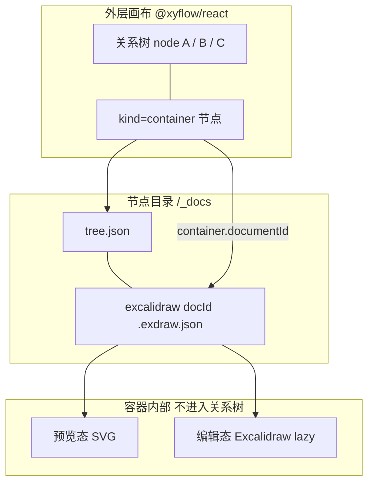

# TopoMind 容器节点 + Excalidraw 技术方案

- 版本：v1.0
- 日期：2026-11-20
- 状态：已定方案，待实现
- 交接对象：实现 agent
- 本文只描述技术方案，不含实现代码

---

## 0. 决策摘要

已定决策（本次沟通结论）：

1. 外层关系树、React Flow 画布、graph meta v2 分片结构 **全部不动**。
2. 节点从“知识卡片”升级为**可选容器**：新增 `kind: 'container'`，默认节点仍是 `knowledge`。
3. 容器内可挂载组件；**第一个容器类型是 Excalidraw 白板/流程图**。
4. **X6 flowchart 文档类型退场**：不再新建、不再编辑、不再注册为文档类型；`@antv/x6` 及 7 个插件依赖移除。
5. 容器载荷仍存在节点自身的 `<cardId>/_docs/` 目录下，**不新建 `_container/` 目录，不改 graph meta 格式**。
6. 旧 `.tflow.json` 文件**不删、不自动转换**：保留磁盘数据，UI 层过滤隐藏。

非目标（v1 明确不做）：

- 不做容器嵌套；不做容器内引用外层节点；不做跨容器连线。
- 不改 `graphHierarchy.ts` 的从属校验，不把容器内部元素变成外层边。
- 不索引容器正文到全局搜索。
- 不做多人协作（Excalidraw 的 collab 只在 hosted app，npm 包不含）。
- 不做 Excalidraw ↔ X6 旧格式转换器。

---

## 1. 现状事实基线

实现前请先核对以下路径，所有结论以此为准：

| 主题        | 位置                                                                                                                                                                                              | 现状                                                                         |
| --------- | ----------------------------------------------------------------------------------------------------------------------------------------------------------------------------------------------- | -------------------------------------------------------------------------- |
| 节点种类      | `src/types/graph.ts:24`                                                                                                                                                                         | `GraphNodeKind = 'knowledge' \| 'shape'`；`shape` 注释明确“永不物化目录、永不下钻”，不可复用为容器 |
| 节点字段白名单   | `src/types/graph.ts`、`src/domain/graph/model.ts`、`src/domain/graph/graphMapper.ts` 双向、`src/domain/graph/normalizeGraphMeta.ts`、`src/core/storage/file.ts` 双向、`src/domain/graph/graphBuilder.ts` | 新增字段必须全链路同步，否则“画面生效、重开丢失”                                                  |
| kind 白名单闸 | `src/domain/graph/normalizeGraphMeta.ts:75-77`、`src/core/storage/file.ts:72-74`                                                                                                                 | 两处 `normalizeNodeKind` 只放行 `knowledge`/`shape`                             |
| 外层画布      | `src/features/graph/GraphCanvas/GraphCanvas.tsx:36`                                                                                                                                             | `nodeTypes` 硬编码为 `{ knowledgeCard: KnowledgeCard }`                        |
| 滚轮捕获      | `GraphCanvas.tsx:302`                                                                                                                                                                           | `onWheelCapture={handleWheelCapture}`，捕获阶段会抢在内层之前处理                        |
| 快捷键作用域    | `src/hooks/useShortcut.ts:83-84`                                                                                                                                                                | 通过 DOM `data-shortcut-scope` 判定；画布为 `canvas`                               |
| 只读闸门      | `src/domain/graph/canvasReadOnly.ts:43`                                                                                                                                                         | 缩放 <100% 或有隐藏节点时只读                                                         |
| 选中唯一写入    | `src/stores/graphStore.tsx:285-298`                                                                                                                                                             | `applySelectionChanges` 是多选选中态唯一写入点                                        |
| 文档类型枚举    | `src/core/topoDocumentTypes.ts:1`                                                                                                                                                               | `['smart','mindmap','flowchart']`                                          |
| 文档落盘      | `electron/file-service.js:535-546,560-568`                                                                                                                                                      | `_docs/tree.json` + `.tdoc/.tmind/.tflow.json`                             |
| 旧流程图编辑器   | `src/features/documents/FlowchartDocumentEditor/`                                                                                                                                               | 3 个文件，依赖 X6 + 7 插件                                                         |
| X6 依赖     | `package.json:74-81`、`package-lock.json:11-18,83-163`                                                                                                                                           | 8 个包（核心 + 7 插件）                                                            |
| 文档扩展名常量   | `electron/services/document-id-service.js:24-28,805`                                                                                                                                            | 三类型 + 扫描正则                                                                 |
| 测试断言      | `scripts/verify-critical-regressions.mts:24,28,9694`                                                                                                                                            | 导入 flowchart 纯函数 + 扩展名清单断言                                                 |

---

## 2. 总体架构

外层保持单一关系树语义；容器是树上的一个普通节点，内部载荷与外层解耦。



两套引擎的边界必须清晰：

- `@xyflow/react`：外层关系树，唯一图语义来源，不变。
- `@excalidraw/excalidraw`：容器内编辑器，只在活跃容器激活时动态加载，不参与外层图计算。
- 移除 `@antv/x6`：它此前只服务于右栏 flowchart 文档，没有其他引用。

---

## 3. 数据模型

### 3.1 节点 meta 新增字段

```ts
export type GraphNodeKind = 'knowledge' | 'shape' | 'container'

export interface ContainerRef {
  type: 'excalidraw'
  documentId: string   // doc_<32hex>，指向该节点 _docs/tree.json 中的条目
}

// GraphChild / KnowledgeNodeData 同时新增：
container?: ContainerRef
```

约束：

- 旧数据没有 `kind`/`container` 时一律按 `knowledge` 处理，**零迁移**。
- `container.documentId` 必须是本文档节点 `_docs/tree.json` 中存在的文档 id；不存在时渲染“载荷缺失”占位，不崩溃、不自动创建、不改写 meta。
- `kind='container'` 的节点**必须物化目录**（与 `shape` 相反）。

必须同步修改的白名单位置：

1. `src/types/graph.ts`（`GraphNodeKind`、`GraphChild`、`KnowledgeNodeData`）
2. `src/domain/graph/model.ts`（`RoomGraphNode`、`KBNode`）
3. `src/domain/graph/graphMapper.ts`（双向 map）
4. `src/domain/graph/normalizeGraphMeta.ts`（字段归一化 + `normalizeNodeKind`）
5. `src/core/storage/file.ts`（`convertFSBToGraph` / `convertGraphToFSB` + `normalizeNodeKind`）
6. `src/domain/graph/graphBuilder.ts`
7. `scripts/verify-critical-regressions.mts` 的 kind 往返断言组（约 `:2533-2543`）

### 3.2 文档类型与扩展名

```ts
TOPO_DOCUMENT_TYPES = ['smart', 'mindmap', 'excalidraw']

DOCUMENT_EXTENSIONS.excalidraw = '.exdraw.json'
TOPO_DOCUMENT_SCHEMAS.excalidraw = 'topomind.excalidraw-document'
```

需要修改：

- `src/core/topoDocumentTypes.ts:1`
- `src/features/documents/services/documentTypeRegistry.ts:11-33`（删除 flowchart 定义，新增 excalidraw：`label='Excalidraw 白板'`，`icon` 用纯文本，`defaultTitle='未命名白板'`）
- `electron/file-service.js:537-546`（扩展名/schema 表）、`:837` 起的 flowchart 初始内容分支整段替换为 excalidraw 初始内容  
  |  |  |  |  
  | --- | --- | --- |
- `electron/services/document-id-service.js:24-28`（扩展名表）、`:805`（扫描正则改为 `\.(tdoc|tmind|exdraw)\.json$`）
- `scripts/verify-critical-regressions.mts:9694`（扩展名清单断言）

### 3.3 Excalidraw 文档载荷 schema

新建纯领域模块（建议路径）：

- `src/features/documents/ExcalidrawDocument/excalidrawDocumentTypes.ts`
- `src/features/documents/ExcalidrawDocument/excalidrawDocumentContent.ts`（normalize / serialize / version 守卫）

```ts
export interface ExcalidrawDocumentContent {
  schema: 'topomind.excalidraw-document'
  version: 1
  title: string
  scene: {
    elements: ExcalidrawElement[]
    appState: Pick<AppState,
      'viewBackgroundColor' | 'gridSize' | 'theme' | 'scrollX' | 'scrollY' | 'zoom'>
    files?: BinaryFiles
  }
  metadata?: {
    createdAt?: number
    updatedAt?: number
    editor?: 'excalidraw'
  }
}
```

规则：

- 存储用 `serializeAsJSON({ elements, appState })` 的结果反解，天然去掉 deleted 元素与大部分 AppState；**禁止落完整 AppState**。
- `normalizeExcalidrawDocumentContent(raw, fallbackTitle)` 必须是纯函数：
  - 缺省/空 → 空场景；
  - 已知字段做有界归一化（坐标、尺寸、zoom 上下限，参照旧 `flowchartDocumentTypes.ts:51-61` 的写法）；
  - **未知 version 抛错**，由适配层捕获后显示“数据版本不受支持”，且**绝不回写**。
- 语义扩展放在 element 的官方 `customData` 字段，不改 Excalidraw 类型：

```ts
customData?: { tm?: { kind?: 'start' | 'process' | 'decision' | 'end' } }
```

v1 只写 `kind`，不写 `ref`，避免跨边界引用。

- `files`（图片）v1 **禁止插入**：`UIOptions.tools.image = false`，normalize 时忽略 files。理由：二进制资源会引入附件链路、跨房间搬运和去重问题，超出本方案范围。

---

## 4. X6 flowchart 退场与旧数据策略

### 4.1 移除清单

删除文件：

- `src/features/documents/FlowchartDocumentEditor/FlowchartDocumentEditor.tsx`
- `src/features/documents/FlowchartDocumentEditor/flowchartDocumentTypes.ts`
- `src/features/documents/FlowchartDocumentEditor/flowchartCellSync.ts`
- 整个 `src/features/documents/FlowchartDocumentEditor/` 目录

修改引用：

- `src/features/documents/services/documentEditorRegistry.tsx:9,14,395-412,425-428`：删除 import、lazy 组件、`FlowchartDocumentAdapter`、`DOCUMENT_EDITOR_REGISTRY.flowchart`
- `src/features/documents/services/documentTypeRegistry.ts:26-32`：删除 flowchart 定义
- `src/core/topoDocumentTypes.ts:1`
- `electron/file-service.js:540,545,837` 起整段 flowchart 初始内容分支
- `electron/services/document-id-service.js:27,805`
- `scripts/verify-critical-regressions.mts:24,28` 的 import 与 flowchart 相关断言组、`:9694` 扩展名清单

依赖移除：

- `package.json:74-81` 删除 `@antv/x6` 与 `@antv/x6-plugin-*`（clipboard / history / keyboard / selection / snapline / stencil / transform）
- 重新生成 `package-lock.json`（`npm install` 或等价命令），确认 `package-lock.json:83-163` 中 X6 相关 entry 全部消失

### 4.2 旧 `.tflow.json` 处理

原则：**磁盘数据零损失，UI 零暴露**。

- 不删除任何 `.tflow.json` 文件，不改写已有 `_docs/tree.json` 条目。
- `electron/services/document-id-service.js:805` 的扫描正则去掉 `tflow` 后，旧文件不再参与双链索引；这不影响文件本身。
- 文档树读取层（`electron/services/unified-document-tree-service.js:254,566,598`）保持原样返回 `type: 'flowchart'`，但在 UI 层用 `TOPO_DOCUMENT_TYPES` 类型守卫隐藏该条目，避免写回 tree.json 时误删。
- 若通过旧缓存/旧链接尝试打开 flowchart 文档：`DocumentEditorHost.tsx` 的 adapter 查找失败分支显示“旧版流程图已下线，文件仍保留在节点目录中”，**不提供重建入口**。
- 明确不做自动转换、不提供导入器。若未来要做，另立方案。

### 4.3 验证要求

- 构造含 `.tflow.json` 的 tree.json 夹具，验证：文档树不显示该条目、文件仍存在、房间可正常加载、保存后文件未被删除。  
  |  |  |  |  
  | --- | --- | --- |
- 验证 `grep -R "@antv/x6\|flowchart\|tflow" src electron scripts package.json` 只剩本文允许的“旧数据兼容”注释（如果有）。

---

## 5. 容器类型注册表

### 5.1 领域层（纯函数，无 React / Excalidraw import）

建议路径：`src/domain/container/containerTypes.ts`

```ts
export interface ContainerTypeSpec<T = unknown> {
  id: 'excalidraw'
  documentType: TopoDocumentType
  schema: string
  version: number
  createEmpty(title: string): T
  normalize(raw: unknown, title: string): T
  serialize(value: T): string
  getSceneVersion?(value: T): number
}

export function registerContainerType(spec: ContainerTypeSpec): void
export function getContainerType(id: string): ContainerTypeSpec | undefined
```

### 5.2 渲染层

建议路径：`src/features/graph/GraphCanvas/containers/containerRenderers.tsx`

```ts
export interface ContainerRendererRegistration {
  type: 'excalidraw'
  Preview: React.ComponentType<{ content: ExcalidrawDocumentContent }>
  Editor: React.ComponentType<{
    content: ExcalidrawDocumentContent
    onChange: (next: ExcalidrawDocumentContent) => void
    active: boolean
  }>
}
```

- `Editor` 必须是 `lazy(() => import(...))`，Excalidraw 不得进入主 chunk。
- v1 注册表在宿主内静态装配，不走插件系统。原因：
  - `src/plugins/host/pluginTypes.ts:8` 的 `ContributionType` 没有节点渲染器贡献点；
  - `GraphCanvas.tsx:36` 的 `nodeTypes` 硬编码；
  - `scripts/verify-plugin-boundaries.mts:17-25` 禁止 builtin 引用 `@/stores/*`。
- 后续要开放插件扩展时，新增 `containerTypes` 贡献类型 + 受限 public context，不在本方案范围。

新增一种容器类型的成本（验证扩展性）：新增 spec + renderer + 文档类型枚举/扩展名 + 一行注册，外层树零改动。

---

## 6. 渲染与交互

### 6.1 节点渲染器

- `GraphCanvas.tsx:36` 的 `nodeTypes` 扩展为 `{ knowledgeCard, containerCard }`。
- `ContainerCard` 根据节点 `container.type` 查注册表；未知类型显示占位，不抛错。
- 容器节点尺寸沿用现有 `widthMode/heightMode/expanded*` 字段；**不新增尺寸字段**。

### 6.2 两态模型

| 状态 | 条件                                | 渲染                        | Excalidraw 实例 |
| -- | --------------------------------- | ------------------------- | ------------- |
| 预览 | 非活跃 / 缩放 <100% / 有隐藏节点 / 失焦 / 切房间 | `exportToSvg` 生成的缓存 SVG   | **不挂载**       |
| 编辑 | 100% 缩放 + 无隐藏节点 + 节点激活            | 动态 import 的 Excalidraw 组件 | 恰好 1 个        |

- 全局同时最多一个活跃容器，用 `activeContainerId` 记录在 `GraphCanvas` 局部 state 或小 store。
- 失焦、Esc、缩放下降、切房间时先 flush 保存，再卸载编辑器并切回预览。
- `viewModeEnabled={!active}` 作为双保险；活跃容器外部不可切换该值。

### 6.3 预览生成

- 纯函数 helper 使用官方导出：

```ts
exportToSvg({ elements, appState, exportPadding: 10, files: undefined })
```

- 返回 Promise，结果按 `${roomId}:${nodeId}` 缓存在内存 Map。
- v1 预览缓存不落盘；节点卸载后重新进入时从文档内容重新生成。
- 生成失败时显示简化占位框，不影响节点本身。

### 6.4 事件仲裁（关键新增复杂度）

1. **滚轮**：`GraphCanvas.tsx:302` 的 `onWheelCapture` 增加守卫：

   `event.target.closest('[data-tm-container-surface="active"]')` 存在时直接 return，不调用 `handleWheelCapture`。
2. **键盘**：Excalidraw 的 `handleKeyboardGlobally` 默认 `false`，保持默认；容器根元素加 `data-shortcut-scope="excalidraw"`。内层选中元素时，外层 Delete/Backspace 必须失效。
3. **选中**：点击容器内部仍走 `onPointerDownCapture={selectNode}` 选中外层节点；Excalidraw 内部选中态留在自己的 appState，**不镜像到图谱**，不调用 `applySelectionChanges`。
4. **只读**：直接复用 `computeCanvasReadOnly`（`canvasReadOnly.ts:43`）的判定结果作为进入编辑态的前置条件。


1. **保存**：`onChange` 在绘制过程中高频触发，必须 debounce（建议 300-500ms）并用 `getSceneVersion(elements)` 去重；失焦/切房间/关窗时 flush。

### 6.5 Excalidraw 集成要点

- 安装 `@excalidraw/excalidraw@^0.18.1`（MIT，peer 支持 React 19）。
- 显式引入样式：`import '@excalidraw/excalidraw/index.css'`。
- **字体自托管**（Electron 离线必须）：把 `node_modules/@excalidraw/excalidraw/dist/prod/fonts` 复制到 `public/`，并在编辑器加载前设置 `window.EXCALIDRAW_ASSET_PATH = '/'`。
- 容器父元素必须有非零宽高；建议 `absolute inset-0`。
- 固定 `theme="light"`、`langCode="zh-CN"`；`UIOptions.tools.image = false`。
- 0.18 起用 `excalidrawAPI` 回调 prop，不用 `ref`；类型从 `@excalidraw/excalidraw/types` 与 `@excalidraw/excalidraw/element/types` 导入。
- 视觉冲突已知：Excalidraw 自带配色与手绘线条，与项目“颜色只在 `tokens.css`、单色制”的约束不一致。本方案接受其编辑态保持原生视觉；预览 SVG 也应保留手绘风（这是选型目的）。

---

## 7. 存储与生命周期

### 7.1 创建容器节点

唯一创建路径（避免多入口状态漂移）：

1. 校验当前画布非只读；先 `flushDocumentSave()` / `flushGraphSave()`。
2. `storage.createTopoDocument(nodePath, { type: 'excalidraw', title })` → 得到 `doc_<32hex>`。
3. 用既有节点更新路径写回 `kind='container'` 与 `container={ type:'excalidraw', documentId }`。
4. `saveNow()`，然后 `graph.refreshCurrentRoom()`。

禁止：`loadRoom`、传源/目标路径、`全量 setNodes(map)`、回灌 `saveNow` 到文档链路。

### 7.2 生命周期矩阵

| 操作      | 行为                                                            | 依据                                   |
| ------- | ------------------------------------------------------------- | ------------------------------------ |
| 跨房间移动   | `_fs_moveTopoNodesToRoom` 搬目录，载荷自动跟随；meta 指针用 documentId，不含路径 | `electron/file-service.js:1438-1616` |
| 撤销/前进移动 | 目录被搬回，载荷跟随；`positionsByNode` 语义不变                             | 现有 nodeMoveHistoryStore              |
| 删除      | 目录进回收站，载荷跟随                                                   | `_fs_moveToTrash`                    |
| 导入/导出   | 归档包含 `_docs/`，载荷自动包含                                          | 现有 KB 导入导出                           |
| 刷新      | 一律 `graph.refreshCurrentRoom()`                               | 项目铁律                                 |
| 关闭/切页   | `flushAllTabs` 收口，预览缓存可丢弃                                     | `src/core/close-guard.ts:50`         |
| 复制节点    | 深拷贝 excalidraw 文档并生成新 documentId；v1 无跨元素引用，无需重映射              | —                                    |

载荷内禁止出现绝对路径；所有引用用稳定 id。

### 7.3 搜索与索引

- v1 全局搜索只索引容器标题与节点名，不读 `.exdraw.json`。
- `documentPresence` 的 TTL 目录级剪枝逻辑保持原样，不因新类型改变。

---

## 8. 验证门禁

每个阶段结束必须按顺序执行：

```text
typecheck
node --check  （改动的 .mjs / .js）
verify:critical
verify:plugins
vite build --outDir outputs/.tmp-build-N
拷 dist/ 到目标目录
verify:linked:gui
```

新增/扩展断言组：

| 断言                       | 文件                                                        | 要求                                                                                            |
| ------------------------ | --------------------------------------------------------- | --------------------------------------------------------------------------------------------- |
| kind + container 往返      | `scripts/verify-critical-regressions.mts`（原 `:2533-2543`） | `normalizeGraphMeta` 与 `convertFSBToGraph` 往返后 `kind==='container'`、`container.documentId` 不丢 |
| 未知 kind 降级               | 同上                                                        | 旧档无 `kind`/`container` 时按 `knowledge`，零迁移                                                     |
| 文档扩展名清单                  | `scripts/verify-critical-regressions.mts:9694`            | 从 `.tflow.json` 改为 `.exdraw.json`                                                             |
| Excalidraw normalize 纯函数 | 新增 `verify:containers` 或并入 `verify:critical`              | 空值、未知 version、越界坐标、非法元素；esbuild 打包后真跑                                                         |
| 跨房间移动载荷                  | `scripts/verify-multi-select-move.mjs:121-168`            | 容器节点移动后 `.exdraw.json` 存在，撤销后仍存在                                                              |
| 旧 tflow 兼容               | 新增断言                                                      | tree.json 含 flowchart 条目时房间可加载、文件不被删、UI 不显示                                                   |
| 插件边界                     | `scripts/verify-plugin-boundaries.mts` 等三处                | 新增渲染层不得引入 `@/stores/*` 许可以外的插件依赖                                                              |

改能力必须做**反向验证**：先让旧实现 exit 1，再原子恢复并校验 sha256。

GUI 验收清单：

- 新建流程图容器 → 节点显示手绘预览。
- 100% 缩放点击激活 → Excalidraw 可编辑；滚轮只缩放内层，外层不动。
- 内层 Delete 不删除外层节点；Esc 退出编辑并回预览。
- 缩放到 99% → 自动回预览且不可编辑。
- 跨房间移动 → 容器内容保留；撤销后仍保留。
- 新建文档菜单不再出现“流程图”；打开旧 flowchart 文档显示下线占位。
- 断网启动 → Excalidraw 字体从本地加载，无 CDN 请求。

---

## 9. 实现阶段拆解

| 阶段               | 内容                                             | 交付物        | 验收                              |
| ---------------- | ---------------------------------------------- | ---------- | ------------------------------- |
| P0 数据协议          | 节点 `kind/container` 全链路白名单 + 文档类型枚举/扩展名        | 类型与归一化改动   | 旧档零迁移，往返断言通过；反向验证通过             |
| P1 X6 退场         | 删除编辑器目录，清理注册表/引用/依赖，旧 tflow 降级                 | 干净的依赖树与 UI | 无 flowchart 入口；旧文件保留；grep 无残留引用 |
| P2 容器外壳          | `containerCard`、`ContainerTypeSpec`、注册表、SVG 预览 | 只读容器节点     | 普通节点零回归；预览正确渲染                  |
| P3 Excalidraw 接入 | 动态 import、字体自托管、编辑态、保存节流                       | 可编辑容器      | 首次激活明显加载但主 chunk 不增大；断网字体正常     |
| P4 事件与保存闭环       | 滚轮/键盘/选中仲裁、flush、refreshCurrentRoom            | 无冲突交互      | GUI 清单全过                        |
| P5 生命周期与门禁       | 移动/撤销/删除/导入导出断言、全套门禁                           | 可交接版本      | 全套 verify + GUI 通过              |

建议按阶段提交，不要跨阶段大提交。

---

## 10. 风险与回滚

| 风险     | 说明                                           | 缓解                                           |
| ------ | -------------------------------------------- | -------------------------------------------- |
| 包体积    | Excalidraw 安装体积约 46.8 MB、31 依赖；实际 bundle 需实测 | 动态 import；检查 `stats.html`/manualChunks；字体自托管 |
| 视觉冲突   | 手绘配色与单色制不一致                                  | 明确接受；预览与编辑态都保留手绘风                            |
| 事件冲突   | 外层 `onWheelCapture`、全局快捷键、选中写入点              | 非活跃容器完全不挂载；active-surface 守卫                 |
| 旧数据    | 用户已有 `.tflow.json`                           | 不删不转；UI 隐藏；后续另立转换方案                          |
| 语义能力退化 | Excalidraw 无端口/路由/自动布局                       | v1 定位为“手绘流程图/白板”，不承诺图算法能力                    |

回滚策略：按阶段提交粒度回滚；P1（删 X6）与 P3（接 Excalidraw）分开提交，避免一次性回滚丢失旧实现。

---

## 11. 实现前需产品确认的开放项

以下项本方案已给出默认选择，若产品有不同意见请在 P0 前确认：

1. 容器内是否允许插入图片（本方案默认禁止，避免附件链路复杂化）。
2. 预览 SVG 是否落盘为 sidecar（本方案默认不落盘，内存缓存）。
3. 手绘配色与单色制并存是否接受（本方案默认接受）。
4. 旧 `.tflow.json` 是否需要后续转换器（本方案默认不做）。

---

## 附：关键事实引用索引

- React Flow 12.x / X6 2.19 / React 19 / Excalidraw 0.18.1 兼容性：见 `package.json` 与 Excalidraw np**m peerDepend**encies 声明。
- Excalidraw 官方能力：**`initialData`**、`onChange`、`excalidrawAPI`、`viewModeEnabled`、`theme`、`UIOptions`、`serializeAsJSON`、`exportToSvg`、`getSceneVersion`、`customData`、`EXCALIDRAW_ASSET_PATH`。
- Excalidraw MIT；Excalidraw+ 为独立付费产品，不在本方案范围。
