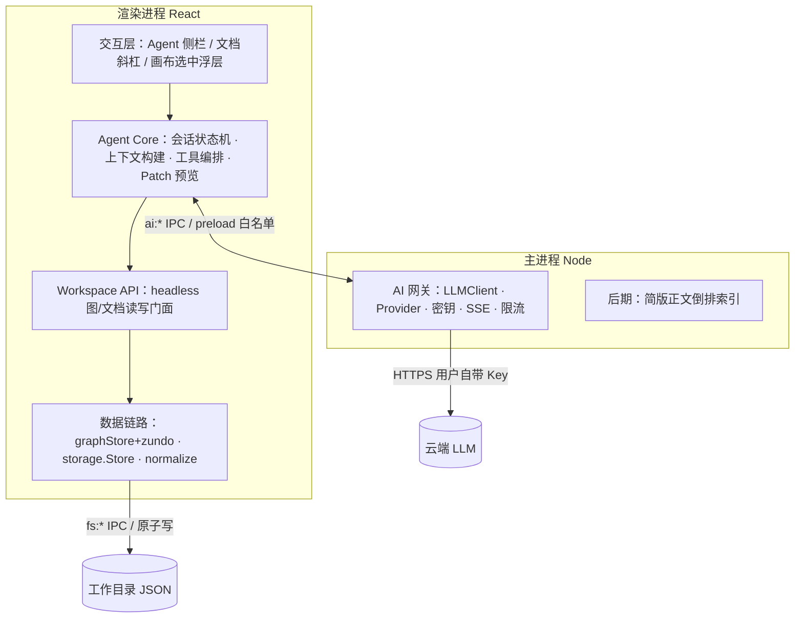

# TopoMind native-AI Agent 设计定稿（阶段 6 拆分方案）

- 版本：v1.0
- 日期：2026-11-25
- 定位：`docs/design/ai-knowledge-card-master-plan.md` **阶段 6 的超集与拆分**；本文只描述设计、类型契约与实施顺序，**不含任何实现代码**
- 状态：**方案已定稿，代码未实现**
- 适用范围：辅助写文档、编辑润色、编辑节点与画布、生成知识卡片、知识库问答，以及覆盖全软件的跨对象批量操作

---

## 1. 决策记录（用户已拍板）

| # | 决策点 | 结论 | 对设计的直接影响 |
| --- | --- | --- | --- |
| 1 | 模型与密钥 | **仅支持用户自带 Key 的云端 API**；托管账号 / Ollama 只留扩展能力 | 一期只实现 `OpenAICompatibleProvider`；`providerType` 联合类型预留 `'ollama' \| 'hosted'`，不注册实现、不在设置 UI 暴露 |
| 2 | 数据边界 | **一期允许发送文档正文**，后续再做精细化控制 | 所有外发内容必须经单一入口 `buildContextEnvelope()` 组装；后期加范围开关 / 脱敏 / 黑名单只改这一处 |
| 3 | 自主度 | **所有写操作先预览确认**；流程稳定后再评估开放自动执行 | `AgentPatch` 一律 dry-run，`commit` 只能由用户显式触发；权限矩阵保留 `auto` 档位但代码路径禁用 |
| 4 | 一期优先级 | 按推荐：**先 B（工具层地基）+ C（读写工具集）**，RAG 后置到 D | P0/A 作为前置基础设施与 B 同期；P3/D 才建索引 |
| 5 | RAG 深度 | **先简单做**，后期再逐个功能深入优化 | 一期只做「标题 + 正文关键词 + 图结构」纯 JS 索引；不引 embedding / 向量库 / native 模块 |

补充约定：用户要求「先简单做，后期再深入每个功能优化」——每个工具先交付最小可用版本，**工具注册表与 Patch 协议必须稳定**，保证后续能逐个替换实现而不动地基。

继承主需求文档的决策 7/8/9/11/12：CardSpec 受控输出、生成→校验→预览→确认→落盘、样式只引用 token、HTML 默认禁用、Provider 无关 `LLMClient`。本文不推翻任何一条。

---

## 2. 现状基线与硬约束（实现前必读）

### 2.1 可复用的现成资产

| 资产 | 位置 | 用途 |
| --- | --- | --- |
| AI 侧栏占位 | `src/features/graph/GraphPage/components/AgentPlaceholder.tsx`、`NodeTreePanel.tsx:388`、`stores/nodeTreePanelStore.ts:29`、`NavRail/navModel.tsx:129` | 替换占位组件即可，Dock 外壳零改动 |
| 结构化输出契约 | `features/documents/CardSpecDocument/cardSpecTypes.ts`（`normalizeCardSpecContent`，已含 `metadata.generatedBy?: 'ai' \| 'user'`） | AI 卡片产物唯一校验闸 |
| 文档数据契约 | `features/documents/SmartDocumentEditor/smartDocumentTypes.ts`（`SmartDocumentContent` / `normalizeSmartDocumentContent`） | AI 文档产物校验闸 |
| 图编辑门面 | `src/hooks/useGraph.ts`、`src/contexts/GraphContext.tsx`、`src/hooks/useGraph/graphOperations.ts` | headless 化后成为工具执行层 |
| 存储门面 | `src/core/storage/service.ts` 的 `Store`（`createTopoDocument` / `readTopoDocument` / `writeTopoDocument` / `saveGraphDebounced`） | 可脱离 React 树构造，文档与容器写入 |
| 批量可撤销写入 | `applyNodeStylePatch` / `clearNodeStyles`（`graphBuilder.ts:244,260`）、`captureGraphHistorySnapshot` / `commitGraphHistorySnapshot`（`graphStore.tsx:216-233`） | 一次任务合并为一步 zundo 历史 |
| 检索 / 双链 | `fs:searchUnifiedDocuments`、`fs:listDocumentBacklinks`、`fs:listDocumentRelations`、`.topomind/` 派生索引 | 简版 RAG 的增量索引起点与图扩展数据源 |
| 命令与埋点 | `application/commands/commandRegistry.ts`、`core/observe.ts`、`shared/observability/eventCatalog.ts` | 工具注册、trace、审计 |
| 主进程网络范式 | `electron/services/attachment-service.js:179-227`、`file-service.js:418-457`（SSRF 校验、AbortController、分块流读取） | LLM 传输层照抄改造 |
| 日志脱敏 | `electron/log-redact.js:23-28` | 已含 `apikey/token/authorization/credential` |

### 2.2 不可绕过的硬约束

1. **生产 CSP `connect-src 'self'`**（`vite.config.js:12`）+ `sandbox: true` / `contextIsolation: true`（`electron/main.js:895-903`）→ 模型请求、SSE 解析**只能在主进程**，渲染层不得 `fetch` 外部端点。
2. **preload 三张白名单**（`electron/preload.js:8-55`）→ 新增 `ai:*` 通道必须同时登记 invoke / send / receive；流式 token 走 `send`/`on`，不走高频 `invoke`。
3. **7 处节点字段白名单**（`types/graph.ts`、`domain/graph/model.ts`、`graphMapper`、`normalizeGraphMeta.ts`、`core/storage/file.ts`、`core/fs-backend.ts`、`graphBuilder`）→ 新增字段漏一处即「画面生效、重开丢失」。
4. **文档并发写**：智能文档 1500ms autosave 整篇覆盖 + `draftVersion` / `saveSeq` / `currentDocumentKey` 三重比对 → AI 不能吐整篇覆盖，必须块级 Patch + 版本校验。
5. **上下文不能读 `lod.visibleNodes`**：万级节点下 LOD 会隐藏节点；必须读 store 全量或按房间遍历 16 分片，且只取 activeTab。
6. **离线基线**：产品要求离线可用、日志不远程上报、数据不上传 → AI 是可选增强，无 Key / 断网 / 超时 / 限流一律降级提示，绝不阻断主流程。
7. **门禁反噬**：`scripts/verify-critical-regressions.mts` 第 72 组断言 `AgentPlaceholder` 中不得出现 `<input` 与 `fetch(`；实现真功能时必须同步改断言。另有 `verify:design`、`lint-baseline.json`、`design-system-baseline.json`、`gen:events`。
8. **AI 不能做成 builtin 插件**：`verify-plugin-boundaries.mts` 禁止插件 import `@/core`、`@/stores`、`@/features`、`@/application` 及 `window.electronAPI`，且 `PluginHostServices` 无文档 / 图数据 / 网络能力。Agent 必须是 **host feature**。

### 2.3 一期明确不做

多 Agent / Planner-Executor、MCP 客户端、自动执行档、embedding 与向量库、native sqlite、PDF / 网页 / Office 解析、HTML 产出、任意 hex 配色、删除类工具、跨房间移动工具、放宽 CSP、云端账号体系。

---

## 3. 总体架构与进程边界

四层：`交互层（复用） → Agent Core（新增，渲染进程） → AI 网关（新增，主进程） → 数据链路（复用，所有写入唯一出口）`。



**核心设计**：定义版本化 `AgentPatch` 中间协议。模型永远只产出结构化 Patch，不产出 HTML / 整篇文档 / 磁盘路径；Patch 经 `normalize` 校验 → dry-run 生成 `PatchPlan` → Diff 预览 → 用户勾选确认 → 走既有写入口落盘，整次任务合并为一步 zundo 历史。

---

## 4. 目录级设计（新增 / 修改清单）

### 4.1 新增文件

| 路径 | 职责 | 依赖约束 |
| --- | --- | --- |
| `electron/services/ai-service.js` | 主进程 LLM HTTP / SSE 调用、错误归一化、超时、重试、并发上限、取消 | 只依赖 Node `fetch` + `electron`；复制 SSRF 白名单校验 |
| `electron/services/ai-key-store.js` | `safeStorage` 加解密、密钥读写、脱敏 | 不把明文传给渲染层 |
| `electron/services/ai-index-service.js` | P3/D：正文抽取、倒排索引、按 stat 签名增量重建、损坏自愈 | 只读写 `.topomind/ai-index/`；不得改写业务文件 |
| `src/core/ai-backend.ts` | renderer 侧 `ai:*` IPC 封装（invoke / send / on / cancel） | 与 `core/fs-backend.ts` 同构；业务代码不直接碰 `window.electronAPI` |
| `src/features/ai-agent/AgentPanel.tsx` | 替换占位页的会话面板入口 | 保持 `NodeTreePanel.tsx:388` 引用不变 |
| `src/features/ai-agent/model/agentSessionStore.ts` | zustand：会话、消息、流式、工具调用记录、会话落盘 | 不进 localStorage |
| `src/features/ai-agent/model/contextBuilder.ts` | `buildContextEnvelope()`：L1 锚点 / L2 结构 / L3 检索 + token 预算 | **外发唯一入口**，后期精细化只改这里 |
| `src/features/ai-agent/model/agentRuntime.ts` | 单 Agent 工具循环状态机（读工具 → 结构化 Patch → 结束） | 无自动 commit 路径 |
| `src/features/ai-agent/llm/types.ts` | `LLMClient` 接口与 Provider 描述 | 不依赖任何厂商 SDK |
| `src/features/ai-agent/tools/toolRegistry.ts` | 工具注册、JSON Schema 导出、权限校验 | 复用 `commandRegistry` 的注册 / 埋点语义 |
| `src/features/ai-agent/tools/readTools.ts` / `writeTools.ts` | 只读工具 / 产出 Patch 的写工具 | 写工具**不得**调用任何写入口 |
| `src/features/ai-agent/patch/agentPatchTypes.ts` | `AgentPatch v1` 类型契约 | 纯类型，无 React / 无 IO，可被主进程与门禁脚本复用 |
| `src/features/ai-agent/patch/normalizeAgentPatch.ts` | 纯函数校验闸（对齐 `normalizeCardSpecContent` 风格） | 未知 version / op 抛错且不回写 |
| `src/features/ai-agent/patch/dryRunAgentPatch.ts` | 纯函数：Patch + 状态快照 → `PatchPlan`（含逐项 diff） | 不产生任何副作用 |
| `src/features/ai-agent/patch/commitAgentPatch.ts` | 按勾选执行，统一走既有写入口 + 合并历史 | 唯一的写执行点 |
| `src/features/ai-agent/components/PatchPreview.tsx` | Diff 预览、逐项勾选、影响范围、应用 / 放弃 | 只用 `TM_UI` / `tokens.css` |
| `src/features/ai-agent/components/MessageList.tsx` / `Composer.tsx` / `ToolCallCard.tsx` | 会话 UI 与工具调用可视化 | 不新增占文档流的横条 |
| `src/application/workspace/workspaceApi.ts` | headless `Workspace API`：把 `useGraph` / `graphOperations` 从 hook 下沉为可注入 `storeApi + storage` 的模块级服务 | 保留 `guardCanvasEdit` 与 `saveLater` 语义 |
| `src/features/ai-agent/config/aiConfig.ts` | 模型配置（providerType / baseURL / apiKeyRef / model / temperature / maxTokens / timeoutMs / contextBudget） | 明文 Key 不在此 |
| `src/features/settings/...` AI 分区 | 供应商 / Key / 模型 / 温度 / 上下文预算 / 测试连接 / 数据外发提示 | 遵守设计系统三层真源 |

### 4.2 修改文件（必须同步）

| 路径 | 改动 |
| --- | --- |
| `electron/main.js` `registerIPC()` | 新增 `ai:chat:start` / `ai:chat:cancel` / `ai:key:set` / `ai:key:test` / `ai:index:query`（P3） |
| `electron/preload.js` 三张白名单 | invoke：`ai:chat:start` 等；send：`ai:chat:cancel`；receive：`ai:chat:chunk` / `ai:chat:tool` / `ai:chat:done` / `ai:chat:error` |
| `src/features/graph/GraphPage/components/AgentPlaceholder.tsx` | 原地替换为真实面板（或改为 re-export），保留文件名以减小改动面 |
| `src/application/commands/commandRegistry.ts` | 新增 `agent.open` / `agent.toggle`；菜单项与 `useShortcut` 绑定 |
| `src/shared/observability/eventCatalog.ts` | 新增 `ai.chat` / `ai.tool` / `ai.patch.preview` / `ai.patch.commit` / `ai.patch.reject` / `ai.error`，然后 `npm run gen:events` |
| `scripts/verify-critical-regressions.mts` 第 72 组 | 解除「无 input / 无 fetch」断言，改为断言真实面板存在且**渲染层无外部 fetch** |
| `vite.config.js` | 若引入 `ai` SDK，加入 `manualChunks`，勿进 `editor` chunk；CSP 保持不变 |
| `scripts/lint-baseline.json` / `design-system-baseline.json` | 按 `verify:all` 结果收敛，不用 `--update` 写进违规 |
| `docs/design/ai-knowledge-card-master-plan.md` | **实现开始时**更新状态行与 §6 路线表：阶段 6 → 6a(P0+P1) / 6b(P2)，新增 D 期说明 |

### 4.3 依赖规则

- 允许：`@/core`、`@/stores`（经 Provider 拿 storeApi）、`@/application`、`@/shared/ui`、`@/shared/observability`、`@/domain`、`lucide-react`。
- 禁止：`@/plugins/host`、`@/plugins/bootstrap`、其它 builtin 插件、`lod.visibleNodes`、直接 `fetch` 外部端点、直接读写磁盘文件、字面色值 / `z-[数字]`。
- 一期新增运行时依赖尽量只加 `zod`；若采用 Vercel AI SDK 则 `ai` + 对应 provider adapter。**禁止 native 模块**（三平台 rebuild 成本）。

---

## 5. AgentPatch v1 协议（核心契约）

> 以下为类型契约草案，不是实现代码。要求：版本化、纯函数校验、可 dry-run、可预览、可撤销、可回放。

```ts
export const AGENT_PATCH_SCHEMA = 'topomind.agent-patch'
export const AGENT_PATCH_VERSION = 1

export type AgentPatchOp =
  | { op: 'document.insert_blocks'; documentId: string; afterBlockId?: string; blocks: SmartDocumentBlock[] }
  | { op: 'document.replace_blocks'; documentId: string; blockIds: string[]; blocks: SmartDocumentBlock[] }
  | { op: 'document.update_meta'; documentId: string; patch: TopoDocumentMetaPatch }
  | { op: 'node.create'; roomPath: string; title: string; position: { x: number; y: number }; parentId?: string }
  | { op: 'node.rename'; nodeId: string; title: string }
  | { op: 'node.style'; nodeIds: string[]; patch: Partial<KnowledgeNodeStyle> }
  | { op: 'node.tree_order'; roomPath: string; order: string[] }
  | { op: 'edge.create'; roomPath: string; source: string; target: string; relation: 'related' | 'subordinate'; weight?: 'main' | 'minor' }
  | { op: 'edge.delete'; edgeId: string }
  | { op: 'cardspec.create'; roomPath: string; title: string; spec: CardSpecContent; nodeId?: string }
  | { op: 'cardspec.update'; documentId: string; spec: CardSpecContent }
  | { op: 'canvas.layout'; roomPath: string; algorithm: 'grid' | 'tree'; nodeIds?: string[] }

export interface AgentPatch {
  schema: 'topomind.agent-patch'
  version: 1
  taskId: string
  reason?: string
  baseRevision: { documentRev?: Record<string, number>; roomRev?: number }
  ops: AgentPatchOp[]
}
```

**校验规则**（`normalizeAgentPatch`）：

- 未知 `version` / 未知 `op` / 非对象 → 抛错且不回写（继承 CardSpec 约定）。
- `ops.length <= 50`；单次文档块 <= 200；单段文本 <= 4000 字（对齐 CardSpec 既有阈值）。
- 所有 id 必须能在当前工作区解析；跨房间 / 跨知识库引用拒绝。
- 颜色只允许 token 引用或受限色板，**拒绝任意 hex / CSS / 远程 URL / 绝对路径**。
- 拒绝 `html` 类型 CardSpec 组件、可执行内容；`cardspec.*` 的 spec 必须再过 `normalizeCardSpecContent`。
- 一期**不提供** `node.delete` / `node.move_room` / `document.clear` 等破坏性 op（即使有预览也不开放）。
- 每个 op 必须能生成 `PatchPreviewItem`：`before` / `after` diff、影响对象数、风险级别。

**三段执行**：

1. `normalizeAgentPatch(raw)` → 合法 Patch 或错误码 `schema_invalid`。
2. `dryRunAgentPatch(patch, snapshot)` → `PatchPlan`，纯函数、零副作用，产出逐项 diff 与影响范围。
3. `commitAgentPatch(plan, selectedOpIds)` → 唯一写执行点。

**commit 落点**：

- 图操作：`guardCanvasEdit` → 同 `applyNodeStylePatch` 的一次遍历 / 一次 `setNodes` / 一次 `saveLater` → `normalizeGraphMeta` 白名单 → `SaveCoordinator` → 16 分片原子写。
- 文档：校验 `baseRevision.documentRev` 与当前 `draftVersion` / content hash；一致才用 BlockNote `editor.transact` 或 `storage.writeTopoDocument`；不一致直接拒绝并提示重跑。写入期间置 `aiApplying` 标记，避免 1500ms autosave 陈旧回写。
- 容器 / 卡片：复用 `useNodeActions.ts:104-148` 的 `createContainerChild` 语义（建节点 → `createTopoDocument` → `updateNode` 写 `container` 指针 → `flushCurrentRoomSave` → `refreshCurrentRoom`），失败保留普通节点、不留空指针。
- 全程用 `captureGraphHistorySnapshot` / `commitGraphHistorySnapshot` 合并为 **1 步 zundo 历史**（注意历史上限 20 步，超大批量需分批）。

---

## 6. 工具清单与权限矩阵

### 6.1 工具清单

| 工具 id | 类别 | 输入 | 输出 | 一期 |
| --- | --- | --- | --- | --- |
| `workspace.getContext` | 读 | — | activeTabId / roomPath / 选中节点 / 当前文档 / 视口 | ✅ |
| `document.read` | 读 | docId | 纯文本 + 块结构摘要 | ✅ |
| `document.search` | 读 | query | 标题 / 面包屑命中（复用 `searchUnifiedDocuments`） | ✅ |
| `graph.read` | 读 | roomPath | 全量节点 / 边（**不走 visibleNodes**） | ✅ |
| `graph.relations` | 读 | docId / nodeId | 双链、反向链接、从属路径 | ✅ |
| `kb.list` | 读 | — | 知识库 / 房间枚举 | ✅ |
| `document.draft` | 写 | 指令 + 上下文 | `document.insert_blocks` Patch | ✅ |
| `document.polish` | 写 | 选区块 id | `document.replace_blocks` Patch | ✅ |
| `document.outline` | 写 | docId | 大纲 / 摘要块 Patch | ✅ |
| `node.style` | 写 | nodeIds + 意图 | `node.style` Patch（仅 token） | ✅ |
| `node.create` / `node.rename` / `node.link` | 写 | 指令 | 对应 Patch | ✅ |
| `canvas.layout` | 写 | roomPath + nodeIds | `canvas.layout` Patch（需 `dagre` / `elkjs`） | ✅ |
| `cardspec.generate` | 写 | nodeId / docId | `cardspec.create` / `cardspec.update` Patch | ✅ |
| `kb.ask` | 读 | question | 带引用的回答（P3/D） | P3 |
| `node.delete` / `node.move_room` / `document.clear` | — | — | — | **永不开放** |

### 6.2 权限矩阵

| 档位 | 读工具 | 写工具 | 破坏性 | 一期状态 |
| --- | --- | --- | --- | --- |
| `read-only` | 允许 | 禁止 | 禁止 | 问答默认 |
| `suggest`（**默认**） | 允许 | 只允许产出 Patch + 预览确认 | 禁止 | **一期全部写能力** |
| `auto` | 允许 | 直接 commit | 禁止 | **预留档位，代码路径禁用**，流程验证稳定后再评估 |

补充：所有工具调用写入 `ai.tool` 事件；`ai.patch.preview` / `commit` / `reject` 单独留痕，便于后期审计与评测。工具注册表对外导出 JSON Schema，模型侧用 tool calling / `structured` 输出，不解析自由文本。

---

## 7. LLM 接入与密钥（决策 1）

```ts
export interface LLMClient {
  chat(req: ChatRequest, signal?: AbortSignal): AsyncIterable<ChatChunk>
  structured<T>(req: StructuredRequest<T>, signal?: AbortSignal): Promise<T>
  listModels(): Promise<string[]>
}
```

- 一期只注册 `OpenAICompatibleProvider`：`/chat/completions` + SSE + tool calling；国产模型通过各自 OpenAI 兼容 `baseURL` 接入，不引厂商专属 SDK。
- 配置项：`providerType`（联合类型预留 `'openai-compatible' | 'ollama' | 'hosted'`，后两者不实现）、`baseURL`、`apiKeyRef`、`model`、`temperature`、`maxTokens`、`timeoutMs`、`contextBudget`。
- 密钥：`safeStorage.encryptString` 后写 `<workDir>/.topomind/ai/keyring.json`（或 `_config.json` 加密字段）；渲染层只见 `apiKeyRef`；设置页提供「测试连接」；日志脱敏字典已覆盖 `apikey/token/authorization`。
- 网络：主进程 `fetch` + AbortController（默认 60s）+ 指数退避重试 2 次（仅网络错误 / 5xx）+ 并发上限 2 + 复用 `_fs_requirePublicHttpUrl` 的 SSRF 校验。
- 流式通道：`ai:chat:start`(invoke) → `ai:chat:chunk` / `ai:chat:tool` / `ai:chat:done` / `ai:chat:error`(推送)；`ai:chat:cancel`(send)。
- 错误归一化：`AIServiceError { code: 'no_key' | 'network' | 'timeout' | 'rate_limit' | 'bad_response' | 'schema_invalid' | 'cancelled' }`，任一错误都只降级提示，主流程不受影响。
- 离线语义：无 Key / 断网时 Agent 面板显示「需要联网与 API Key」，本地编辑、搜索、画布全部照常可用。

---

## 8. 上下文策略（决策 2）

`buildContextEnvelope()` 是**唯一外发组装点**，三层 + 显式 token 预算：

| 层 | 内容 | 来源 |
| --- | --- | --- |
| L1 锚点（必带、用户可见） | activeTabId / roomPath、选中节点 id、当前文档 docId + 选区、视口可见节点 id | `graphStore` / `draftStore` / `tabStore` |
| L2 结构（按需） | 从属路径面包屑、父/子/兄弟标题、`linkedDocuments`、反向双链、`tree.json` manifest | `graphHierarchy` / `fs:listDocumentBacklinks` / `fs:listDocumentRelations` |
| L3 检索（P3/D） | 正文片段 top-k，每条带 `docId / cardPath / charRange` | `.topomind/ai-index/` |

- 优先级：L1 > L2 > L3；默认输入预算 8k tokens，超预算按 L3 → L2 顺序裁剪。
- 只取 activeTab；按房间遍历 16 分片；**不读 `lod.visibleNodes`**。
- 回答中的 `[ref:i]` 必须映射到 `docId`，点击走既有文档打开链路；无检索命中时明确说明「未检索到」，不允许编造。
- 后期精细化（范围开关、敏感文档黑名单、字段脱敏、按知识库授权、外发日志）全部挂在 `buildContextEnvelope()`，不改工具与协议。
- 设置页必须明示「当前会把文档正文发送给所配置的模型服务」，对应决策 2 的知情前提。

---

## 9. RAG 一期简版（决策 5 / P3）

**做**：

- 正文抽取只处理 `.tdoc.json`（BlockNote blocks → 纯文本）与 `.tmind.json`（节点标签）；`.exdraw.json` / `.cardspec.json` 沿用主需求文档 §2.3「不索引正文」约定。
- chunk：按块 / 段落切分，约 400 字、重叠 80 字，携带 `docId / cardPath / breadcrumb / charRange`。
- 索引：`.topomind/ai-index/documents.json` 倒排（term → postings）；按源文件 mtime + size 签名增量重建、损坏自愈、**首次问答才建**。
- 检索：`Intl.Segmenter` 中文切分 + 简化 BM25 + 标题加权 + 图结构扩展（一跳邻居 / 双链标题加权）。
- 问答：片段注入 L3，回答强制带引用；范围可选当前房间 / 当前知识库 / 全库。

**不做**：embedding、向量库、rerank、查询改写、多跳推理、PDF / 网页 / Office 解析、native 模块、远程索引服务。后续逐项优化时保持 `kb.ask` 工具签名不变。

---

## 10. UI 与交互

- 主入口：原地替换 `AgentPlaceholder.tsx`（`NodeTreePanel.tsx` / `navModel.tsx` / `nodeTreePanelStore.ts` 零改动）。
- 会话面板：消息流、流式 token、工具调用卡片（可折叠，显示「读了什么」「准备改什么」）、输入框、停止、新建会话；会话存 `<workDir>/.topomind/ai/sessions/*.json`。
- 行内：BlockNote 斜杠菜单加「AI 续写 / 润色 / 生成大纲」；选中文本浮层 portal 到 `document.body`，避开 React Flow transform。
- 画布：选中节点右键菜单加「让 AI 处理选中节点」；`agent.toggle` 快捷键。
- Patch 预览面板：逐项勾选、before/after diff、影响范围（N 个节点 / M 个文档）、「应用所选」「全部放弃」；应用后 toast 提供「撤销」。
- 设计系统：只用 `TM_UI` / `tokens.css` / `EmptyState`；禁止字面色值、`z-[数字]`、新增占文档流横条；`NavRail` 保持单例。
- 设置页 AI 分区：供应商 baseURL / Key / 模型 / 温度 / 上下文预算 / 测试连接 / 数据外发说明。

---

## 11. 分期与验收（按决策 4 调整）

| 期 | 内容 | 核心验收 |
| --- | --- | --- |
| **P0 / A** | AI 网关 + 密钥 + 会话 UI（只读问答，不接工具） | 无 Key / 断网 / 超时 / 限流不阻断主流程；流式正常；Key 不进日志；`npm run verify` 全绿 |
| **P1 / B** | `Workspace API` headless 化 + `AgentPatch` + dry-run / 预览 / commit / 撤销 | 取消后节点零改动；一次任务 = 一步 undo；节点字段 7 处白名单往返不丢；纯函数用 esbuild 打包真跑 |
| **P2 / C** | 读工具 + 文档 / 润色 / 节点 / 样式 / 卡片写工具 | 五类能力各一条 GUI 冒烟；AI 输出必过 normalize；无任意 hex / HTML；文档并发编辑不互相覆盖 |
| **P3 / D** | 简版 RAG + 知识库问答 + 引用跳转 | 索引增量重建 / 损坏自愈；引用可定位；未命中不编造；断网时本地功能不受影响 |
| **P4 / E** | 画布自动布局深化、每个功能逐个优化、`auto` 档评估、Ollama / 托管 Provider、MCP | 单独评估，需重新走决策流程 |

每期门禁：`typecheck` → `verify:all` → `vite build` → GUI 冒烟；**接 AI 前先补「知识卡片容器」专属 GUI 冒烟**（主需求文档 §10 遗留）。阶段 6 对应关系：6a = P0 + P1，6b = P2，D 为新增能力，阶段 7 部分内容顺延至 P4。

---

## 12. 风险与开放项

| 风险 / 开放项 | 处理 |
| --- | --- |
| 文档并发覆盖（最大风险） | `baseRevision` 校验 + `aiApplying` 标记 + 块级 Patch；拒绝时提示重跑，绝不静默覆盖 |
| 图批量写入与 zundo 20 步上限 | 单次任务合并一步；超大批量分批且每批仍保持一次 undo |
| 门禁与设计系统 | 第 72 组断言、preload 三张白名单、`eventCatalog` + `gen:events`、design / lint 基线同步 |
| 字段白名单 / LOD / 16 分片 | 新增字段全链路登记；上下文读全量 store，按房间遍历 |
| 数据外发（决策 2） | 设置页明示；`buildContextEnvelope()` 单点收敛，后期加精细化开关 |
| 依赖体积 | 一期尽量只加 `zod`；不引 native 模块；AI SDK 若引入需进独立 chunk |
| 待定默认值 | 默认模型与 baseURL、上下文预算（暂定 8k）、Patch ops 上限（50）、会话保留策略、AI 产物是否计入学习统计 |

---

## 13. 与主需求文档的关系

- 本文是 `ai-knowledge-card-master-plan.md` **阶段 6 的拆分与超集**：6a = P0/A + P1/B（工具层地基），6b = P2/C（能力落地），原阶段 7 的样式 / 摘要生成并入 P2，原阶段 8 的拖拽设计器与 HTML 逃生舱顺延 P4。
- 主需求文档决策 7/8/9/11/12 全部继承；「所有 AI 写入走既有 store 写入口，保证可撤销」「AI 不产出可执行 HTML」为不可协商硬约束。
- **实现开始时**需同步更新主需求文档的状态行与 §6 路线表，避免两份文档状态冲突。
- 本文定稿后，下一步可交付：`AgentPatch` 的 zod schema 细化、工具 JSON Schema 清单、IPC 通道签名表与 P0 改动清单；进入编码前仍需用户显式确认。
