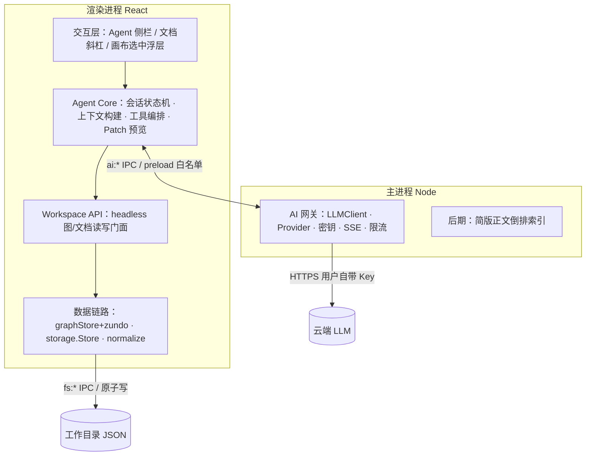

# TopoMind native-AI Agent 设计定稿（阶段 6 拆分方案）

- 版本：v1.7
- 日期：2026-11-25（v1.1 增补同日晚；v1.2 深夜补 P1 实现记录；2026-11-26 补真机 GUI 冒烟记录 §18、P2 实现记录 §19、遗留补齐与 S3 实现记录 §20、P3 / D 简版 RAG 实现记录 §21、P4 / E 决策评估 §22，以及阶段 6 闭环收尾 §23）
- 定位：`docs/design/ai-knowledge-card-master-plan.md` **阶段 6 的超集与拆分**；本文只描述设计、类型契约与实施顺序，**不含任何实现代码**
- 状态：方案已定稿；**P0（§14）、S1 全部 + S2 核心（§16）、P1 / B（§17）、P2 / C 核心（§19）、S3 自动调度（§20）、P3 / D 简版 RAG 与 `kb.ask`（§21）已落地**；**§19.4 六类遗留已补齐五类**（仅「真实 Key 行为对比」需用户自带 Key，改由本地 mock 请求体行为对比覆盖）；**阶段 6 已闭环收口（§23）**：7 个真机 GUI 冒烟 **527/527**、`npm run verify` 七步全绿、typecheck / lint / build 产物同步，本轮**零产品代码改动**；**P4 / E 深化优化已由用户裁决移出本轮，另立方案再执行**（不加本地 Ollama / 不做拖拽设计器与 HTML 沙箱 / 不做自动布局深化，见 §22.7）；唯一遗留为「真实 Key 下跨模型行为对比」（需用户自带 Key）；阶段 7-8 仍待实现；v1.1 新增 **S 轨道（智能体模板 / 提示词 / 模型参数 / 多 Agent 配置）**，设计见 §15，落地计划按 §11 重排
- 适用范围：辅助写文档、编辑润色、编辑节点与画布、生成知识卡片、知识库问答、覆盖全软件的跨对象批量操作，以及**模型能力可见性、系统提示词与智能体模板配置、多 Agent 调度**
- v1.1 变更摘要：新增 §15（配置体系设计）与 §16（S1 / S2 实现记录）；修订 §1 / §2.1 / §2.2 / §2.3 / §4 / §7 / §10 / §11 / §12 / §13 / §14.7 的口径与排期
- v1.2 变更摘要：新增 §17（P1 / B 实现记录）；§11.3 分期表标 P1 ✅；§11.5 门禁由六步改为七步；§4.2 补 `ai.patch_*` 事件；§16.5 下一步改指 P2
- v1.2 补记（2026-11-26）：新增 §18（真机 GUI 冒烟记录）；§11.3 图例、§11.5 冒烟口径、§17.4 第 8 条与 §17.5 同步为「S1 / S2 界面冒烟已验，真实 Key 行为对比与 `PatchPreview` 窄栏排布仍待 P2」
- v1.3 变更摘要（2026-11-26）：新增 §19（P2 / C 实现记录）；§11.3 分期表标 P2 ◐ 并同步图例；§4.1 / §15.2 / §15.3 更正工具「已接入」状态的派生口径；§16.4 第 8 条、§16.5、§17.4 第 8 条、§17.5、§18 表格与 §18.4 同步为 P2 事实；主需求文档状态行与 §6 更新为「6a / 6b 均已落地」
- v1.4 变更摘要（2026-11-26）：新增 §20（遗留补齐 + S3 自动调度实现记录）；§11.3 分期表标 P2 ✅ / S3 ✅ 并刷新图例；§11.5 门禁数据、遗留说明与 CDP 端口口径同步；§19.4 遗留清单补 v1.4 状态、§19.5 下一步改指 P3；主需求文档状态行与 §6 更新为「6a / 6b / S3 均已落地」
- v1.5 变更摘要（2026-11-26）：新增 §21（P3 / D 简版 RAG 实现记录）；§11.3 分期表标 P3 ✅ 并刷新图例；§6.1 工具表 `kb.ask` / `agent.delegate` 状态列改为 ✅；§4.1 索引服务与 §4.3 IPC 表去掉 P3 待办口径；§19.4 / §19.5 / §20.8 的「`kb.ask` 待接入」与「下一步 = P3」同步为 P3 已落地、下一步 P4；§11.5 刷新全量复验数据；主需求文档状态行与 §6 更新为「6a / 6b / S3 / P3 均已落地」
- v1.6 变更摘要（2026-11-26）：新增 §22（P4 / E 决策前评估：事实基线 / 候选拆分 / 口径冲突 / 推荐范围 / 待拍板决策点）；本轮不含任何实现代码，P4 仍为「待实现」，主需求文档状态行与 §6 暂不改，等用户拍板后同步
- v1.7 变更摘要（2026-11-26）：新增 §22.7（用户拍板结果：P4 / E 移出本轮、三条明确否决、只做闭环不做新能力）与 §23（阶段 6 闭环收尾：全量复验 527/527、范围界定、移出项清单、唯一遗留）；刷新头部状态行、§11.3 P4 行、§19.5 / §20.8 / §21.7 的「下一步」口径；主需求文档同步升 v1.6。**本轮零产品代码改动**

---

## 1. 决策记录（用户已拍板）

| # | 决策点 | 结论 | 对设计的直接影响 |
| --- | --- | --- | --- |
| 1 | 模型与密钥 | **仅支持用户自带 Key 的云端 API**；托管账号 / Ollama 只留扩展能力 | 一期只实现 `OpenAICompatibleProvider`；`providerType` 联合类型预留 `'ollama' \| 'hosted'`，不注册实现、不在设置 UI 暴露 |
| 2 | 数据边界 | **一期允许发送文档正文**，后续再做精细化控制 | 所有外发内容必须经单一入口 `buildContextEnvelope()` 组装；后期加范围开关 / 脱敏 / 黑名单只改这一处 |
| 3 | 自主度 | **所有写操作先预览确认**；流程稳定后再评估开放自动执行 | `AgentPatch` 一律 dry-run，`commit` 只能由用户显式触发；权限矩阵保留 `auto` 档位但代码路径禁用 |
| 4 | 一期优先级 | 按推荐：**先 B（工具层地基）+ C（读写工具集）**，RAG 后置到 D | P0/A 作为前置基础设施与 B 同期；P3/D 才建索引 |
| 5 | RAG 深度 | **先简单做**，后期再逐个功能深入优化 | 一期只做「标题 + 正文关键词 + 图结构」纯 JS 索引；不引 embedding / 向量库 / native 模块 |

补充约定：用户要求「先简单做，后期再深入每个功能优化」——每个工具先交付最小可用版本，**工具注册表与 Patch 协议必须稳定**，保证后续能逐个替换实现而不动地基。

### 1.1 v1.1 增补决策（2026-11-25 第二 / 三轮讨论）

需求演进：最初提出的「工具控制台（可添加 / 测试 / 删除工具）」经可行性调研后收敛——工具的运行时动态增删需要放宽 CSP 并重写半个插件系统，代价过高，故**放弃工具增删改**，改为「只读能力清单 + 可配置的系统提示词与智能体模板」；终局目标扩展为**对话 Agent 作为总调度指挥官，调度用户自定义的多个 subAgent**，每个 Agent 独立配置系统提示词、模板变量与模型参数。完整设计见 §15。

| # | 决策点 | 结论 | 来源 | 对设计的直接影响 |
| --- | --- | --- | --- | --- |
| 6 | 工具控制台范围 | **只做只读工具列表**，不做工具的添加 / 删除 / 编辑 / 启停 / 测试台 | 用户（第二轮） | 工具目录是编译期静态数据、运行时不可变；不提供 `toolRegistry` 动态注册 API，不建工具配置存储 |
| 7 | 导入导出 | **先不支持任何导入导出**（Yaml / JSON 文件、剪贴板批量粘贴、文件下载）；不引 `yaml` 依赖 | 用户（本次 ③） | 模板只来自随包内置集合；用户 Agent 只来自「模板深拷贝」或「空白新建」；编辑走表单，不提供原始文本编辑框；只读展示与「最终 prompt 预览」不属于导入导出，保留 |
| 8 | 深度思考配置 | **可手动开启、也可设为自动，在对话界面配置** | 用户（本次 ④） | 三态 `off / on / auto` 属会话级偏好，落在 `agentPreferencesStore`（localStorage 口径），入口在 `AgentPanel` 而非设置页；Agent 定义保留 Agent 级默认值，会话可覆盖 |
| 9 | Agent 级连接配置 | **先不支持为单个 Agent 单独设置 baseURL / API Key**，一律沿用全局密钥与地址 | 用户（本次 ⑤） | `AgentDefinition` 不含 `baseURL` / `apiKeyRef`；`config.json` 仍是唯一连接配置源 |
| 10 | 开发节奏 | **先做 S1（配置与可见性）+ S2（接入网关）；S3（自动调度）排入正式计划但不提前** | 助手按当前进度规划（本次 ①） | S1 / S2 前置于 P1 且不占用决策 4 的 B / C 主线；S3 锚定在 P2 之后；执行顺序见 §11.2 |
| 11 | 调度方式 | **一期手动选择 Agent；自动调度必须由 LLM `tool_call` 触发 `agent.delegate`，不解析自由文本** | 助手按最终目标规划（本次 ②） | 需修订 §2.3「一期不做多 Agent」措辞；S3 依赖 P2 打通 `tools` / `tool_calls` 全链路；不得用关键词匹配伪造调度（违反 §6.2） |

说明：6–9 为用户已拍板项，实现时不得擅自扩展；10–11 为助手依据「P0 已完成、P1 未开工、最终要有多 Agent 调度」作出的节奏规划，用户保留否决权。v1.1 不推翻决策 1–5 中任何一条，只调整先后顺序与配置分层。

继承主需求文档的决策 7/8/9/11/12：CardSpec 受控输出、生成→校验→预览→确认→落盘、样式只引用 token、HTML 默认禁用、Provider 无关 `LLMClient`。本文不推翻任何一条。

---

## 2. 现状基线与硬约束（实现前必读）

### 2.1 可复用的现成资产

| 资产 | 位置 | 用途 |
| --- | --- | --- |
| AI 侧栏入口 | `src/features/graph/GraphPage/components/AgentPlaceholder.tsx`（P0 已改为 re-export）、`NodeTreePanel.tsx:388`、`stores/nodeTreePanelStore.ts:29`、`NavRail/navModel.tsx:129` | 入口引用不变；Dock 外壳本身零改动，**但侧栏宽度已改为几何派生，见下方基线修订** |
| 结构化输出契约 | `features/documents/CardSpecDocument/cardSpecTypes.ts`（`normalizeCardSpecContent`，已含 `metadata.generatedBy?: 'ai' \| 'user'`） | AI 卡片产物唯一校验闸 |
| 文档数据契约 | `features/documents/SmartDocumentEditor/smartDocumentTypes.ts`（`SmartDocumentContent` / `normalizeSmartDocumentContent`） | AI 文档产物校验闸 |
| 图编辑门面 | `src/hooks/useGraph.ts`、`src/contexts/GraphContext.tsx`、`src/hooks/useGraph/graphOperations.ts` | headless 化后成为工具执行层 |
| 存储门面 | `src/core/storage/service.ts` 的 `Store`（`createTopoDocument` / `readTopoDocument` / `writeTopoDocument` / `saveGraphDebounced`） | 可脱离 React 树构造，文档与容器写入 |
| 批量可撤销写入 | `applyNodeStylePatch` / `clearNodeStyles`（`graphBuilder.ts:244,260`）、`captureGraphHistorySnapshot` / `commitGraphHistorySnapshot`（`graphStore.tsx:216-233`） | 一次任务合并为一步 zundo 历史 |
| 检索 / 双链 | `fs:searchUnifiedDocuments`、`fs:listDocumentBacklinks`、`fs:listDocumentRelations`、`.topomind/` 派生索引 | 简版 RAG 的增量索引起点与图扩展数据源 |
| 命令与埋点 | `application/commands/commandRegistry.ts`、`core/observe.ts`、`src/shared/observability/logContract.ts`（`LOG_ACTIONS` / `LOG_ACTION_META` / `FACT_KIND_GROUPS` 三处真源，`:291` / `:399` / `:119`） | 工具注册、trace、审计；**新增事件改 `logContract.ts` 而非 `eventCatalog.ts`**，再跑 `gen:events` + `gen:coverage` |
| 主进程网络范式 | `electron/services/attachment-service.js:179-227`、`file-service.js:418-457`（SSRF 校验、AbortController、分块流读取） | LLM 传输层照抄改造 |
| 日志脱敏 | `electron/log-redact.js:23-28` | 已含 `apikey/token/authorization/credential` |

> **基线修订（2026-11-25 21:17，v1.1 补记）**：v1.0 与 §10 / §14 多处按「Dock 外壳零改动、AI 侧栏固定 280/360」描述。工作区在该时点落了一批未提交的布局改造：新增 `src/domain/layout/workspaceGeometry.ts`，三边栏水平互斥几何、左栏四页共用可拖宽度（`geometry.leftWidth`，默认 280、范围 240–560），涉及 `NodeTreePanel.tsx` / `RightPanelContainer` / `nodeTreePanelStore` / `base.css`。**Dock 外壳与入口引用仍是零改动，但「侧栏宽度固定」已失效**。S1 在对话界面新增 Agent 选择器 / 深度思考三态 / 最终 prompt 入口时，须按窄栏 240 做紧凑排版与换行降级，不得假设固定像素宽度；这批改动尚未回填其它设计文档，实现前以代码为准。

### 2.2 不可绕过的硬约束

1. **生产 CSP `connect-src 'self'`**（`vite.config.js:12`）+ `sandbox: true` / `contextIsolation: true`（`electron/main.js:895-903`）→ 模型请求、SSE 解析**只能在主进程**，渲染层不得 `fetch` 外部端点。
2. **preload 三张白名单**（`electron/preload.js:8-55`）→ 新增 `ai:*` 通道必须同时登记 invoke / send / receive；流式 token 走 `send`/`on`，不走高频 `invoke`。
3. **7 处节点字段白名单**（`types/graph.ts`、`domain/graph/model.ts`、`graphMapper`、`normalizeGraphMeta.ts`、`core/storage/file.ts`、`core/fs-backend.ts`、`graphBuilder`）→ 新增字段漏一处即「画面生效、重开丢失」。
4. **文档并发写**：智能文档 1500ms autosave 整篇覆盖 + `draftVersion` / `saveSeq` / `currentDocumentKey` 三重比对 → AI 不能吐整篇覆盖，必须块级 Patch + 版本校验。
5. **上下文不能读 `lod.visibleNodes`**：万级节点下 LOD 会隐藏节点；必须读 store 全量或按房间遍历 16 分片，且只取 activeTab。
6. **离线基线**：产品要求离线可用、日志不远程上报、数据不上传 → AI 是可选增强，无 Key / 断网 / 超时 / 限流一律降级提示，绝不阻断主流程。
7. **门禁反噬**：`scripts/verify-critical-regressions.mts` 第 72 组断言 `AgentPlaceholder` 中不得出现 `<input` 与 `fetch(`；实现真功能时必须同步改断言。另有 `verify:design`、`lint-baseline.json`、`design-system-baseline.json`、`gen:events`。
8. **AI 不能做成 builtin 插件**：`verify-plugin-boundaries.mts` 禁止插件 import `@/core`、`@/stores`、`@/features`、`@/application` 及 `window.electronAPI`，且 `PluginHostServices` 无文档 / 图数据 / 网络能力。Agent 必须是 **host feature**。
9. **左栏几何可变**：`workspaceGeometry.ts` 的 `geometry.leftWidth` 在 240–560 间可拖且左栏四页共用（见 §2.1 基线修订）→ 对话界面新增控件不得假设固定宽度，须在 240 下可换行 / 折叠；与 §10「不新增占文档流横条」叠加。
10. **日志真源与域数量固定**：`logContract.ts:222` 的 `LOG_MODULES` 恰好 10 域；`verify-logging.mts` 的 C9 要求事件先登记、C10 / C15 要求事实唯一性（过程步骤走内存 `recordStep`，不逐条落盘）。新增 `ai.agent.*` 事件必须挂现有 `app` 域，**不得新增第 11 个 module**；prompt 正文、密钥、工具调用明细不落盘。

### 2.3 一期明确不做（v1.1 修订）

**仍不做**：MCP 客户端、自动执行档、embedding 与向量库、native sqlite、PDF / 网页 / Office 解析、HTML 产出、任意 hex 配色、删除类工具、跨房间移动工具、放宽 CSP、云端账号体系、**工具的运行时动态增删**、**Agent 模板与配置的导入导出**、**单个 Agent 独立的 baseURL / API Key**。

**口径调整（原「多 Agent / Planner-Executor 一期不做」）**：用户已明确终局需要「对话 Agent 作为调度指挥官调度自定义 subAgent」。v1.1 把它拆成三段，避免与最终目标直接冲突：

| 段 | 内容 | 排期 |
| --- | --- | --- |
| 配置层 | `AgentDefinition v1`、内置模板、系统提示词与模板变量、模型参数分层、工具只读目录 | **S1，一期就做** |
| 手动切换 | 用户在对话界面选择本次会话使用哪个 Agent（含 `kind: 'orchestrator' \| 'sub'`） | **S2，一期就做** |
| 自动调度 | LLM `tool_call` → `agent.delegate(subAgentId, task)` → 独立子调用 → 结果回灌 | **S3，P2 之后**，依赖 tool calling 全链路 |

因此「一期不做 Planner-Executor / 独立 Executor / 自动委托」依然成立，但**不再笼统写「不做多 Agent」**；MCP 仍留在 P4。

---

## 3. 总体架构与进程边界

四层：`交互层（复用） → Agent Core（新增，渲染进程） → AI 网关（新增，主进程） → 数据链路（复用，所有写入唯一出口）`。



**核心设计**：定义版本化 `AgentPatch` 中间协议。模型永远只产出结构化 Patch，不产出 HTML / 整篇文档 / 磁盘路径；Patch 经 `normalize` 校验 → dry-run 生成 `PatchPlan` → Diff 预览 → 用户勾选确认 → 走既有写入口落盘，整次任务合并为一步 zundo 历史。

---

## 4. 目录级设计（新增 / 修改清单）

### 4.1 新增文件

| 路径 | 职责 | 依赖约束 |
| --- | --- | --- |
| `electron/services/ai-service.js` | 主进程 LLM HTTP / SSE 调用、错误归一化、超时、重试、并发上限、取消 | 只依赖 Node `fetch` + `electron`；复制 SSRF 白名单校验 |
| `electron/services/ai-key-store.js` | `safeStorage` 加解密、密钥读写、脱敏 | 不把明文传给渲染层 |
| `electron/services/ai-index-service.js` | P3/D **已落地（§21）**：正文抽取、倒排索引、按 stat 签名增量重建、损坏自愈、首次问答才建 | 只读写 `.topomind/ai-index/`；不得改写业务文件 |
| `src/core/ai-backend.ts` | renderer 侧 `ai:*` IPC 封装（invoke / send / on / cancel） | 与 `core/fs-backend.ts` 同构；业务代码不直接碰 `window.electronAPI` |
| `src/features/ai-agent/AgentPanel.tsx` | 替换占位页的会话面板入口 | 保持 `NodeTreePanel.tsx:388` 引用不变 |
| `src/features/ai-agent/model/agentSessionStore.ts` | zustand：会话、消息、流式、工具调用记录、会话落盘 | 不进 localStorage |
| `src/features/ai-agent/model/contextBuilder.ts` | `buildContextEnvelope()`：L1 锚点 / L2 结构 / L3 检索 + token 预算 | **外发唯一入口**，后期精细化只改这里 |
| `src/features/ai-agent/model/agentRuntime.ts` | 单 Agent 工具循环状态机（读工具 → 结构化 Patch → 结束） | 无自动 commit 路径 |
| `src/features/ai-agent/llm/types.ts` | `LLMClient` 接口与 Provider 描述 | 不依赖任何厂商 SDK |
| `src/features/ai-agent/tools/toolRegistry.ts` | 工具注册、JSON Schema 导出、权限校验 | 复用 `commandRegistry` 的注册 / 埋点语义 |
| `src/features/ai-agent/tools/readTools.ts` / `writeTools.ts` | 只读工具 / 产出 Patch 的写工具 | 写工具**不得**调用任何写入口 |
| `src/features/ai-agent/patch/agentPatchTypes.ts` | `AgentPatch v1` 类型契约 | 纯类型，无 React / 无 IO，可被主进程与门禁脚本复用 |
| `src/features/ai-agent/patch/normalizeAgentPatch.ts` | 纯函数校验闸（对齐 `normalizeCardSpecContent` 风格） | 未知 version / op 抛错且不回写 |
| `src/features/ai-agent/patch/dryRunAgentPatch.ts` | 纯函数：Patch + 状态快照 → `PatchPlan`（含逐项 diff） | 不产生任何副作用 |
| `src/features/ai-agent/patch/commitAgentPatch.ts` | 按勾选执行，统一走既有写入口 + 合并历史 | 唯一的写执行点 |
| `src/features/ai-agent/components/PatchPreview.tsx` | Diff 预览、逐项勾选、影响范围、应用 / 放弃 | 只用 `TM_UI` / `tokens.css` |
| `src/features/ai-agent/components/MessageList.tsx` / `Composer.tsx` / `ToolCallCard.tsx` | 会话 UI 与工具调用可视化 | 不新增占文档流的横条 |
| `src/application/workspace/workspaceApi.ts` | headless `Workspace API`：把 `useGraph` / `graphOperations` 从 hook 下沉为可注入 `storeApi + storage` 的模块级服务 | 保留 `guardCanvasEdit` 与 `saveLater` 语义 |
| `src/features/ai-agent/config/aiConfig.ts` | 模型配置（providerType / baseURL / apiKeyRef / model / temperature / maxTokens / timeoutMs / contextBudget） | 明文 Key 不在此 |
| `src/features/settings/...` AI 分区 | 供应商 / Key / 模型 / 温度 / 上下文预算 / 测试连接 / 数据外发提示 | 遵守设计系统三层真源 |

**v1.1 / S 轨道新增文件**（详见 §15；S1 全部、S2 仅第 2 项）：

| 路径 | 职责 | 依赖约束 |
| --- | --- | --- |
| `electron/services/ai-agent-store.js` | `<workDir>/.topomind/ai/agents.json` 读写：独立 `normalize`（version + 字段白名单 + 未知字段丢弃）、原子写、损坏自愈、工作区隔离 | 与 `ai-key-store.js` 同构；**不得复用 `normalizeAiConfig`**（`ai-key-store.js:103` 版本不符会整体回退默认配置） |
| `electron/services/ai-request-builder.js` | 纯 CJS 函数 `buildRequestBody(config, agentModel, reasoningOverride)`：按供应商能力位协商推理字段与采样参数，产出最终请求体 | 零依赖、无 IO；用 `node --test` 表驱动真跑；不引厂商 SDK |
| `src/features/ai-agent/config/agentTypes.ts` | `AgentDefinition v1` / `AgentConfigFile v1` / `ReasoningMode` / `PromptVarId` 类型契约（§15.8） | 纯类型，无 React / 无 IO，主进程与门禁脚本可复用 |
| `src/features/ai-agent/config/agentTemplates.ts` | 随包内置智能体模板集合（火山引擎式模板卡片的数据源，只读） | 编译期常量、不落盘、运行时不可写；不提供导入导出 |
| `src/features/ai-agent/config/toolCatalog.ts` | §6.1 工具元数据静态目录：`id` / 类别 / 权限档 / 最小参数草案 / 输出 / `status` | 编译期常量、运行时不可变；P2 起 `status` 翻为 `wired`（15）/ `not-wired`（1）/ `never`（3），UI 直接由 `status` 派生；**契约门禁双向比对 `toolRegistry.WIRED_TOOL_IDS`**，目录不反向 import 注册表、也不进请求体（§19.1） |
| `src/features/ai-agent/config/renderPrompt.ts` | 纯函数 `renderPrompt(template, vars)`：`{{var}}` 白名单变量替换 | 禁表达式 / 函数 / 嵌套；变量值只由 `buildContextEnvelope()` 提供；可 esbuild 打包真跑 |
| `src/features/ai-agent/model/agentDefinitionStore.ts` | zustand：Agent 列表、`activeAgentId`、编辑草稿 | 与主进程 `agents.json` 单向同步，不进 localStorage |
| `src/features/ai-agent/components/AgentSelector.tsx` / `ReasoningToggle.tsx` / `PromptPreview.tsx` | 对话界面：Agent 选择、深度思考三态、最终 prompt 查看 | 只用 `TM_UI` / `tokens.css`；窄栏 240 可折叠 |
| `src/features/settings/AgentSettingsSection.tsx` | 设置页「AI 智能体」分区：模板卡片 / Agent 表单 / 工具只读列表 / 最终 prompt 预览 | 遵守设计系统三层真源；不改 `SettingsPage.tsx:30,146` 既有字面量 |

### 4.2 修改文件（必须同步）

| 路径 | 改动 |
| --- | --- |
| `electron/main.js` `registerIPC()` | 新增 `ai:chat:start` / `ai:chat:cancel` / `ai:key:set` / `ai:key:test` / `ai:index:query`（P3 已落地，§21） |
| `electron/preload.js` 三张白名单 | invoke：`ai:chat:start` 等；send：`ai:chat:cancel`；receive：`ai:chat:chunk` / `ai:chat:tool` / `ai:chat:done` / `ai:chat:error` |
| `src/features/graph/GraphPage/components/AgentPlaceholder.tsx` | 原地替换为真实面板（或改为 re-export），保留文件名以减小改动面 |
| `src/application/commands/commandRegistry.ts` | 新增 `agent.open` / `agent.toggle`；菜单项与 `useShortcut` 绑定 |
| `src/shared/observability/logContract.ts` | 新增 `ai.chat` / `ai.tool` / `ai.agent_save` / `ai.agent_select` / `ai.patch_preview` / `ai.patch_commit` / `ai.patch_reject` / `ai.error`；改 `LOG_ACTIONS` / `LOG_ACTION_META` / `FACT_KIND_GROUPS` 三处，然后 `npm run gen:events` + `gen:coverage`；module 挂现有 `app` 域，**不得加第 11 个**。事件 id 用单段下划线（`ai.patch_commit`）以过日志门禁 C2 的 `<domain>.<verb>` 格式，§5 草案里的 `ai.patch.preview` 三段式已废弃 |
| `scripts/verify-critical-regressions.mts` 第 72 组 | 解除「无 input / 无 fetch」断言，改为断言真实面板存在且**渲染层无外部 fetch** |
| `vite.config.js` | 若引入 `ai` SDK，加入 `manualChunks`，勿进 `editor` chunk；CSP 保持不变 |
| `scripts/lint-baseline.json` / `design-system-baseline.json` | 按 `verify:all` 结果收敛，不用 `--update` 写进违规 |
| `docs/design/ai-knowledge-card-master-plan.md` | **S1 实现开始时**更新状态行与 §6 路线表：6a = P0 + S1 + S2 + P1，6b = P2，S3 列为新增能力，D 期说明保留 |

**v1.1 / S 轨道同步修改**：

| 路径 | 改动 |
| --- | --- |
| `electron/main.js:810-826` | 新增 invoke `ai:agents:get` / `ai:agents:set`；`ai:chat:start` payload 扩 `{ taskId, messages, agent }`（agent 只含渲染后的最终 prompt 与模型参数，**不含密钥**） |
| `electron/preload.js:39/49/60` 三张白名单 | invoke 追加 `ai:agents:get` / `ai:agents:set`；send / receive 沿用 P0，不新增流式通道 |
| `electron/services/ai-service.js` | `:20` `SYSTEM_PROMPT` 常量降级为默认回退；`:79-90` `normalizeMessages` 改为「只允许一条由主进程构造的 system，丢弃调用方传入的 system」；`:329-335` 请求体改由 `buildRequestBody()` 产出 |
| `src/core/ai-types.ts` / `src/core/ai-backend.ts` | `AiChatStartPayload` 扩 `agent` / `reasoningOverride`；`AiChatMessage` 加可选 `agentId` / `reasoningSnapshot`（复盘模型行为用） |
| `src/features/ai-agent/model/agentSessionStore.ts` | 加 `activeAgentId`；会话开始固定一份 tools 快照（S3） |
| `src/features/ai-agent/model/agentPreferencesStore.ts` | 沿用 §14.6 的 localStorage 口径，新增 `reasoningOverride` 与协议选择；非法值回落 `auto` |
| `src/features/ai-agent/AgentPanel.tsx` | 顶部加 Agent 选择器、深度思考三态、「查看本次最终 prompt」入口 |
| `src/shared/observability/logContract.ts` | 新增 `ai.agent_select` / `ai.agent_save`，挂现有 `app` 域；跑 `gen:events` + `gen:coverage` |
| `scripts/verify-critical-regressions.mts` 第 72 组 | 保持「渲染层不直连网络」断言，补「主进程只产出一条 system」静态断言 |
| `npm run verify` 六步与两份基线 | S1 / S2 每期全绿；`design-system-baseline.json` / `lint-baseline.json` 只减不增 |

### 4.3 依赖规则

- 允许：`@/core`、`@/stores`（经 Provider 拿 storeApi）、`@/application`、`@/shared/ui`、`@/shared/observability`、`@/domain`、`lucide-react`。
- 禁止：`@/plugins/host`、`@/plugins/bootstrap`、其它 builtin 插件、`lod.visibleNodes`、直接 `fetch` 外部端点、直接读写磁盘文件、字面色值 / `z-[数字]`。
- 一期新增运行时依赖尽量只加 `zod`；若采用 Vercel AI SDK 则 `ai` + 对应 provider adapter。**禁止 native 模块**（三平台 rebuild 成本）。

---

## 5. AgentPatch v1 协议（核心契约）

> 以下为类型契约草案，不是实现代码。要求：版本化、纯函数校验、可 dry-run、可预览、可撤销、可回放。

```ts
export const AGENT_PATCH_SCHEMA = 'topomind.agent-patch'
export const AGENT_PATCH_VERSION = 1

export type AgentPatchOp =
  | { op: 'document.insert_blocks'; documentId: string; afterBlockId?: string; blocks: SmartDocumentBlock[] }
  | { op: 'document.replace_blocks'; documentId: string; blockIds: string[]; blocks: SmartDocumentBlock[] }
  | { op: 'document.update_meta'; documentId: string; patch: TopoDocumentMetaPatch }
  | { op: 'node.create'; roomPath: string; title: string; position: { x: number; y: number }; parentId?: string }
  | { op: 'node.rename'; nodeId: string; title: string }
  | { op: 'node.style'; nodeIds: string[]; patch: Partial<KnowledgeNodeStyle> }
  | { op: 'node.tree_order'; roomPath: string; order: string[] }
  | { op: 'edge.create'; roomPath: string; source: string; target: string; relation: 'related' | 'subordinate'; weight?: 'main' | 'minor' }
  | { op: 'edge.delete'; edgeId: string }
  | { op: 'cardspec.create'; roomPath: string; title: string; spec: CardSpecContent; nodeId?: string }
  | { op: 'cardspec.update'; documentId: string; spec: CardSpecContent }
  | { op: 'canvas.layout'; roomPath: string; algorithm: 'grid' | 'tree'; nodeIds?: string[] }

export interface AgentPatch {
  schema: 'topomind.agent-patch'
  version: 1
  taskId: string
  reason?: string
  baseRevision: { documentRev?: Record<string, number>; roomRev?: number }
  ops: AgentPatchOp[]
}
```

**校验规则**（`normalizeAgentPatch`）：

- 未知 `version` / 未知 `op` / 非对象 → 抛错且不回写（继承 CardSpec 约定）。
- `ops.length <= 50`；单次文档块 <= 200；单段文本 <= 4000 字（对齐 CardSpec 既有阈值）。
- 所有 id 必须能在当前工作区解析；跨房间 / 跨知识库引用拒绝。
- 颜色只允许 token 引用或受限色板，**拒绝任意 hex / CSS / 远程 URL / 绝对路径**。
- 拒绝 `html` 类型 CardSpec 组件、可执行内容；`cardspec.*` 的 spec 必须再过 `normalizeCardSpecContent`。
- 一期**不提供** `node.delete` / `node.move_room` / `document.clear` 等破坏性 op（即使有预览也不开放）。
- 每个 op 必须能生成 `PatchPreviewItem`：`before` / `after` diff、影响对象数、风险级别。

**三段执行**：

1. `normalizeAgentPatch(raw)` → 合法 Patch 或错误码 `schema_invalid`。
2. `dryRunAgentPatch(patch, snapshot)` → `PatchPlan`，纯函数、零副作用，产出逐项 diff 与影响范围。
3. `commitAgentPatch(plan, selectedOpIds)` → 唯一写执行点。

**commit 落点**：

- 图操作：`guardCanvasEdit` → 同 `applyNodeStylePatch` 的一次遍历 / 一次 `setNodes` / 一次 `saveLater` → `normalizeGraphMeta` 白名单 → `SaveCoordinator` → 16 分片原子写。
- 文档：校验 `baseRevision.documentRev` 与当前 `draftVersion` / content hash；一致才用 BlockNote `editor.transact` 或 `storage.writeTopoDocument`；不一致直接拒绝并提示重跑。写入期间置 `aiApplying` 标记，避免 1500ms autosave 陈旧回写。
- 容器 / 卡片：复用 `useNodeActions.ts:104-148` 的 `createContainerChild` 语义（建节点 → `createTopoDocument` → `updateNode` 写 `container` 指针 → `flushCurrentRoomSave` → `refreshCurrentRoom`），失败保留普通节点、不留空指针。
- 全程用 `captureGraphHistorySnapshot` / `commitGraphHistorySnapshot` 合并为 **1 步 zundo 历史**（注意历史上限 20 步，超大批量需分批）。

---

## 6. 工具清单与权限矩阵

### 6.1 工具清单

| 工具 id | 类别 | 输入 | 输出 | 一期 |
| --- | --- | --- | --- | --- |
| `workspace.getContext` | 读 | — | activeTabId / roomPath / 选中节点 / 当前文档 / 视口 | ✅ |
| `document.read` | 读 | docId | 纯文本 + 块结构摘要 | ✅ |
| `document.search` | 读 | query | 标题 / 面包屑命中（复用 `searchUnifiedDocuments`） | ✅ |
| `graph.read` | 读 | roomPath | 全量节点 / 边（**不走 visibleNodes**） | ✅ |
| `graph.relations` | 读 | docId / nodeId | 双链、反向链接、从属路径 | ✅ |
| `kb.list` | 读 | — | 知识库 / 房间枚举 | ✅ |
| `document.draft` | 写 | 指令 + 上下文 | `document.insert_blocks` Patch | ✅ |
| `document.polish` | 写 | 选区块 id | `document.replace_blocks` Patch | ✅ |
| `document.outline` | 写 | docId | 大纲 / 摘要块 Patch | ✅ |
| `node.style` | 写 | nodeIds + 意图 | `node.style` Patch（仅 token） | ✅ |
| `node.create` / `node.rename` / `node.link` | 写 | 指令 | 对应 Patch | ✅ |
| `canvas.layout` | 写 | roomPath + nodeIds | `canvas.layout` Patch（需 `dagre` / `elkjs`） | ✅ |
| `cardspec.generate` | 写 | nodeId / docId | `cardspec.create` / `cardspec.update` Patch | ✅ |
| `agent.delegate` | 调度 | subAgentId / task | 子 Agent 独立回答摘要 + 委托卡片（S3） | ✅ |
| `kb.ask` | 读 | question | 带引用的回答（`[ref:i]` 编号 + 文档跳转，P3/D） | ✅ |
| `node.delete` / `node.move_room` / `document.clear` | — | — | — | **永不开放** |

### 6.2 权限矩阵

| 档位 | 读工具 | 写工具 | 破坏性 | 一期状态 |
| --- | --- | --- | --- | --- |
| `read-only` | 允许 | 禁止 | 禁止 | 问答默认 |
| `suggest`（**默认**） | 允许 | 只允许产出 Patch + 预览确认 | 禁止 | **一期全部写能力** |
| `auto` | 允许 | 直接 commit | 禁止 | **预留档位，代码路径禁用**，流程验证稳定后再评估 |

补充：所有工具调用写入 `ai.tool` 事件；`ai.patch.preview` / `commit` / `reject` 单独留痕，便于后期审计与评测。工具注册表对外导出 JSON Schema，模型侧用 tool calling / `structured` 输出，不解析自由文本。

---

## 7. LLM 接入与密钥（决策 1）

```ts
export interface LLMClient {
  chat(req: ChatRequest, signal?: AbortSignal): AsyncIterable<ChatChunk>
  structured<T>(req: StructuredRequest<T>, signal?: AbortSignal): Promise<T>
  listModels(): Promise<string[]>
}
```

- 一期只注册 `OpenAICompatibleProvider`：`/chat/completions` + SSE + tool calling；国产模型通过各自 OpenAI 兼容 `baseURL` 接入，不引厂商专属 SDK。
- 配置项：`providerType`（联合类型预留 `'openai-compatible' | 'ollama' | 'hosted'`，后两者不实现）、`baseURL`、`apiKeyRef`、`model`、`temperature`、`maxTokens`、`timeoutMs`、`contextBudget`。
- **v1.1 配置分层**：`config.json` 降级为**全局默认值 + 唯一连接配置**（baseURL / Key / model / temperature / maxTokens / timeoutMs / contextBudget）；`AgentDefinition.model` 可覆盖采样参数，但**不得覆盖 baseURL / apiKeyRef**（决策 9）；对话界面的深度思考三态只对本次会话覆盖（决策 8）。优先级固定为 **会话覆盖 > Agent 定义 > 全局默认**，并提供「恢复为该 Agent 默认」入口。参数不可无条件透传，统一经 `buildRequestBody()` 按供应商能力位协商后发出，详见 §15.6 / §15.7。
- 密钥：`safeStorage.encryptString` 后写 `<workDir>/.topomind/ai/keyring.json`（或 `_config.json` 加密字段）；渲染层只见 `apiKeyRef`；设置页提供「测试连接」；日志脱敏字典已覆盖 `apikey/token/authorization`。
- 网络：主进程 `fetch` + AbortController（默认 60s）+ 指数退避重试 2 次（仅网络错误 / 5xx）+ 并发上限 2 + 复用 `_fs_requirePublicHttpUrl` 的 SSRF 校验。
- 流式通道：`ai:chat:start`(invoke) → `ai:chat:chunk` / `ai:chat:tool` / `ai:chat:done` / `ai:chat:error`(推送)；`ai:chat:cancel`(send)。
- 错误归一化：`AIServiceError { code: 'no_key' | 'network' | 'timeout' | 'rate_limit' | 'bad_response' | 'schema_invalid' | 'cancelled' }`，任一错误都只降级提示，主流程不受影响。
- 离线语义：无 Key / 断网时 Agent 面板显示「需要联网与 API Key」，本地编辑、搜索、画布全部照常可用。

---

## 8. 上下文策略（决策 2）

`buildContextEnvelope()` 是**唯一外发组装点**，三层 + 显式 token 预算：

| 层 | 内容 | 来源 |
| --- | --- | --- |
| L1 锚点（必带、用户可见） | activeTabId / roomPath、选中节点 id、当前文档 docId + 选区、视口可见节点 id | `graphStore` / `draftStore` / `tabStore` |
| L2 结构（按需） | 从属路径面包屑、父/子/兄弟标题、`linkedDocuments`、反向双链、`tree.json` manifest | `graphHierarchy` / `fs:listDocumentBacklinks` / `fs:listDocumentRelations` |
| L3 检索（P3/D） | 正文片段 top-k，每条带 `docId / cardPath / charRange` | `.topomind/ai-index/` |

- 优先级：L1 > L2 > L3；默认输入预算 8k tokens，超预算按 L3 → L2 顺序裁剪。
- 只取 activeTab；按房间遍历 16 分片；**不读 `lod.visibleNodes`**。
- 回答中的 `[ref:i]` 必须映射到 `docId`，点击走既有文档打开链路；无检索命中时明确说明「未检索到」，不允许编造。
- 后期精细化（范围开关、敏感文档黑名单、字段脱敏、按知识库授权、外发日志）全部挂在 `buildContextEnvelope()`，不改工具与协议。
- 设置页必须明示「当前会把文档正文发送给所配置的模型服务」，对应决策 2 的知情前提。

---

## 9. RAG 一期简版（决策 5 / P3）

**做**：

- 正文抽取只处理 `.tdoc.json`（BlockNote blocks → 纯文本）与 `.tmind.json`（节点标签）；`.exdraw.json` / `.cardspec.json` 沿用主需求文档 §2.3「不索引正文」约定。
- chunk：按块 / 段落切分，约 400 字、重叠 80 字，携带 `docId / cardPath / breadcrumb / charRange`。
- 索引：`.topomind/ai-index/documents.json` 倒排（term → postings）；按源文件 mtime + size 签名增量重建、损坏自愈、**首次问答才建**。
- 检索：`Intl.Segmenter` 中文切分 + 简化 BM25 + 标题加权 + 图结构扩展（一跳邻居 / 双链标题加权）。
- 问答：片段注入 L3，回答强制带引用；范围可选当前房间 / 当前知识库 / 全库。

**不做**：embedding、向量库、rerank、查询改写、多跳推理、PDF / 网页 / Office 解析、native 模块、远程索引服务。后续逐项优化时保持 `kb.ask` 工具签名不变。

---

## 10. UI 与交互

- 主入口：原地替换 `AgentPlaceholder.tsx`（`NodeTreePanel.tsx` / `navModel.tsx` / `nodeTreePanelStore.ts` 零改动）。
- 会话面板：消息流、流式 token、工具调用卡片（可折叠，显示「读了什么」「准备改什么」）、输入框、停止、新建会话；会话存 `<workDir>/.topomind/ai/sessions/*.json`。
- 行内：BlockNote 斜杠菜单加「AI 续写 / 润色 / 生成大纲」；选中文本浮层 portal 到 `document.body`，避开 React Flow transform。
- 画布：选中节点右键菜单加「让 AI 处理选中节点」；`agent.toggle` 快捷键。
- Patch 预览面板：逐项勾选、before/after diff、影响范围（N 个节点 / M 个文档）、「应用所选」「全部放弃」；应用后 toast 提供「撤销」。
- 设计系统：只用 `TM_UI` / `tokens.css` / `EmptyState`；禁止字面色值、`z-[数字]`、新增占文档流横条；`NavRail` 保持单例。
- 设置页 AI 分区（P0 已有）：供应商 baseURL / Key / 模型 / 温度 / 上下文预算 / 测试连接 / 数据外发说明。
- **v1.1 设置页新增「AI 智能体」分区（S1）**：内置模板卡片（名称 / 描述 / 标签 / 模型 / 工具白名单 / systemPrompt 摘要）、「使用模板」深拷贝成用户 Agent、Agent 表单编辑（名称 / 描述 / 系统提示词 / 模板变量 / 模型参数 / 工具只读列表）、**工具只读列表**（id / 类别 / 权限档 / 输入 schema / 来源 / 状态，一期全部标注「尚未接入」，**无任何增删改按钮**）、**最终 prompt 预览**。参考的火山引擎模板页里「技能 / MCP」两类芯片**置灰标注「后续支持」，不做可点的假入口**；不提供 Yaml / JSON 导入导出按钮。**v1.3 补注**：「一期全部标注尚未接入」是 S1 的设计快照；P2 起状态列已改为三态（15「已接入」/ 1「待接入（P3）」/ 3「永不开放」置灰），增删改按钮始终为零（§19.2）。
- **v1.1 对话界面新增控件（S1 / S2）**：顶部 Agent 选择器（手动切换）、深度思考三态（关闭 / 开启 / 自动）+ 协议选择、`查看本次最终 prompt` 抽屉。三者须在 `geometry.leftWidth = 240` 下可折叠换行，不新增占文档流的横条（见 §2.1 基线修订）。
- **「查看本次最终 prompt」是模型行为可观测的最小闭环**：只读显示最终 system、本轮生效参数（model / temperature / top_p / top_k / 推理协议 / effort）、本会话 Agent id 与工具目录快照；**不可编辑、不可导出**（决策 7），正文不进日志。

---

## 11. 分期与验收（v1.1 重排）

### 11.1 两条轨道

- **P 轨道（能力轨）**：决策 4 的 B → C → D 主线，编号 P0–P4 保持不变，§5–§9 的 `AgentPatch` / 工具 / 上下文契约不动。
- **S 轨道（配置与可见性轨，v1.1 新增）**：承接智能体模板、系统提示词、模型参数、深度思考、多 Agent 配置与调度（§15）。它不改写 P 轨道契约，只提供前置输入（`toolCatalog`、`AgentDefinition`）与最终调度层（`agent.delegate`）。

### 11.2 执行顺序（唯一口径）

```text
P0/A（已完成） → S1 → S2 → P1/B → P2/C → S3 → P3/D → P4/E
```

| 约束 | 理由 |
| --- | --- |
| S1 必须先于 P2 | S1 产出的 `toolCatalog` 是 `toolIds` 白名单与 §6.1 元数据显式化的唯一来源；P2 逐个注册工具时以目录为准，不另立数据源 |
| S2 先于 P1 | S2 改的是主进程请求体与 `normalizeMessages`，与 P1 的 `Workspace API` headless 化无代码重叠；先做可避免 P1 完成后再动网关、重跑 GUI 冒烟 |
| S3 必须后于 P2 | 自动调度依赖 `tools` / `tool_calls` 全链路；未打通前只能手动切换，**不得解析自由文本伪造调度**（违反 §6.2） |
| P3 / P4 不动 | RAG 与后期优化不受 S 轨道影响；MCP 仍在 P4 |

**为什么不把 S3 提前**：当前网关请求体没有 `tools`、SSE 明确忽略 `tool_calls`、系统提示词写死「不能执行任何修改操作」（`ai-service.js:20` / `:93` / `:329-335`）。在此之上做「指挥官调度」只能靠关键词匹配，会产出不可靠行为，反而违背「让用户了解模型行为」的初衷。先把配置与请求链路做实：S1 起用户能看到完整 prompt 与参数，S2 起能真实对比不同 Agent 的行为差异。

### 11.3 分期表

| 期 | 轨道 | 内容 | 核心验收 | 前置 |
| --- | --- | --- | --- | --- |
| **P0 / A** ✅ | P | AI 网关 + 密钥 + 会话 UI（只读问答，不接工具） | 无 Key / 断网 / 超时 / 限流不阻断主流程；流式正常；Key 不进日志；`npm run verify` 全绿 | — |
| **S1** ✅ | S | 工具只读目录 + `AgentDefinition v1` + 内置模板 + 提示词编辑与 `{{var}}` 注入 + 参数分层表单 + 对话界面三态控件 + `agents.json` | 目录与 §6.1 一致；`renderPrompt` 白名单 / 未命中降级 / 禁表达式单测通过；`agents.json` 损坏自愈与工作区隔离；**工具列表无任何增删改按钮**；**无任何导入导出入口**；`npm run verify` 全绿 | P0 |
| **S2** ◐ | S | `buildRequestBody()` 能力位协商 + 单 system 修正 + `ai:chat:start` 扩 agent + 手动切换 Agent + 查看本次最终 prompt | 能力矩阵表驱动单测覆盖各供应商与参数冲突；调用方传入的 system 被丢弃；限长生效；旧调用兼容；真实 Key 下不同 Agent 行为可对比 | S1 |
| **P1 / B** ✅ | P | `Workspace API` headless 化 + `AgentPatch` + dry-run / 预览 / commit / 撤销 | 取消后节点零改动；一次任务 = 一步 undo；节点字段 7 处白名单往返不丢；纯函数 esbuild 打包真跑 | S2 |
| **P2 / C** ✅ | P | `tools` / `tool_calls` 全链路 + 6 个读工具 + 9 个写工具（只产 `AgentPatch`）+ 多轮编排 + `PatchPreview` 接入 | 工具目录状态由「未接入」翻为「已接入」✅；AI 输出必过 normalize、无任意 hex / HTML ✅；**五类能力各一条 GUI 冒烟 ✅、文档并发编辑不互相覆盖 ✅**（§20.2–§20.4）；「真实 Key 行为对比」属 S2 跨期遗留，仍待用户自带 Key | P1 + S1 |
| **S3** ✅ | S | `agent.delegate` 内置工具 + 指挥官 / subAgent 独立调用 + 委托卡片 + 级联取消 | 真实 `tool_call` 触发调度（非文本解析）✅；子调用沿用各自 prompt / 参数 / 工具子集 ✅；主进程并发上限提到 4 且取消可级联 ✅；每会话 tools 快照固定 ✅（§20.5） | P2 |
| **P3 / D** ✅ | P | 简版 RAG + 知识库问答 + 引用跳转 | 索引增量重建 / 损坏自愈 ✅；引用可定位（`[ref:i]` → docId 映射 + 复用既有 docLink 打开链路）✅；未命中不编造 ✅；断网时本地功能不受影响（纯本地倒排、首次问答才建）✅（§21） | S3（仅排期） |
| **P4 / E** ⏸ | P | 画布自动布局深化、逐个功能优化、`auto` 档评估、Ollama / 托管 Provider、MCP | **冻结：已由用户裁决移出本轮，另立方案再执行**（§22.7 / §23）。三条明确否决：不加本地 Ollama（保持自带 Key 云端 API）、不做拖拽设计器与 HTML 沙箱、不做自动布局深化；其余细节优化亦须重新设计方案，不在当前轮 | P3（仅排期） |

> 图例：✅ = 已落地并通过静态门禁；◐ = 核心已落地但仍有明确未验项；⏸ = 已冻结、移出本轮（另立方案）。**v1.7 收口**：P0–P3 与 S1–S3 已完成阶段 6 闭环验收（§23，7 个真机 GUI 冒烟 527/527），P4 不再作为「下一期」自动推进。**S2 ◐**：配置与对话界面的离线真机 GUI 冒烟已验（§18），「真实 Key 下不同 Agent 行为可对比」仍待验（v1.4 已用本地 mock 请求体行为对比覆盖协议侧，见 §20.4）；**P2 ✅ / S3 ✅**：协议 / 工具 / 编排 / 预览 / 文档写入 / 自动调度链路均有契约真跑断言与真机 GUI 冒烟（§19 / §20）；**P3 ✅**：主进程本地倒排索引、L3 检索信封、`kb.ask` 工具与 `[ref:i]` 引用跳转均有契约真跑断言与真机 GUI 冒烟（§21），仅余「真实 Key 行为对比」这一跨期遗留。实现记录见 §16 / §17 / §18 / §19 / §20 / §21。

### 11.4 S1 交付物拆解（S1 已按此顺序交付）

| 编号 | 交付物 | 类型 | 风险 |
| --- | --- | --- | --- |
| **S1-1** | `AgentDefinition v1` / `AgentConfigFile v1` 类型契约（§15.8） | 纯类型 | 无 |
| **S1-2** | `toolCatalog.ts` 静态目录 + 与 §6.1 的一致性静态断言（§15.3 交付口径） | 静态数据 | 无 |
| S1-3 | `renderPrompt.ts` + 白名单变量表 + 纯函数单测 | 纯函数 | 无 |
| S1-4 | `ai-agent-store.js` + `ai:agents:get/set` + preload 三白名单 + `ai-backend` / `ai-types` | 主进程配置 | 低（不碰业务数据） |
| S1-5 | 设置页「AI 智能体」分区：模板卡片 / Agent 表单 / 工具只读列表 / 最终 prompt 预览 | UI | 低（设计系统门禁） |
| S1-6 | 对话界面：Agent 选择器 + 深度思考三态 + 查看本次最终 prompt | UI | 低（窄栏几何） |
| S1-7 | 门禁同步：`logContract.ts` 三处 + `gen:events` / `gen:coverage` + 第 72 组断言 + 两份基线 | 门禁 | 中（C9 / C15） |

**S1-1 / S1-2 即「开工前先交」的两份契约**：只产纯类型文件 + 编译期静态数据 + 断言脚本，无运行时行为、无 IPC、无 UI、无依赖，因此可独立评审与验证，不视为功能开工。S1 **不改网关请求体、不注册任何工具、不写业务数据**，可在 P1 之前独立交付。

### 11.5 每期门禁与阶段 6 对应

每期门禁：`typecheck` → `npm run verify`（**七步**：design / typecheck / critical / contracts / plugins 三项 / logging / lint baseline）→ `npm run build` → GUI 冒烟；新增 `ai.agent.*` / `ai.patch_*` / `ai.tool` 事件后必须跑 `gen:events` + `gen:coverage`。**P3 全量复验数据（§21）**：`verify:contracts` **116 项**（原 102 + 14 项 P3 真跑）、`verify:logging` **4180 checks / 464 src files**、`npm run lint` **0 errors / 173 warnings**、`npm run build` 成功；`verify:ai:gui` **37/37**、`verify:ai:tools:gui` **114/114**（新增 `kbask` / `kbaskmiss` 两组场景），其余 5 个回归冒烟沿用 v1.4 的 `297/297`、`20/20`、`18/18`、`14/14`、`27/27`（§20.6）。
**遗留已清**：主需求文档 §10 要求的「知识卡片容器」专属 GUI 冒烟已于 S3 开工前补齐（`verify:cardspec:gui`，27/27，见 §20.3）；§19.4 其余四项也已一并补齐，仅「真实 Key 下不同 Agent / 推理协议行为对比」需用户自带 Key；P3 / D 落地后该项仍是唯一遗留（§21.7）。**v1.7 收口**：阶段 6 闭环的全量复验数据（7 个真机 GUI 冒烟 527/527）见 §23.2；P4 / E 已冻结移出本轮（§22.7）。

GUI 冒烟脚本（`npm run verify:*:gui`，需真机 Electron，**不进 `verify-all.mjs`**）：`verify:ai:gui`（9237）、`verify:ai:tools:gui`（9238）、`verify:cardspec:gui`（9232）、`verify:linked:gui`（**默认已改为 9236**）、`verify:container:gui`（9223）、`verify:excalidraw:block:gui`（9224）、`verify:image:container:gui`（9231）。**9222 是 WorkBuddy IDE 自身的调试端口**，任何脚本都不得复用；所有脚本支持各自的 `TOPOMIND_*_CDP_PORT` 环境变量隔离，并使用独立 Electron profile 与独立临时工作区。

阶段 6 对应：**6a = P0 + S1 + S2 + P1**，**6b = P2**，S3 与 D 为新增能力，阶段 7 部分内容顺延至 P4。S1 / S2 属「配置可见性」增量，不改变阶段 6 的能力范围，只改变达到该范围的顺序。

---

## 12. 风险与开放项

| 风险 / 开放项 | 处理 |
| --- | --- |
| 文档并发覆盖（最大风险） | `baseRevision` 校验 + `aiApplying` 标记 + 块级 Patch；拒绝时提示重跑，绝不静默覆盖 |
| 图批量写入与 zundo 20 步上限 | 单次任务合并一步；超大批量分批且每批仍保持一次 undo |
| 门禁与设计系统 | 第 72 组断言、preload 三张白名单、`eventCatalog` + `gen:events`、design / lint 基线同步 |
| 字段白名单 / LOD / 16 分片 | 新增字段全链路登记；上下文读全量 store，按房间遍历 |
| 数据外发（决策 2） | 设置页明示；`buildContextEnvelope()` 单点收敛，后期加精细化开关 |
| 依赖体积 | 一期尽量只加 `zod`；不引 native 模块；AI SDK 若引入需进独立 chunk |
| 待定默认值 | 默认模型与 baseURL、上下文预算（暂定 8k）、Patch ops 上限（50）、会话保留策略、AI 产物是否计入学习统计；**v1.1 已定**：系统提示词上限 8000 字、深度思考默认 `auto`、Agent 不覆盖密钥、模板不可导入导出 |
| 供应商参数协议碎片化（v1.1） | `top_k` 非 OpenAI Chat Completions 标准字段；深度思考各家写法互不相同；开推理后采样参数会冲突 → 能力位表 + `buildRequestBody()` 纯函数钳制 + 表驱动单测；**禁止「用户填任意 JSON 直接塞 body」**（§15.6） |
| 系统提示词注入（v1.1） | 只允许一条 system 且由主进程构造、丢弃调用方传入的 system；模板变量白名单替换、禁表达式；长度上限；prompt 正文不进日志（§15.4 / §15.5） |
| 会话级覆盖歧义（v1.1） | 固定优先级「会话 > Agent > 全局」，消息记录 `reasoningSnapshot`，提供「恢复为该 Agent 默认」（§15.7） |
| 调度期并发与取消（v1.1） | `ai-service.js:15` 主进程 `MAX_CONCURRENT = 2`，主 + 子会占满 → S3 提到 4 并做级联取消；每轮会话固定 tools 快照，避免中途变更让在途 `tool_call` 悬空（§15.9） |

---

## 13. 与主需求文档的关系

- 本文是 `ai-knowledge-card-master-plan.md` **阶段 6 的拆分与超集**：6a = P0/A + P1/B（工具层地基），6b = P2/C（能力落地），原阶段 7 的样式 / 摘要生成并入 P2，原阶段 8 的拖拽设计器与 HTML 逃生舱顺延 P4。
- 主需求文档决策 7/8/9/11/12 全部继承；「所有 AI 写入走既有 store 写入口，保证可撤销」「AI 不产出可执行 HTML」为不可协商硬约束。
- **实现开始时**需同步更新主需求文档的状态行与 §6 路线表，避免两份文档状态冲突。**v1.3 已完成**：主需求文档升 v1.3，状态行改为「6a / 6b 均已落地」，§6 路线表补 2026-11-26 更新说明。
- 本文 v1.1 定稿后，下一步可交付（按 §11 的 S1 顺序）：`AgentDefinition v1` / `AgentConfigFile v1` 类型契约、`toolCatalog` 静态目录与 §6.1 一致性断言、`renderPrompt` 白名单变量表、`ai:agents:get/set` IPC 签名表与 preload 白名单清单、供应商推理能力矩阵表；随后才是 `AgentPatch` 的 zod schema 细化与工具 JSON Schema 清单。**进入编码前仍需用户显式确认**（P0 是上一次确认后的产物，S1 需重新确认一次）。
- v1.1 新增的 S 轨道属于**配置层与展示层增量**，不改写 `AgentPatch` / 工具 / 上下文三条既有契约；§15 与 §5–§9 冲突时，以 §5–§9 的写入安全约束为准。
- v1.1 当轮只修订本文；主需求文档与 `event-coverage.md` 在工作区均处于未提交状态，故未一并改动，避免互相覆盖。**v1.3 补注**：此后 S1 / P1 / P2 已按需同步主需求文档状态行与 §6，`event-coverage.md` 也随 `gen:coverage`（新增 `ai.tool`）重生成；两份文档当前状态一致。

---

## 14. P0 实现记录（2026-11-25）

用户确认「开始落地」后按本文 §11 的 P0/A 实现，**只读问答，不注册任何工具、不写业务数据**。

### 14.1 新增文件

| 文件 | 内容 |
| --- | --- |
| `electron/services/ai-key-store.js` | `<workDir>/.topomind/ai/config.json` 白名单配置 + `safeStorage` 加密密钥；原子写、损坏自愈、工作区隔离 |
| `electron/services/ai-service.js` | OpenAI-compatible 流式网关：SSE 解析、取消、超时、重试（仅未吐 token 时）、并发上限 2、错误码归一化、测试连接 |
| `src/core/ai-types.ts` / `src/core/ai-backend.ts` | 渲染侧共享契约与 IPC 封装（含流式订阅 disposer） |
| `src/features/ai-agent/AgentPanel.tsx` | 会话面板：消息流、流式追加、停止、新建会话、错误提示 |
| `src/features/ai-agent/model/agentSessionStore.ts` | zustand 会话状态（纯内存） |
| `src/features/settings/AiSettingsSection.tsx` | 设置页 AI 分区：服务地址 / 模型 / Key / 保存 / 测试连接 / 清除密钥 / 数据外发提示 |

### 14.2 修改文件

- `electron/main.js`：新增 `ai:*` handlers 与推送（`ai:chat:chunk/done/error`）、`currentAiWorkDir()`；
- `electron/preload.js`：三张白名单登记 4 invoke / 1 send / 3 receive 通道；
- `src/features/graph/GraphPage/components/AgentPlaceholder.tsx`：改为 re-export，Dock 外壳零改动；
- `src/features/settings/SettingsPage.tsx`：插入 AI 分区；
- `src/application/commands/commandRegistry.ts`：`agent.open` / `agent.toggle`；
- `src/features/layout/CustomTitleBar/CustomTitleBar.tsx`：`Ctrl+Shift+A`；
- `src/shared/observability/logContract.ts`：`ai.chat` / `ai.chat_failed` / `ai.config_save`，并跑 `gen:events` + `gen:coverage`；
- `scripts/verify-critical-regressions.mts`：第 72 组断言从「占位页无输入框」改为「入口页只做转发且渲染层不直连网络」；
- 生成产物：`eventTypes.generated.ts`、`electron/log-categories.generated.js`、`docs/design/event-coverage.md`。

### 14.3 验证结果

- `npm run typecheck`：0 error；
- `npm run verify`：**ALL_VERIFY_PASSED**（design / typecheck / critical / plugins 三项 / logging 3951 checks / lint baseline 0 errors）；
- `node --check`：两个新主进程服务 + main/preload 全部通过；
- `npm run build`：生产构建成功，产物包含 `ai:config:get` 与 `data-tm-ai-agent-panel`（首次清理 `dist/assets` 被沙箱批量删除保护拦截，脚本回退后构建成功）。

### 14.4 与本文设计的偏差（均为「先简单做」的有意简化）

1. **会话不落盘**：P0 为纯内存 zustand，未实现 `.topomind/ai/sessions/*.json`（§4.1 / §10）；后续补持久化时组件与协议不变。
2. **未引入 `zod` / AI SDK**：P0 无结构化输出需求，用 Node 原生 `fetch` + 自写 SSE 解析，零新增运行时依赖；`zod` 留到 P1 的 `AgentPatch` 校验。
3. **Provider 只实现 `openai-compatible`**：`ollama` / `hosted` 仅在 `providerType` 枚举中预留，设置 UI 不暴露。
4. **配置字段精简**：设置页只暴露 baseURL / model / apiKey，temperature 等走主进程默认值。
5. **主进程日志**：只记 taskId 与错误码，不记对话正文、不记密钥。
6. **未做 GUI 端到端冒烟**：需要真实 Electron 环境与用户自带 Key；静态门禁与构建已全绿。

### 14.5 P0 体验修复：流式重复与 Markdown 渲染（2026-11-25）

**用户实测现象**：回答里每个片段重复 2~4 次（「我是我是我是我是」「不过。不过。不过。」），并且 `**` 等 Markdown 标记原样显示。

**定位**：用本地 mock SSE 直接驱动 `createAiService`，5 个 chunk 原样输出、无重复 → 主进程推流本身正常。重复来自渲染层：早期把 `chunk/done/error` 订阅写在 `AgentPanel` 的 `useEffect` 里，StrictMode 双挂载、左栏反复切换、开发态 HMR 会累积 listener，同一 delta 被 `appendDelta` 追加多次。Markdown 未解析是因为助手气泡用了 `whitespace-pre-wrap` 纯文本渲染。同时回归测试抓到 SSE 分帧重写期间的一个隐患：合法帧解析成功后仍走逐行重试，会把同一 delta 推两次（标准帧被相邻重复抑制掩盖，累积式帧会直接错乱），已在合入前修正。

**修复（均为 P0 范围内，不引入新依赖、不动写操作）**：

| 文件 | 改动 |
| --- | --- |
| `electron/services/ai-service.js` | chunk 带单调递增 `seq`；兼容「累积全文式 delta」（只取新增尾部）与「相邻重复帧」（长度 ≥ 2 的完全相同片段抑制）；SSE 按空行分帧、合并多行 `data`、兼容 CRLF / 无空行分隔 / 错标 event-stream 的 JSON；合法帧只推一次 |
| `src/core/ai-types.ts` | `AiChunkEvent` / `AiDoneEvent` 增加可选 `seq` |
| `src/features/ai-agent/model/aiEventBridge.ts`（新增） | 流式事件改为模块级单例管道，`globalThis` 存 disposer；store 模块被 HMR 替换时先注销旧管道再重建 |
| `src/features/ai-agent/model/agentSessionStore.ts` | 增加 `lastSeq`，`seq <= lastSeq` 的重复/乱序 chunk 直接丢弃；`fail` 按 taskId 过滤旧任务迟到错误；各状态重置 `lastSeq` |
| `src/features/ai-agent/AiMarkdown.tsx`（新增） | 零依赖、纯 React 元素渲染：标题 / 粗体 / 斜体 / 行内代码 / 围栏代码块 / 有序无序列表 / 引用 / 链接 / 分隔线；不用 `dangerouslySetInnerHTML`，链接仅允许 http(s)，未闭合语法在流式过程中原样保留；视觉只走设计 token |
| `src/features/ai-agent/AgentPanel.tsx` | 移除组件内事件订阅；助手消息改走 `AiMarkdown`，用户消息保留纯文本 |

**验证**：本地 mock 回归 5 场景（标准 SSE / 无空行 / 服务端重复帧 / 累积式 delta / CRLF，且刻意切碎 TCP 包）全部 `PASS`，输出与 `seq=[1,2,3,4,5]` 一致；`npm run typecheck` 0 error；改动文件 ESLint 0 error；`npm run verify` → **ALL_VERIFY_PASSED**（logging 3965 checks）；`npm run build` 成功。

**仍需真机确认**：真实 Electron + 用户自带 Key 下复测一次，确认重复消失且 Markdown 正常。若某模型服务把同一片段以不同帧重复推送，网关的相邻重复抑制可兜住；若重复片段之间夹着其它内容，则属于服务端行为，需要换供应商或加更严格的去重策略。

### 14.6 对话字号三档（2026-11-25）

**现象**：会话气泡没有显式字号类，直接继承浏览器默认 16px；而全应用控件字号是 11–12px，因此回答显得过大。

**方案**：三档语义字号，全部引用 `tokens.css` 变量，不写字面 px：

| 档位 | token | 实际字号 | 说明 |
| --- | --- | --- | --- |
| 小 | `--font-size-base` | 12px | 紧凑，贴近全局控件 |
| 中（默认） | `--font-size-lg` | 14px | 可读性与密度平衡 |
| 大 | `--font-size-xl` | 16px | 接近修复前的旧观感 |

纯 UI 偏好按 `themeStore` 同口径存 `localStorage` 的 `topomind:ai-chat-font-size`（只存一个枚举字符串），**不进主进程 `ai/config.json`**：字号不需要跨进程、不需要加密、也不该触发 IPC 审计。

**改动**：

- `src/styles/controls.css` / `src/shared/ui/controlStyles.ts`：新增 `.tm-ai-font-sm/md/lg` 与对应 `TM_UI` 常量（设计门禁要求 CSS 类与常量一一对应）；
- `src/features/ai-agent/model/agentPreferencesStore.ts`（新增）：zustand 偏好 store，非法存档值回落 medium、`typeof window` 保护、localStorage 不可用时降级为本次会话有效；
- `src/features/settings/AiSettingsSection.tsx`：AI 分区新增「对话字号」按钮组，点击即时生效，无需按「保存」；
- `src/features/ai-agent/AgentPanel.tsx`：字号类加在面板根容器与输入框上；`.tm-hint` 标签、`.tm-btn` 按钮、代码块等仍按各自控件字号，不会被一起放大。

**验证**：`typecheck` 0 error、改动文件 ESLint 0 error、`npm run verify` → ALL_VERIFY_PASSED（logging 3972 checks）、`npm run build` 成功。

### 14.7 下一步（v1.1 修订：先 S1 / S2，再 P1 / B）

> 本节是 v1.0 的收尾记录，当时结论为「下一步 = P1 / B」。v1.1 按 §11 重排后先做 S1（配置与可见性）→ S2（接入网关）；**S1 / S2 已于 2026-11-25 晚落地（实现记录见 §16），此后下一步回到 P1 / B**；P1 完成前仍不开放任何写工具。

原有的 P1 内容保留作为 §11 中 P1 的展开：`Workspace API` headless 化 → `AgentPatch v1` 类型契约与 `normalize` / `dryRun` / `commit` 三段执行 → Diff 预览与单步 zundo。

---

## 15. 智能体模板、提示词与多 Agent 配置体系（v1.1 增补）

- 来源：2026-11-25 第二 / 三轮方案讨论（工具控制台 → 收敛为只读能力清单 + 配置体系 → 扩展到自定义 subAgent 与调度指挥官）
- 定位：P0 之后、P1 之前的独立增量（S 轨道），**只做配置层与展示层**，不改写 §5 `AgentPatch`、§6 工具权限矩阵、§8 上下文外发约束
- 目标：让用户看得见「模型被开放了哪些能力、收到什么 prompt、用什么参数发出去」，并为后期自定义 subAgent 与调度指挥官建稳数据契约
- 本节为设计，不含实现代码；下方代码块均为类型契约草案

### 15.1 结论与范围

| 能力 | 一期 | 说明 |
| --- | --- | --- |
| 工具只读列表 | ✅ S1 | 静态目录，展示 id / 类别 / 权限档 / 输入 schema / 来源 / 状态；**不做添加、删除、编辑、启停、测试台** |
| 系统提示词配置 | ✅ S1 | 每个 Agent 独立，主进程单 system 构造 |
| 提示词模板注入 | ✅ S1 | `{{var}}` 白名单变量，带「最终 prompt 预览」 |
| 模型参数配置 | ✅ S1 表单 / S2 生效 | temperature / top_p / top_k / max_tokens / presence_penalty / 深度思考，分层 + 能力位协商 |
| 深度思考三态 | ✅ S1 控件 / S2 生效 | 关闭 / 开启 / 自动，**入口在对话界面** |
| 智能体模板 | ✅ S1 | 火山引擎式模板卡片，「使用模板」= 深拷贝；**不支持导入导出** |
| 手动切换 Agent | ✅ S2 | 一次会话绑定一个 Agent |
| 自动调度 subAgent | ⏳ S3 | `agent.delegate` tool_call，依赖 P2 |
| Agent 独立密钥 | ❌ | 沿用全局 `config.json`（决策 9） |

### 15.2 现状基线：为什么这不是「加个列表页」

| 事实 | 证据 |
| --- | --- |
| **当前开放给模型的工具数是 0** | `ai-service.js:329-335` 请求体只有 `model / messages / stream / temperature / max_tokens`，无 `tools` |
| 网关忽略工具调用 | `ai-service.js:93`「`tool_calls` 等 P0 一律忽略」 |
| 系统提示词写死 | `ai-service.js:20` 常量，且明写「不能执行任何修改操作」 |
| `normalizeMessages` 有两个缺口 | `ai-service.js:79-90` 无条件插一条 system；`:84` 又把调用方传入的 `role:'system'` 原样追加 → 可被伪造第二系统指令 |
| 配置存储不能塞新字段 | `ai-key-store.js:84` `normalizeAiConfig` 静默丢弃未知字段；`:103` `version !== CONFIG_VERSION` 会整体回退默认配置；改 `CONFIG_VERSION` 会让旧配置失效 |
| 会话层现状 | `agentSessionStore` 只有 `messages / status / taskId / lastSeq`，无 `agentId`；`agentPreferencesStore` 已用 localStorage 存纯 UI 偏好（§14.6） |
| 主进程并发上限 | `ai-service.js:15` `MAX_CONCURRENT = 2`，主 + 子会占满 |

因此 S1 的一期数据源是**静态工具目录**（把 §6.1 的 15 行 / **19 个 id** 显式化，其中「`node.create` / `node.rename` / `node.link`」与三个破坏性工具是合并行，目录须**一行一 id**），S1 列表状态列全部为「尚未接入」。**P2 已落地**（§19）：`status` 在源码中翻为 15 `wired` + 1 `not-wired`（`kb.ask`，P3）+ 3 `never`，UI 直接由 `status` 只读派生；`verify:contracts` 双向比对目录 wired 集合与 `toolRegistry.WIRED_TOOL_IDS`，保证「UI 说已接入」与「运行时真注册」不漂移。**目录本身永不运行时变更，也不反向 import 注册表**（避免设置页把整套 handler 打进 bundle）。

**动态增删工具的可行性结论**（已调研，作为放弃依据保留）：

| 层 | 判定 | 依据 |
| --- | --- | --- |
| L1 启停 / 注销已注册工具 | 可行 | `commandRegistry.ts:190-199` 的 `Disposable` 范式 |
| L2 用户自定义「名字 + 参数 schema + 绑定内置 op」 | 可行 | 执行体仍是内置白名单代码 |
| L3 运行时装载用户代码 / 插件提供新语义工具 | **当前不可行** | `builtinPluginLoader` 编译期硬编码 manifest、`pluginManager` 不扫盘、`verify-plugin-boundaries.mts` 禁 `@/core` 等与 `window.electronAPI`、CSP `script-src 'self'` + `sandbox: true` 无 `unsafe-eval`、全仓无 `eval` / `new Function` / `vm`；补齐需放宽 CSP 并重写半个插件系统 |

用户已据此放弃工具增删改（决策 6）。L3 若后期重启，与 P4 的 MCP 一并评估。

### 15.3 工具只读目录

`toolCatalog.ts` 为编译期常量数组，字段：

| 字段 | 说明 |
| --- | --- |
| `id` | 与 §6.1 工具 id 严格一致 |
| `kind` | `read` / `write` |
| `permission` | `read-only` / `suggest` / `never`（破坏性工具） |
| `params`（实现字段名） | 最小参数草案（参数名 / 类型 / 必填 / 说明），**不是完整 JSON Schema**；完整 schema 由 `toolSchemas.ts` 单独持有 |
| `output` | 人话描述，不承诺可执行 |
| `source` | `builtin`（一期全部） |
| `status` | `not-wired`（S1 / S2 全部，P2 后仅剩 `kb.ask`）→ `wired`（15）/ `never`（3） |

> **交付口径（v1.1 补充，S1-1 / S1-2 按此执行）**：
> 1. §6.1 表格 15 行、按 `/` 展开后 **19 个 id**：读 6（`workspace.getContext` / `document.read` / `document.search` / `graph.read` / `graph.relations` / `kb.list`）、写 9（`document.draft` / `document.polish` / `document.outline` / `node.style` / `node.create` / `node.rename` / `node.link` / `canvas.layout` / `cardspec.generate`）、P3 读 1（`kb.ask`）、永不开放 3（`node.delete` / `node.move_room` / `document.clear`）。目录必须一行一 id，静态断言解析 §6.1 表格并展开 `/` 后与目录 id 集合双向比对。
> 2. `params` 只存**最小草案**（参数名 / 类型 / 必填 / 说明），不承诺可直接下发；**P2 由 `toolSchemas.ts` 持有完整 JSON Schema**，经 `toolRegistry.exportToolSchemas()` 与 `normalizeTools()` 白名单化后才进请求体。目录永远不会成为发给模型的 `tools` 请求体来源，避免双份真源。
> 3. `status` 是**编译期字段**：S1 全部 `not-wired`，P2 通过改源码翻为 `wired`；UI 的「已接入」只由目录 `status` 只读派生，一致性由 `verify:contracts` 的「注册表 ↔ 目录 wired 集合双向比对」断言兜底，**运行时不修改目录、不在 UI 层合并注册表**（§19.1）。

约束：无增删改按钮、无启停开关、无「测试」按钮（决策 6 已把测试台一并砍掉）；`node.delete` / `node.move_room` / `document.clear` 固定展示「永不开放」并置灰；静态断言校验目录 id 集合与 §6.1 表格一致，防止文档与实现漂移。Agent 的 `toolIds` 只能引用目录内 id；**S1 / S2 阶段该字段只作展示，P2 起才作为每轮会话的工具白名单快照生效**（§19.1）。

### 15.4 系统提示词可配置

- `AgentDefinition.systemPrompt` 为唯一来源；`ai-service.js:20` 的常量降级为「未传 agent 时的默认回退」，保证旧调用兼容。
- 主进程 `normalizeMessages()` 重写为：**只构造一条 system（取 payload 中渲染后的最终字符串，或默认回退）→ 丢弃调用方传入的所有 `role:'system'` 消息 → 再追加 user / assistant**。这是防提示词注入的硬要求，不能只做字符串拼接。
- 限长 **8000 字**（超长直接拒绝并返回 `schema_invalid` 类错误，不截断后静默发送）；`MAX_CONTENT_LENGTH` 对普通消息仍保持 20000。
- 日志：主进程只记 `taskId` / `agentId` / 错误码（`main.js:821` 已是此口径）；**prompt 正文、密钥、工具调用明细一律不落盘**。
- 「查看本次最终 prompt」为只读抽屉，显示渲染后的完整 system + 生效参数 + Agent id + 工具目录快照；不提供编辑、复制为文件、导出（决策 7）。

### 15.5 提示词模板注入

- 语法只支持 `{{var}}`，**纯字符串白名单替换**，不是模板引擎：禁嵌套、表达式、函数调用、过滤器、条件、循环。
- 变量枚举（v1 固定）：`nodeTitle` / `roomPath` / `selectedNodes` / `activeTab` / `documentTitle` / `documentSummary` / `linkedDocuments` / `date` / `tools`。值统一由 **`buildContextEnvelope()`（§8 唯一外发组装点）** 提供，**不另开一条读数据的通道**；`tools` 只注入工具目录的 id / 描述等元数据，不含业务数据。
- `AgentDefinition.promptVars` 是声明式白名单：模板里出现未声明变量 → 编辑期校验报错；声明了但本轮上下文取不到 → 降级为 `[未提供:var]` 占位符，不猜测、不静默删除。
- 渲染在**渲染层**完成（`renderPrompt.ts` 纯函数，可 esbuild 打包真跑）；主进程只接收最终字符串，不接触模板语法。
- 设置页与对话界面都提供「预览」按钮，展示替换后的完整 prompt —— 这是用户「了解模型行为」最直接的窗口。

### 15.6 模型参数分层与供应商能力位

用户要求的 `temperature / topk / 深度思考` 里，后两项**不是 OpenAI Chat Completions 标准能力**，必须分层处理，不能无条件透传。

**第一层 `common`（主进程钳范围后总是可发）**：`temperature`（0–2，`ai-key-store.js:90` 已按此钳制）、`top_p`（0–1）、`max_tokens`、`presence_penalty`、`model`。`config.json` 已有 `temperature` / `maxTokens`，但 `ai-service.js:329-335` 目前只发前两者，`top_p` 需补。

**第二层 `providerExtras`（按能力位决定发不发）**：

| 参数 | 兼容性事实 | 处理 |
| --- | --- | --- |
| `top_k` | **非 OpenAI Chat Completions 标准字段**；火山方舟 ChatAPI 参数表无 `top_k`（有 `temperature` / `top_p` / `presence_penalty` / `reasoning_effort` / `tools`）；主要见于 Anthropic / vLLM / Ollama / 自建服务 | 字段保留在 `AgentDefinition.model.topK`，但仅在能力位允许（如 Ollama / 自建 vLLM）时才发送；UI 标注「仅部分供应商支持」 |
| 深度思考 | 火山豆包 `thinking:{type:'enabled'}`（经 `extra_body`）；OpenAI 系 `reasoning_effort`；Qwen / SiliconFlow `enable_thinking`；vLLM `chat_template_kwargs`；OpenRouter `reasoning.enabled`；Ollama `think`；Gemini `extra_body.google.thinking_config` | 能力位表驱动映射，用户可选具体协议或 `auto` |
| 开推理后的采样冲突 | Anthropic 强制 `temperature = 1` 并忽略 `top_p` / `top_k`；OpenAI Responses 携带 `temperature` 会 400；DeepSeek 静默忽略；各家 `temperature` 范围 0–1 / 0–2 不一 | `buildRequestBody()` 命中推理协议时统一钳制 / 剔除冲突字段，并在「本次最终 prompt」里显示实际生效值 |

**硬约束**：**绝不做「用户填任意 JSON 直接塞进 body」**；`providerExtras` 是能力位 + 白名单键值，由 `buildRequestBody()` 纯函数生成，不接收原始对象。`buildRequestBody()` 放在主进程 CJS（`ai-request-builder.js`），零依赖、无 IO，用 `node --test` 做表驱动单测（覆盖上述每种协议 + 未知供应商降级 + 参数冲突）；渲染层只做 prompt 渲染与 UI，不重复实现协商逻辑。

### 15.7 深度思考三态与对话界面配置（决策 8）

| 态 | 行为 |
| --- | --- |
| `off`（关闭） | 显式不发送任何推理字段；对「默认开思考」的服务要发送协议对应的 disabled 值 |
| `on`（手动开启） | 按用户选择的协议（或 `auto` 解析出的协议）+ `effort` 发送；配置旁提供「试跑」（单句、无工具、`suggest` 档）验证是否被服务端接受 |
| `auto`（默认，自动） | 按 `providerType` + baseURL 主机名 + model 前缀匹配内置能力表；**匹配不到就不发送任何推理字段**并降级为普通调用，同时在对话界面提示「未识别推理协议，已按普通模式发送」 |

- **配置落点在对话界面**（`AgentPanel` 顶部），不在设置页；存 `agentPreferencesStore` 的 localStorage（沿用 §14.6 字号偏好口径：纯 UI 偏好、不进主进程 `config.json`、不触发 IPC 审计），非法值回落 `auto`。
- 优先级：**会话覆盖 > Agent 定义 > 全局默认**（§7）；提供「恢复为该 Agent 默认」。消息上记录 `reasoningSnapshot`，便于事后复盘「这一轮到底发没发推理参数」。
- 「自动」不做网络探测、不拉模型列表；能力表是随包静态数据，避免额外请求与隐私外发。

### 15.8 智能体模板与 `AgentDefinition v1`

**模板形态**（参考火山引擎智能体模板详情页，做减法）：模板卡片展示 名称 / 描述 / 标签 / 模型 / 工具白名单 / System prompt 摘要；「使用模板」= 深拷贝成 `origin:'user'` 的 Agent 写入 `agents.json`，之后可自由编辑；「预览」= 渲染后的最终 prompt。**「技能」「MCP」两类芯片置灰标注「后续支持」，不做可点的假入口**；不提供 Yaml 视图、Yaml / JSON 导入导出、原始文本编辑框（决策 7），因此不引 `yaml` 依赖。

**类型契约草案**：

```ts
export const AGENT_DEFINITION_SCHEMA = 'topomind.agent-definition'
export const AGENT_DEFINITION_VERSION = 1

export type AgentKind = 'orchestrator' | 'sub'
export type ReasoningMode = 'off' | 'on' | 'auto'
export type ReasoningProtocol =
  | 'auto'
  | 'volcengine.thinking'
  | 'openai.reasoning_effort'
  | 'qwen.enable_thinking'
  | 'ollama.think'
  | 'openrouter.reasoning'
  | 'gemini.thinking_config'
export type PromptVarId =
  | 'nodeTitle' | 'roomPath' | 'selectedNodes' | 'activeTab'
  | 'documentTitle' | 'documentSummary' | 'linkedDocuments' | 'date' | 'tools'

export interface AgentModelConfig {
  model?: string              // 空 = 继承全局 config.json
  temperature?: number        // 0..2，主进程钳制
  topP?: number               // 0..1
  topK?: number               // 非标准字段，仅能力位允许时发送
  maxTokens?: number
  presencePenalty?: number
  reasoning: {
    mode: ReasoningMode        // 默认 auto
    protocol: ReasoningProtocol
    effort?: 'low' | 'medium' | 'high'
  }
  // 明确不含 baseURL / apiKeyRef：一律继承全局（决策 9）
}

export interface AgentDefinition {
  schema: 'topomind.agent-definition'
  version: 1
  id: string
  name: string
  description: string
  kind: AgentKind
  systemPrompt: string         // <= 8000 字，可含 {{var}}
  promptVars: PromptVarId[]    // 声明式白名单
  model: AgentModelConfig
  toolIds: string[]            // 只能引用 toolCatalog 内 id
  enabled: boolean
  origin: 'template' | 'user'
  templateId?: string
  tags?: string[]
}

export interface AgentConfigFile {
  schema: 'topomind.agent-config'
  version: 1
  agents: AgentDefinition[]
  orchestratorId: string       // 有且仅有一个 kind:'orchestrator'
  allowedSubAgentIds: string[] // S3 调度白名单，S1/S2 只做展示
}
```

**契约规则**（对齐 `normalizeCardSpecContent` 风格）：未知 `version` 抛错且不回写；未知字段丢弃；`toolIds` 越界或引用 `never` 工具直接拒绝；`systemPrompt` 超限拒绝；`orchestratorId` 必须存在且唯一；`normalize` 为纯函数，主进程与门禁脚本可复用。

### 15.9 多 Agent 与调度指挥官

- **S1 / S2 手动期**：`orchestratorId` 只作为默认选中的 Agent；用户在对话界面选任一 Agent（含 `kind:'sub'`）发起本次会话。会话层加 `activeAgentId`，`AiChatMessage` 加 `agentId` / `reasoningSnapshot`。此时**没有任何自动调度**，也不解析模型输出里的「委托给 X」文本。
- **S3 自动期（依赖 P2）**：把「委托」暴露为内置工具 `agent.delegate(subAgentId, task)`，白名单为 `AgentConfigFile.allowedSubAgentIds`；模型产生 `tool_call` → 渲染层用该 subAgent 的 prompt / 模型参数 / `toolIds` 子集发起**独立调用**（独立 taskId、独立消息数组、不继承主 Agent 的 system）→ 结果以 `role:'tool'` 回灌主会话 → 委托卡片展示「谁被调用、用了什么 prompt、耗时、结果摘要」。
- 约束：子调用同样受 §6.2 权限矩阵约束（`suggest` 档、只产 Patch、不自动 commit）；设置多轮上限与总 token 预算，防递归委托；主进程 `MAX_CONCURRENT` 由 2 提到 4（主 + 子至少占 2），并做**级联取消**（主任务取消时所有在途子调用一起 `AbortController.abort()`）；**每轮会话开始固定一份 tools 快照**，会话中途不允许增删，否则在途 `tool_call` 会悬空。
- 与 §2.3 的关系：本节把「多 Agent」拆成配置 / 手动 / 自动三段，仅第三段属原「一期不做」范围。

### 15.10 存储、继承与进程分工

| 项 | 位置 | 说明 |
| --- | --- | --- |
| 全局连接与默认参数 | `<workDir>/.topomind/ai/config.json`（P0 已有） | 唯一 baseURL / Key / model / temperature / maxTokens；**S1 不改动其结构、不改 `CONFIG_VERSION`** |
| Agent 定义 | `<workDir>/.topomind/ai/agents.json`（**新增独立文件**） | 独立 `normalize`、原子写、损坏自愈、工作区隔离；与 `config.json` 分开，避免 `normalizeAiConfig` 丢字段 / 版本回退把 Agent 配置一起冲掉 |
| 内置模板 | 打包进 `agentTemplates.ts` | 编译期只读，不落盘 |
| 会话级偏好 | `localStorage`（`agentPreferencesStore`） | 字号（§14.6）+ 深度思考三态 / 协议；不进主进程、不记 IPC 审计 |
| 会话消息 | 内存 zustand（P0 现状） | 会话落盘仍为 P0 遗留项（§14.4），S 轨道不解决 |

**进程分工**：渲染层负责 `renderPrompt()`、Agent 表单 / 模板 / 列表 UI、`agentPreferencesStore`；主进程负责 `agents.json` 读写、`normalizeMessages()` 单 system 构造、`buildRequestBody()` 参数协商与最终请求体。**主进程只接收渲染后的最终 prompt 字符串与已钳制的参数，不解析模板语法、不读取 Agent 配置原文**。IPC 新增 `ai:agents:get` / `ai:agents:set`（invoke），`ai:chat:start` 扩 `{ taskId, messages, agent }`；preload 三张白名单同步（§4.2）。

### 15.11 门禁与验证清单

| 门禁 | 要求 |
| --- | --- |
| preload / main / backend | 新增 `ai:agents:get/set` 同步登记 `electron/main.js:810-826`、preload 三白名单（`:39` / `:49` / `:60`）、`src/core/ai-backend.ts` / `ai-types.ts` |
| 事件 C9 / C10 / C15 | 新增 `ai.agent_select` / `ai.agent_save`，改 `logContract.ts` 的 `LOG_ACTIONS`(:291) / `LOG_ACTION_META`(:399) / `FACT_KIND_GROUPS`(:119) 三处；**module 挂现有 `app`，不得加第 11 个域**；跑 `gen:events` + `gen:coverage`；过程步骤走内存 `recordStep`，不逐条落盘 |
| 不新增事件 | 深度思考会话覆盖、prompt 预览属 UI 偏好，参照 §14.6 字号口径**不落盘、不记日志** |
| 设计系统 | `TM_UI` / `tokens.css` / `controls.css` 三层；`design-system-baseline.json` / `lint-baseline.json` 只减不增；设置页改动不碰 `verify-critical-regressions.mts` 第 61 / 63 / 68 组既有字面量；第 72 组补「单 system」断言并保持「渲染层不直连网络」 |
| 安全 | 单 system 由主进程构造、丢弃调用方 system；模板变量白名单；禁任意 URL / 磁盘路径 / 脚本 / html / 任意 hex；`normalize` 未知 version 抛错不回写；写类能力一律只产 `AgentPatch`；prompt 正文不入日志 |
| 单测 | `renderPrompt` 用 esbuild 打包真跑（白名单 / 未命中 / 禁表达式 / 长度）；`buildRequestBody` 用 `node --test` 表驱动（各协议 / 未知降级 / 采样冲突）；`agents.json` 损坏自愈与工作区隔离 |
| 全量 | 每期 `typecheck` → `npm run verify` → `npm run build` → GUI 冒烟（S2 起需真实 Electron + 用户自带 Key） |

### 15.12 对既有章节的修订记录与待统一口径

| 条目 | v1.0 口径 | v1.1 处理 |
| --- | --- | --- |
| §2.3 | 「一期明确不做 多 Agent / Planner-Executor」 | 改为「一期不做自动委托 / 独立 Executor」；配置层与手动切换提前到 S1 / S2，自动调度排 S3（§2.3 三段表） |
| §1 决策 4 | 「先 B（工具层地基）+ C（读写工具集）」 | 主线不变；插入 S1 / S2 作为 P1 前置的零风险增量，不占 B / C 工期（§11.2） |
| §7 配置项 | 温度 / 最大 token 走主进程默认值 | 扩为三层继承 + 能力位协商（§15.6）；连接配置仍全局唯一 |
| §10 / §2.1 | 「Dock 外壳零改动、侧栏固定宽度」 | 修订为「外壳与入口零改动、宽度由 `geometry.leftWidth` 派生」（§2.1 基线修订） |
| §2.1 / §4.2 事件真源 | 写 `eventCatalog.ts` | 改为 `logContract.ts` 三处（`LOG_ACTIONS` / `LOG_ACTION_META` / `FACT_KIND_GROUPS`），并补 `gen:coverage` |
| §13 下一步 | `AgentPatch` zod schema / 工具 JSON Schema / IPC 表 | 前置 S1 的五项契约交付物（§13） |
| §14.7 | 下一步 = P1 / B | 下一步 = S1 → S2 → P1（§14.7） |

**已识别但本轮未处理的文档口径冲突**（涉及其它文档，需 S1 实现前统一，故本次未改）：

1. 主需求文档 §7 / §8 仍写「100% 缩放激活编辑、99% 回预览、失焦 / 缩放下降 flush 卸载」，但 `container-node-excalidraw-design.md` v1.4 §14 已改为全屏编辑、与缩放彻底解耦。
2. `ContainerRef.type` 主需求文档是 `'excalidraw' | 'cardspec'`，容器文档定稿为 `string`，且已加第三种 `image` 载荷。
3. 主需求文档的「7 步门禁」已被 `npm run verify` 六步取代。
4. `docs/design/event-coverage.md` 与 `logContract.ts` 的生成关系需在新增 `ai.agent.*` 事件后重跑 `gen:coverage` 确认。

以上四条统一以**实现时代码与容器文档 v1.4 为准**，并在 S1 开工前回填主需求文档状态行与 §6 路线表。

---

## 16. S1 / S2 实现记录（2026-11-25 晚）

用户确认「按这个交，然后开始继续落地」后，按 §11.4 顺序完成 **S1 全部 7 项**，并把 **S2 核心**一并落地——不接网关会让 Agent 选择器与深度思考三态变成「可点但无效」的假入口，违背「不做假入口」的约定。

### 16.1 新增文件（11 个）

| 文件 | 对应 | 内容 |
| --- | --- | --- |
| `src/features/ai-agent/config/agentTypes.ts` | S1-1 | `AgentDefinition v1` / `AgentConfigFile v1`、9 个 `PromptVarId`、7 个 `ReasoningProtocol`、`AGENT_LIMITS`、错误码；不含 `baseURL` / `apiKeyRef`、无索引签名 |
| `src/features/ai-agent/config/toolCatalog.ts` | S1-2 | 19 个 id / 7 字段的 `as const` 静态目录，16 条 `not-wired` + 3 条 `never` |
| `src/features/ai-agent/config/renderPrompt.ts` | S1-3 | `{{var}}` 白名单纯函数 + 编辑期校验 + 未命中降级 + 值不被二次求值 |
| `src/features/ai-agent/config/agentTemplates.ts` | S1-5 | 3 个随包模板（写作 / 大纲 / 梳理）+ 深拷贝工厂 |
| `src/features/ai-agent/config/promptValues.ts` | S1-3 | S1 最小上下文值（`date` / `tools`），其余变量留给 P1 |
| `src/features/ai-agent/model/agentDefinitionStore.ts` | S1-5/6 | zustand 内存镜像、`activeAgentId`、`upsert/remove/createFromTemplate` |
| `src/features/ai-agent/components/AgentSelector.tsx` | S1-6 | 对话界面 Agent 选择器 + 深度思考三态 + 只读最终 prompt 抽屉 |
| `src/features/settings/AgentSettingsSection.tsx` | S1-5 | 模板卡片 / Agent 表单 / 工具只读表 / 最终 prompt 预览；技能·MCP 置灰，无导入导出 |
| `electron/services/ai-agent-store.js` | S1-4 | 独立 `.topomind/ai/agents.json`：白名单 normalize、原子写、损坏自愈、工作区隔离、写入时未知 version 抛错 |
| `electron/services/ai-request-builder.js` | S2 | 纯 CJS `buildRequestBody()`：能力位表、7 种推理协议映射、采样冲突剔除、`top_k` 能力位 |
| `scripts/verify-ai-agent-contracts.mts` | 门禁 | 28 项真跑断言（esbuild 打包），已挂进 `npm run verify` 的 `verify:contracts` 步骤 |

### 16.2 修改文件

`electron/main.js`（2 个 `ai:agents:*` handler + `ai:chat:start` 传 agent + 日志只记 agentId）、`electron/preload.js`（invoke 白名单 +2）、`electron/services/ai-service.js`（单 system 构造、丢弃调用方 system、请求体改由 builder 产出）、`src/core/ai-types.ts`（`AiChatAgentPayload` + 消息复盘字段）、`src/core/ai-backend.ts`（Agent 配置读写 + `startAiChat` 第三参）、`src/features/ai-agent/AgentPanel.tsx`（顶部控件 + 发送前渲染 prompt / 合并会话覆盖）、`agentSessionStore.ts`（消息带 `agentId` / `reasoningMode`）、`agentPreferencesStore.ts`（三态 + 协议，null = 跟随 Agent）、`SettingsPage.tsx`（插入分区）、`logContract.ts`（2 个 action + FACT_KIND_GROUPS 登记）、`package.json` / `scripts/verify-all.mjs`（新增 `verify:contracts` 步骤）；生成产物 `eventTypes.generated.ts`、`log-categories.generated.js`、`docs/design/event-coverage.md` 已重跑同步（102 events / unconfirmed=0）。

### 16.3 验证结果

- `npm run typecheck`：0 error；`npx eslint` 新增组件：0 problems；`npm run verify:lint:baseline`：0 errors。
- `npm run verify:contracts`：**28 checks 全绿**（目录与 §6.1 双向一致、主进程镜像一致、`renderPrompt` 6 组、`buildRequestBody` 9 组能力位与采样冲突、单 system 2 组真跑）。
- `npm run verify:logging`：**4046 checks / 446 src files**，事件目录 `unconfirmed = 0`。
- `verify:design` / `verify:critical` / `verify:plugins` 三项：全绿。
- `npm run build`：成功（renderer 1m10s、main 734ms、preload 20ms）。
- 一次全量 `npm run verify` 在第 7 步 `lint:baseline` 处被沙箱 SIGTERM 中断，前 6 步输出均通过；第 7 步已单独复验通过。**真机 GUI 端到端冒烟与「真实 Key 下不同 Agent 行为对比」尚未做**。

### 16.4 与设计的偏差（均为实现期取舍）

1. 事件 id 从 `ai.agent.save` / `ai.agent.select` 改为 **`ai.agent_save` / `ai.agent_select`**：`verify-logging` C2 要求 `<domain>.<verb>` 单段式，本文档 §4.2 / §15.11 已同步。
2. 主进程不能 import features 下的 TS，故 `ai-agent-store.js` 内置一份 `ALLOWED_TOOL_IDS` / `NEVER_TOOL_IDS` 镜像；`verify:contracts` 双向比对保证与 `toolCatalog.ts` 不漂移。
3. `buildRequestBody` 与 `normalizeMessages` 的单测并入 `verify-ai-agent-contracts.mts`（esbuild 真跑），未引入独立 `node --test` runner；`verify-all.mjs` 新增第 4 步 `verify:contracts`。
4. 「单 system」用真跑断言替代 §11.4 计划的第 72 组静态断言，因此**未改 `verify-critical-regressions.mts`**（避免扰动既有门禁）。
5. 自动模式识别不到协议时的**运行时**降级提示暂未推到对话界面：`buildRequestBody().meta.warnings` 已产出，UI 侧先由「自动」按钮 hint 与设置页说明静态告知，后续接通道。
6. `promptValues` 在 S1 只填 `date` / `tools`，其余变量预览显示 `[未提供:var]`；不另开取数通道，等 P1 的 `buildContextEnvelope()`。
7. S1 与 S2 核心合并交付；S2 的「试跑验证」按钮与真机行为对比仍待补。
8. 会话不落盘、`auto` 档禁用、工具尚未注册等 P0 / 设计既有状态保持不变（§14.4）。**v1.3 补注**：其中「工具尚未注册」已在 P2 改变——15 个工具已注册并下发（§19）；会话不落盘与 `auto` 档禁用截至 P2 仍保持。

### 16.5 下一步（v1.2 修订）

按 §11.2，**P1 / B 已于同日深夜落地**（实现记录见 §17）。**v1.3 补注**：当时列为「下一步」的 **P2 / C 已于 2026-11-26 落地**（§19），设置页 / 对话界面真机 GUI 冒烟已于 §18 补齐（离线 34 项，P2 复跑 37 项）；「不同 Agent 在真实 Key 下的实际回答差异」仍需用户自带 Key，截至 P2 未验。

---

## 17. P1 / B 实现记录（2026-11-25 深夜）

用户确认「继续下一步」后，按 §11.2 落地 **P1 / B**。调研先行结论：`buildGraphOperations(deps)` 的 `storeApi + storage` 本身就是依赖注入形式，`captureGraphHistorySnapshot` / `commitGraphHistorySnapshot` + `temporal.pause()/resume()` 已是生产使用的事务模板，**不需要重写 `useGraph` 或改任何既有 hook**——只需新增一层 headless 服务与渲染层绑定。

### 17.1 新增文件（7 个）

| 路径 | 职责 |
| --- | --- |
| `src/features/ai-agent/patch/agentPatchTypes.ts` | `AgentPatch v1` / `AgentPatchOp` 12 类 / 限制常量 / 错误码 / `WorkspaceSnapshot` / `PatchPlan` / `PatchPreviewItem`；纯类型 + 编译期常量 |
| `src/features/ai-agent/patch/normalizeAgentPatch.ts` | 第一段纯函数校验闸：白名单构造、未知 version / op 抛错不回写、破坏性 3 项拒绝、颜色仅 token、CardSpec 二次归一化且拒绝 html、块数 / 文本 / ops 限长 |
| `src/features/ai-agent/patch/dryRunAgentPatch.ts` | 第二段纯函数：逐项 before / after、影响数、风险级别、阻断原因、`graphDelta`、快照指纹；导出 `computeGraphDelta` 供 commit 复用 |
| `src/features/ai-agent/patch/commitAgentPatch.ts` | 第三段唯一写执行点：勾选校验、digest 乐观校验、事务合并、一次 `applyGraphDelta`、落盘失败不回滚、只记数量的日志 |
| `src/application/workspace/workspaceApi.ts` | headless 可注入服务：`toWorkspaceSnapshot()`（全量 store，不读 `lod.visibleNodes`）、`createWorkspaceApi()`、内建 / 可注入 history、只改变化字段的 `mergeNode`（保 7 处白名单） |
| `src/application/workspace/useWorkspaceApi.ts` | 渲染层唯一绑定点：注入真实 `graphStore` 的 capture/commit、`guardCanvasEdit` 语义、`recordUser` 日志；storage / buildMeta 留给 P2 |
| `src/features/ai-agent/components/PatchPreview.tsx` | 受控 Diff 预览：逐项勾选、风险徽章、before / after、warnings、应用 / 放弃；不发任何写操作 |

### 17.2 修改文件

| 路径 | 改动 |
| --- | --- |
| `src/shared/observability/logContract.ts` | `LOG_ACTIONS` / `LOG_ACTION_META` / `FACT_KIND_GROUPS` 三处登记 `ai.patch_preview` / `ai.patch_commit` / `ai.patch_reject`（均挂 `app` 域） |
| `scripts/verify-ai-agent-contracts.mts` | 断言 **28 → 56 项**：新增 normalize 10 项、dryRun 9 项、commit 9 项，全部 esbuild 打包真跑（含 mock storeApi / temporal） |
| `electron/log-categories.generated.js`、`src/shared/observability/eventTypes.generated.ts`、`docs/design/event-coverage.md` | `gen:events` / `gen:coverage` 生成产物 |
| `docs/design/native-ai-agent-design.md` | 本文：头部版本 v1.2、§4.2 事件清单、§11.3 分期表、§11.5 七步门禁、§16.5、§17 |

### 17.3 验证结果（§11.3 P1 验收逐条对照）

| 验收项 | 结果 |
| --- | --- |
| 取消后节点零改动 | ✅ 真跑断言：空勾选时 `setNodes = 0`、`pause = 0`、state 深比对不变、无日志 |
| 一次任务 = 一步 undo | ✅ `pause` / `resume` 各 1 次、`pastStates` 只推 1 份；多 op 提交仍只 1 次事务 / 1 次 `setNodes` |
| 节点字段 7 处白名单往返不丢 | ✅ `container` / `linkedDocuments` / `treeOrder` / `nodeStyle` 经 `toWorkspaceSnapshot → dryRun → commit` 后逐项断言保留 |
| 纯函数 esbuild 打包真跑 | ✅ `verify:contracts` 56 项；另含零副作用（patch / snapshot 深比对不变）、stale digest 拒绝、只读闸门拒绝、部分勾选、落盘失败不回滚 |

其它：`typecheck` 0 error；`verify:logging` **4101 checks**；`npm run verify` → **ALL_VERIFY_PASSED**（design / typecheck / critical / contracts / plugins 三项 / logging / lint baseline）；`npm run build` 成功（renderer 59.2s + main / preload）；新增文件 eslint 0 problems。

### 17.4 与设计的偏差（均为实现期取舍）

1. **未重写 `useGraph`**：调研确认既有 `buildGraphOperations(deps)` 已是可注入形式，改为新增薄适配层 + 绑定层，既有写链路零改动、零回归风险。
2. **commit 签名多带 `patch`**：`commitAgentPatch(patch, plan, selectedOpIds, api)`。plan 里的 `graphDelta` 是「全部 op 累积」的结果，部分勾选时必须按选中顺序重算纯变换，故需传入归一化后的 ops；§5 草案的 `(plan, selectedOpIds)` 不足以表达。
3. **文档块级写入与 CardSpec 容器写入 P1 只预览不提交**：产出 `document_write_not_wired` / `cardspec_write_not_wired` 阻断项与 warning。理由是 1500ms autosave 为整篇覆盖，半成品块级写入可能覆盖用户草稿；P2 接编辑器 `editor.transact` / `aiApplying` 标记后再开放。图类 7 种 op 已可真实提交。
4. **`baseRevision` 的落地口径**：`roomRev` 由 Workspace API 注入值提供（缺省 0），尚未与真实 `historyRevision` 打通；`documentRev` 与 `draftVersion` / content hash 的映射留到 P2。`snapshotDigest` 是 FNV-1a 32 位短哈希（乐观并发校验，非加密哈希），不能替代版本锁。
5. **`PatchPreview` 本轮不挂 UI 入口**：受控组件，由 P2 的 tool calling 补丁会话驱动；不造「可点但无效」的假入口，与 §15 决策一致。
6. **事件 id 格式**：日志门禁 C2 要求 `<domain>.<verb>`，故用 `ai.patch_preview` / `ai.patch_commit` / `ai.patch_reject`，§4.2 / §6.2 原稿的 `ai.patch.preview` 三段式已同步修正。
7. **`npm run verify` 六步 → 七步**：S1 已把 `verify:contracts` 挂进 `verify-all.mjs`，§11.5 口径回填。
8. **真机 GUI 冒烟（§18 已补）**：P1 当轮只做静态门禁 + 打包真跑；2026-11-26 补跑后，S1 / S2 配置与对话界面 34 项断言全绿。**v1.3 补注**：P2 已把 `PatchPreview` 挂进 `AgentPanel`（§19.1），但因离线冒烟无 Key、无法触发 `pendingPlan`，**其 240 窄栏排布仍未验证**；真实 Key 下不同 Agent 的行为对比仍待补。

### 17.5 下一步（v1.3 修订：P2 已落地，下一步 S3 / P3）

P1 当轮列出的 P2 清单（`tools` / `tool_calls` 全链路、6 个读工具、5 类写工具只产 Patch、`PatchPreview` 接入 `AgentPanel` 并驱动 `commitAgentPatch`、工具状态翻 `wired`）**已于 2026-11-26 完成**，实现记录见 §19。其中「补文档块级写入与 `aiApplying`」「五类能力各一条 GUI 冒烟」**未完成**，已转入 §19.4 遗留清单。

按 §11.2，下一步为 **S3（自动调度 `agent.delegate`）**，其后为 **P3 / D（简版 RAG / 知识库问答）**。开工前应先清 §19.4 的四项遗留，尤其是「知识卡片容器」专属 GUI 冒烟与真实 Key 行为对比。

真机冒烟基线见 §18 / §19.3；既有 `verify:linked:gui` 的 19 项失败经核对属**旧断言与既有三边栏布局改造的口径漂移**（与本轮 AI 改动无交集），需单独一轮对齐，不在 P2 / S3 顺带修改。

---

## 18. 真机 GUI 冒烟记录（2026-11-26）

### 18.1 运行方式与隔离

沿用 `verify-container-gui.mjs` 的范式：puppeteer 连独立 CDP 端口的 Electron 实例、独立 `--user-data-dir`、独立 `<tmp>/tm-*-gui-e2e/` 工作区，每次重建最小知识库（两普通节点、`zoom=1` 不触发 LOD），跑完自动关闭。

| 脚本 | npm 入口 | 端口 | 结果 |
| --- | --- | --- | --- |
| `verify-container-gui.mjs` | `verify:container:gui` | 9233 | ✅ 20/20 `CONTAINER_GUI_VERIFIED` |
| `verify-excalidraw-block-gui.mjs` | `verify:excalidraw:block:gui` | 9234 | ✅ 18/18 `EXCALIDRAW_BLOCK_GUI_VERIFIED` |
| `verify-image-container-gui.mjs` | `verify:image:container:gui` | 9235 | ✅ 14/14 `IMAGE_CONTAINER_GUI_VERIFIED` |
| `verify-linked-documents-gui.mjs` | `verify:linked:gui` | 9236（显式覆盖） | ⚠️ 278/297，19 项 FAIL，见 §18.3 |
| **`verify-ai-agent-gui.mjs`（新增）** | **`verify:ai:gui`（新增）** | 9237 | ✅ **34/34**（S1/S2 基线）→ **P2 复跑 37/37**（§19.3），均 `AI_AGENT_GUI_VERIFIED` |

**端口陷阱**：`verify:linked:gui` 默认连 `9222`，而该端口是 WorkBuddy IDE 自身的 Electron 调试端口；不覆盖就会连到 IDE 并 reload 它。本次全部显式指定隔离端口（§11.5 已登记）。

### 18.2 AI 专项冒烟覆盖（当轮 34 项，离线、无需真实 API Key）

> **v1.3 补注**：下表是 2026-11-26 上午的 **S1 / S2 基线快照**。P2 落地后同一脚本已扩到 **37 项**、工具目录状态断言改为三态（15 已接入 / 1 待接入 / 3 永不开放），详见 §19.3；本表保留原貌以便对照历史。

| 组 | 断言要点 | 结果 |
| --- | --- | --- |
| A 设置页 | 「AI 智能体」分区 / 默认 orchestrator 表单 / 3 张内置模板 / 技能·MCP·导入导出均为置灰说明且零按钮 / 工具只读目录恰好 19 项（3 项「永不开放」置灰 + 16 项「尚未接入」）/ 目录内零增删改·启停·测试控件 / 启动时未抢写 `agents.json` | ✅ |
| B 模板创建 | 「使用模板」→ `.topomind/ai/agents.json` 独立落盘、orchestrator 仍唯一、产物 `origin=user` / `kind=sub` / `toolIds` 白名单且不含 never 三项 | ✅ |
| C 提示词与参数 | `{{date}}` / `{{tools}}` 白名单注入被真实值替换；未声明变量不残留在最终 prompt；未命中变量如实列出「未提供变量」；越界 `temperature=99` 被主进程 normalize 钳到 2；reload 后提示词与参数不丢 | ✅ |
| D 对话界面 | Agent 选择器列出全部 Agent 且默认 ★ orchestrator / 可手动切到子 Agent / 深度思考「开启·关闭·自动」写入 `localStorage` 偏好并联动协议下拉 /「恢复为该 Agent 默认」清除覆盖 / 最终提示词抽屉只读（零可编辑控件）且展示生效参数与正文 | ✅ |
| E 降级与安全 | 未配置 Key 时发送给出明确提示、零外部 HTTP 请求；全流程零 `pageerror` | ✅ |
| F 240 窄栏 | `topomind_left_dock_width_v1=240` → 面板宽 240、三态按钮全可见、控件 / 输入框 / **展开的提示词抽屉**均无横向溢出（`scrollWidth == clientWidth`） | ✅ |

实现期修正两处**断言本身**的缺陷（非产品缺陷）：① 预览断言原扫整段设置分区，把模板卡片里的 `{{documentTitle}}` 原文误算进最终 prompt，改为精确定位只读预览块；② 键盘输入后未等 React flush 就读 DOM，改为 `waitFor` 轮询。

### 18.3 既有回归的 19 项失败：根因归属

`verify-linked-documents-gui.mjs` 的 297 项中 19 项 FAIL，集中在右栏连线关系面板、LOD 诊断文案、菜单 flip 坐标、缩放滑动条读数。核对结论：**与本轮 AI 改动无交集**，属旧断言与既有未提交布局改造的口径漂移。

1. 本轮所有既有文件 diff 均为**纯插入**（`+N -0`），未删改任何渲染层组件；`SettingsPage.tsx` 只多挂两个 section，且设置页相关断言全部 PASS。
2. 断言期望的 `树覆盖 50%` / `隐藏 N 节点` 文案在当前渲染层已完全不存在；`panelAB.width === 280` 这类固定宽度期望与 `geometry.leftWidth`（240–560）派生几何冲突。
3. 涉事文件 `NodeTreePanel.tsx`(+73/-17)、`RightPanelContainer.tsx`(+55/-44)、`base.css`(+12/-5)、`CanvasSettingsPanel.tsx`(+2/-2) 均为 21:17 三边栏水平互斥改造的产物，本轮一行未碰；该冲突此前已在 §15.12 列为遗留。

**不在本轮顺带修**：更新这批断言需要同时改动用户已有的布局改造口径，应单独一轮对齐。

### 18.4 门禁复验与遗留

`npm run verify` → `ALL_VERIFY_PASSED`（含 `verify:contracts` 56 项、`verify:logging` 4101 checks / 453 src files、lint baseline 0 errors）。新增脚本只加 `verify:ai:gui` npm 入口，**不挂进 `verify-all.mjs`**（真机冒烟需 Electron，不属于静态门禁）。

仍待补（**v1.3 状态已更新，以 §19.4 为准**）：① 真实 API Key 下不同 Agent / 不同深度思考协议的行为对比（需用户提供 Key）——**仍未补**；② `PatchPreview` 在 240 窄栏的排布——**入口已在 P2 挂上**，但离线无 Key 无法触发 `pendingPlan`，**仍未验**；③ §18.3 的旧断言对齐——**仍未补**；④ 「知识卡片容器」专属 GUI 冒烟（主需求文档 §10 遗留）——**仍未补**，且原定「接 AI 写能力前先补」的门禁已被 P2 越过，须在 S3 前补齐。

---

## 19. P2 / C 实现记录（2026-11-26）

P2 把「模型能看见能力、能调用工具、写操作只产可确认的变更建议」这条链路接通。核心分工不变：**主进程只管网络与协议解析，渲染层持有会话状态并执行工具**，二者之间不新增 IPC 通道（§2.2 约束 2）。

### 19.1 新增 / 重写文件（8 个）

| 文件 | 职责 |
| --- | --- |
| `src/features/ai-agent/tools/toolTypes.ts` | 纯类型契约：`ToolRuntime`（只读端口注入）、`ToolOutcome` / `RegisteredTool` / `ToolExecutionResult`；禁止 import React / window / IO，可被门禁 esbuild 打包真跑 |
| `src/features/ai-agent/tools/toolSchemas.ts` | **完整 function JSON Schema 唯一真源**（15 个工具）；写工具 schema 参数直接对应 `AgentPatch` op 字段；纯数据模块，目录 `params` 草案不进请求体 |
| `src/features/ai-agent/tools/toolHandlers.ts` | 6 个读工具消费注入的 `ToolRuntime`（既有 storage / 全量图快照，不新开 IPC、不读盘）；9 个写工具把结构化参数纯映射成 `AgentPatchOp`，**绝不 commit**；单条结果上限 12000 字 |
| `src/features/ai-agent/tools/toolRegistry.ts` | 编译期注册表：`exportToolSchemas(allowedIds)` / `executeToolCall()`；OpenAI function name 不允许点号，统一 `.` → `_` 并可反查；每个 call 先比对**本轮会话固定的 tools 快照**再解析参数；不 import `commitAgentPatch`，`auto` 档无代码路径 |
| `src/features/ai-agent/model/useAgentToolRuntime.ts` | 唯一允许碰 React / Provider / 全局 store 的绑定点：图数据取全量 store（**不读 `lod.visibleNodes`**）、文档 / 房间 / 双链走既有 `useStorage()`、工作区上下文取各 store 的 `getState()`；文档摘要按白名单截断（8000 字 / 200 块），**不把含 base64 媒体的原始载体整包外发**；`workspace.getContext` 不把磁盘工作目录发给模型 |
| `src/features/ai-agent/model/agentSessionStore.ts` | 会话状态扩展 `toolRounds`（每轮只读摘要）/ `pendingPatch` / `pendingPlan` / `selectedOpIds` / `continueAssistant`（轮次切换复用同一条助手气泡）；会话仍不落盘、不进 localStorage；工具明细只在内存 |
| `src/features/ai-agent/model/agentToolLoop.ts` | **多轮编排控制器**（模块级单例，不随组件挂载销毁）：`startToolRun` → `done(toolCalls)` → 执行工具 → 结果回灌 → 下一轮；**上限 3 轮**，到顶给助手气泡追加说明而非静默截断；读结果以 `role:'tool'` 回灌、assistant 轮次带 `tool_calls`；写 op 聚合后走 `normalize → dryRun → 人工勾选 → commit`；一次任务结束聚合记 1 条 `ai.tool` |
| `src/features/ai-agent/model/aiEventBridge.ts` | 流式事件全局单例桥，`done` 事件路由到工具循环；沿用 P0 的 HMR 注销重建机制，避免 StrictMode 双挂载导致 chunk 重复 append |

### 19.2 修改文件（协议 / UI / 门禁）

| 文件 | P2 改动 |
| --- | --- |
| `electron/services/ai-service.js` | `normalizeMessages` 支持 `role:'tool'`（必须带 `tool_call_id`）与 `assistant.tool_calls`（允许空 content），**仍丢弃调用方伪造的 system**；SSE `delta.tool_calls` 按 `index` 累积分片 `arguments`、缺 `name` 的分片丢弃；`normalizeTools` 过滤非法名 / 超大 schema / 重复名 / 错误 `type`；请求体仅在有工具时带 `tools` + `tool_choice:'auto'`；`tool_calls` **随 `done` 回推渲染层**，不新增 IPC |
| `electron/main.js` | `ai:chat:start` 透传 `data.tools` |
| `src/core/ai-types.ts` / `ai-backend.ts` | 新增 `AiToolCall` / `AiToolDefinition` / `AiWireMessage` / `AiWireToolCall`，`AiDoneEvent.toolCalls`、`startAiChat(taskId, messages, agent, tools)` |
| `src/features/ai-agent/AgentPanel.tsx` | 顶部「工具 · 需确认」标识、工具调用轮次折叠记录（`data-tm-ai-tool-round`）、`PatchPreview` 挂载点（`data-tm-ai-patch-host`）、空状态文案改为「写操作只会生成变更建议」 |
| `config/toolCatalog.ts` | `status` 翻为 **15 `wired` + 1 `not-wired`（`kb.ask`，P3）+ 3 `never`**；契约门禁双向比对注册表，UI 不反向 import 注册表 |
| `config/promptValues.ts` / `components/AgentSelector.tsx` | `{{tools}}` 按当前 Agent 的 `toolIds` 派生「本次会话真实开放的能力边界」；最终 prompt 抽屉展示「19 项 / 已接入 15 项 / 本 Agent 开放 N 项」 |
| `settings/AgentSettingsSection.tsx` / `AiSettingsSection.tsx` | 工具目录状态改三态（已接入 / 待接入（P3）/ 永不开放置灰）；表单与 AI 助手说明去掉「工具尚未接入」「当前阶段为只读问答」旧口径，改为「写操作只生成变更建议，需预览确认后才写入」；新增 `data-tm-agent-prompt-vars` / `data-tm-agent-tool-ids` 测试锚点 |
| `logContract.ts` + `gen:events` / `gen:coverage` 产物 | 新增 `ai.tool`（挂现有 `app` 域，**不新增第 11 个 module**），同步 `event-coverage.md` / 两份 generated 文件 |
| `scripts/verify-ai-agent-contracts.mts` | 56 → **70 项**真跑断言（见 §19.3） |
| `scripts/verify-ai-agent-gui.mjs` | 34 → **37 项**离线真机断言（见 §19.3） |

### 19.3 验证结果（§11.3 P2 验收逐条对照）

| 验收项 | 结果 |
| --- | --- |
| 工具目录状态由「未接入」翻为「已接入」 | ✅ 15 `wired`，契约门禁「注册表 ↔ 目录 wired 集合双向一致」，真机目录三态断言 15 / 1 / 3 |
| AI 输出必过 normalize；无任意 hex / HTML | ✅ `verify:contracts` 真跑：写工具 9 类 op 全部结构化产出、不解析自由文本；`normalizeAgentPatch` 拒绝任意 hex / HTML 组件（P1 既有断言延续） |
| `tools` / `tool_calls` 全链路 | ✅ `normalizeMessages` 支持 tool / tool_calls 且丢弃伪造 system；SSE 分片拼接 arguments；`normalizeTools` 白名单四类脏数据全过滤；缺 name 分片被丢弃 |
| 写工具不直接落盘、必须人工确认 | ✅ 注册表源码扫描「无写执行点 / 无网络 / 无动态求值」；`toolHandlers` 只产 op；三段链路（写工具 → normalize → dryRun）真跑产出可确认 `PatchPlan` |
| 读工具不越界 | ✅ `graph.read` 取全量节点不读 `lod.visibleNodes`；`workspace.getContext` 不外发磁盘工作目录；未授权工具 / 非法参数被拒绝且不执行任何 handler |
| 默认 Agent 能力可见 | ✅ 默认 orchestrator 开放 15 个已接入工具，systemPrompt 不再声明「不能执行任何修改操作」 |
| 五类能力各一条 GUI 冒烟 | ❌ **未补**（离线无 Key，无法产生真实 `tool_call`；见 §19.4） |
| 文档并发编辑不互相覆盖 | ❌ **未验**（文档块级写入仍未开放，见 §19.4） |

全量门禁：`npm run verify` → **ALL_VERIFY_PASSED**（`verify:contracts` 70 项、`verify:logging` 4145 checks / 459 src files、lint baseline 0 errors / 0 files）；`npm run lint` → **0 errors / 168 warnings**（全部为既有基线）；`npm run build` → 成功；`npm run verify:ai:gui` → **37/37 `AI_AGENT_GUI_VERIFIED`**、零 `pageerror`、零外部 HTTP 请求。

AI 专项冒烟在 S1 / S2 的 34 项上新增 / 改写 3 项并修正 1 处脚本缺陷：

1. 工具目录状态断言改为 P2 三态；摘要必须显示「已接入 15 项」。
2. 新增「AI 助手设置页不再宣称只读问答」「对话面板按 P2 口径说明工具 · 需确认」两项文案断言。
3. 最终 prompt 抽屉新增「已接入 15 项」「本 Agent 开放 N 项（N>0）」断言。
4. **脚本自身缺陷**：原来勾选模板变量时遍历 `[data-tm-ai-agent-form] label`，把工具白名单里的 16 个 checkbox 一并取消，导致 `toolIds` 被清空、`{{tools}}` 恒显示「本次会话开放 0 项」，污染后续所有工具口径断言。改为限定 `[data-tm-agent-prompt-vars]` 作用域，并新增「编辑提示词不会清空已分配的工具白名单」防回归断言。复跑后正确显示 `本次会话开放 4 项：workspace.getContext、document.read、document.draft、document.polish`。

### 19.4 与设计的偏差、遗留清单

1. **文档块级写入与 CardSpec 写入仍未开放**（P1 遗留顺延）：`dryRunAgentPatch` 仍产出 `document_write_not_wired` / `cardspec_write_not_wired` 阻断项。1500ms autosave 整篇覆盖的风险未消除，`editor.transact` / `aiApplying` 标记未接；图类 7 种 op 仍可真实提交。**这是 §11.3 P2「文档并发编辑不互相覆盖」未验的根因。**
2. **端到端 tool calling 未在真机跑过**：无真实 API Key，冒烟只覆盖离线 UI 与降级；「模型产生 `tool_call` → 注册表执行 → `role:'tool'` 回灌 → 下一轮」的每一段都有纯函数 / 协议级真跑断言，但**没有真实模型参与的整链路验证**。
3. **多轮上限在渲染层**（`MAX_TOOL_ROUNDS = 3`）；主进程 `MAX_CONCURRENT = 2` 未提到 4，级联取消未做，均属 S3 范围。
4. **`kb.ask` 仍 `not-wired`**（P3 / D），3 个破坏性工具永不注册。
5. **工具明细不逐条落盘**：只在内存 `toolRounds`，一次任务聚合记 1 条 `ai.tool`（C10 / C15 事实唯一性）。
6. **四项遗留**（S3 开工前建议先清）：① 真实 Key 下不同 Agent / 不同推理协议的行为对比（需用户提供 Key）；② `PatchPreview` 在 240 窄栏的排布（入口已挂，但离线无 `pendingPlan` 可触发）；③ `verify:linked:gui` 的 19 项旧断言对齐（§18.3）；④ 「知识卡片容器」专属 GUI 冒烟——原定「接 AI 写能力前先补」的门禁已被越过。

> **v1.4 状态补注（2026-11-26，实现记录见 §20）**：上列 1–6 中，**1 / 2 / 3 / 5 / 6 已全部处理**。① 文档块级写入与 CardSpec 写入已可真实提交，并补齐外部写入总线与在途 autosave 拦截（§20.2）；② 端到端 tool calling 已由本地 mock 模型服务在真机 Electron 上跑通 104 项断言（§20.4）；③ `MAX_CONCURRENT` 已提到 4、级联取消已落地（§20.5）；⑤ 仍按「一次任务聚合 1 条 `ai.tool`」执行，属 C10 / C15 设计约束而非遗留；⑥ 的四项中，`PatchPreview` 240 窄栏、`verify:linked:gui` 旧断言、CardSpec 容器专属冒烟均已补齐（§20.3 / §20.6）。**唯一未补的是「真实 Key 下不同 Agent / 不同推理协议的行为对比」**：需用户自带 Key，当前以本地 mock 逐请求比对请求体（单 system、tools 快照、推理协议字段与冲突采样参数剔除）作为替代验证，产品行为与真 Key 的差异仍未实测。④ `kb.ask` 当时仍 `not-wired`（P3 / D），3 个破坏性工具永不注册，两项均属排期而非缺陷。**v1.5 补注（实现记录见 §21）**：`kb.ask` 已随 P3 / D 落地为 `wired`，`toolCatalog` 现为 **17 `wired` + 0 `not-wired` + 3 `never`**；3 个破坏性工具仍永不注册。至此 §19.4 六类遗留仅余「真实 Key 下不同 Agent / 推理协议行为对比」一项。

### 19.5 下一步（历史记录；v1.7：阶段 6 已收口，P4 冻结，见 §23）

按 §11.2，**S3 自动调度已于 2026-11-26 落地**（实现记录见 §20.5）：`agent.delegate` 由真实 `tool_call` 触发，子调用沿用各自 prompt / 参数 / 只读工具子集，主进程并发上限 4 且支持多级级联取消，每会话 tools 快照固定。§19.4 的遗留也已在 S3 开工前先行补齐。**v1.5 补注**：当时列为「下一期」的 **P3 / D 简版 RAG 与 `kb.ask` 知识库问答已于同日落地**（实现记录见 §21）：本地倒排索引、`[ref:i]` 引用信封与文档跳转均已通过契约真跑与真机 GUI 冒烟。下一期为 **P4 / E（深化优化 / `auto` 档评估 / 更多 Provider / MCP）**，需重新走决策流程；真实 Key 行为对比仍需用户自带 Key 后单独一轮。**v1.7 补注**：P4 / E 已由用户裁决移出本轮、另立方案，阶段 6 收口见 §23，本行不再是当前「下一步」。

---

## 20. 遗留补齐与 S3 自动调度实现记录（2026-11-26）

本轮按用户口径「**先补遗留，S3 开完再跑一遍**」分三段交付：① 清 §19.4 遗留 → ② 落地 S3 `agent.delegate` → ③ S3 完成后统一跑全量门禁与 7 个真机 GUI 冒烟。**不新增 IPC 通道**（§2.2 约束 2）：S3 复用 `ai:chat:start` / `ai:chat:cancel`，只透传 `parentTaskId`。

### 20.1 工具目录口径：19 → 20 / 15 → 16

§6.1 表格新增一行 `agent.delegate`（调度 / `subAgentId` + `task` / 子 Agent 独立回答摘要 + 委托卡片 / 只读 / `wired`）。契约门禁解析文档表格做双向比对，数量口径同步为 **17 行 / 20 个 id / 16 `wired`**；`kb.ask` 仍 1 个 `not-wired`（P3），3 个破坏性工具仍 `never`。

`toolCatalog.ts` 新增导出 `SUB_AGENT_TOOL_IDS`：取所有 `status === 'wired' && permission === 'read-only'` 且**排除 `agent.delegate` 自身**的 id 集合，作为子调用固定工具快照与防递归的唯一来源。主进程 `ai-agent-store.js` 的 `ALLOWED_TOOL_IDS` 镜像与 `DEFAULT_TOOL_IDS` 同步加入 `agent.delegate`，否则 normalize 阶段会把该工具过滤掉（本轮实际踩到并修复）。

> **v1.5 补注（实现记录见 §21）**：P3 / D 后 `kb.ask` 也翻为 `wired`，目录现为 **17 `wired` + 0 `not-wired` + 3 `never`**；`SUB_AGENT_TOOL_IDS` 相应变为 7 个只读工具（含 `kb.ask`，仍排除 `agent.delegate`）。本节标题的数字是 S3 当时的快照。

### 20.2 文档块级写入与 CardSpec 写入（§19.4 第 1 项）

P1 / P2 时文档类 op 在 dryRun 里恒定 blocked，根因是 1500ms autosave 会整篇覆盖 AI 写入。本轮改为「**预览时取磁盘基线 → 人工勾选后 commit 重校 → 写盘后广播外部写入**」三段：

| 文件 | 职责 |
| --- | --- |
| `patch/documentWrite.ts`（新增） | 纯函数层：`stableContentDigest()`（键排序后 FNV-1a，产出 12 位摘要）、`readDocumentBlockIds()`、`joinRoomChildRef()`、`toBlockNoteBlock()`、`buildDocumentWrite()`；把白名单 `DocumentBlock` 翻译成本应用真实 BlockNote 块结构；CardSpec / 智能文档写入都过产品自己的 normalize 闸并带 `generatedBy='ai'`。不 import React / window / storage / IO，可被门禁 esbuild 打包真跑 |
| `patch/agentPatchTypes.ts` | 新增 `AgentDocumentState` / `AgentDocumentWrite` / `AgentDocumentWriteOutcome` 等类型，以及 `document_dirty` / `document_target_invalid` / `document_write_failed` / `document_state_unavailable` 等错误码 |
| `patch/dryRunAgentPatch.ts` | `DryRunOptions` 增加 `documentStates`；文档 / CardSpec op 从恒定 blocked 改为产出 ready `documentWrite`，未注入状态时降级 `document_state_unavailable`；`PatchPlan` 增加 `documentDigests` |
| `patch/commitAgentPatch.ts` | 重写执行顺序：**先做文档写入的全量预校验，任一失败零写入且图零变更**，再按勾选顺序重算图 delta；`cardspec.create` 成功后把真实 `documentId` 回写新容器节点；纯文档写入 `undoSteps = 0` |
| `application/workspace/workspaceApi.ts` | 新增 `WorkspaceDocumentStorageLike` / `WorkspaceDocumentBridge` 端口、`describeDocuments()`（磁盘内容摘要 + 脏草稿状态）、`applyDocumentWrites()`（两阶段写盘）；`flush()` 优先走 `flushGraphSave()` 立即落盘；`createNode()` 对 `containerType` 生成产品真实容器节点载荷 |
| `application/workspace/useWorkspaceApi.ts` | `bindDocumentPort(storage)` 桥接真实读写；`onWritten()` 广播外部写入并 `bumpRevision()`；`dirPath` 缺省回落到 `roomPath`（订阅式 `useGraphSession`） |
| `documents/services/documentExternalWriteBus.ts`（新增） | 单向同步总线：dirty 登记、外部写入发布、revision 订阅；不 import storage / 业务 store，避免循环依赖 |
| `right-panel/model/useDetailDocumentSession.ts` | `handleSave()` 启动时记 `externalRevisionAtStart`，写盘前二次比对，拦截在途陈旧 autosave；外部 revision 递增时认领新基线（更新 detail / draft / saved / dirty / savedDraftVersionRef） |
| `documents/services/documentEditorRegistry.tsx` | `editorInstanceKey` 拼入 `#r${externalRevision}`，外部写入后强制重挂载编辑器，避免旧 `initialContent` 覆盖新内容 |
| `SmartDocumentEditor/smartDocumentTypes.ts` | `metadata.generatedBy?: 'ai' \| 'user'` 在 normalize 中显式透传，防止用户下一次 autosave 冲掉 AI 来源标记 |

**关键约束**：白名单块类型、白名单字段、路径校验、`generatedBy` 归一化全部复用产品自身真源；`roomPath` 正则改为 Unicode（`\p{L}\p{N}`），中文知识库名是合法真实值，旧 ASCII-only 规则会让带 `roomPath` 的写工具在中文库失效。`WorkspaceApi.flush()` 此前因缺 `storage / dirPath / buildMeta` 直接 no-op，本轮一并补齐真实落盘依赖。

### 20.3 知识卡片容器专属 GUI 冒烟（§19.4 第 6 项 ④）

新增 `scripts/verify-cardspec-container-gui.mjs`（`npm run verify:cardspec:gui`，默认 CDP 端口 9232，独立工作区与 Electron profile），**27/27 `CARDSPEC_CONTAINER_GUI_VERIFIED`**：创建入口、全屏编辑器、`data-tm-cardspec-*` 锚点、`.cardspec.json` 与 `tree.json` 同步落盘、400ms debounce、`data-tm-fullscreen-save="saved"`、LOD 降级占位、未知组件单条降级且原始数据不丢、reload 持久化、零 pageerror、零外部网络请求。主需求文档 §10 的这条遗留门禁至此清掉。

### 20.4 本地 mock 模型服务驱动的端到端 tool calling（§19.4 第 2 / 6 项 ②）

无真实 API Key 也能跑真链路的关键：主进程 `buildChatUrl()` 允许 `http://127.0.0.1`，主进程 Node `fetch` 不受渲染层 CSP `connect-src 'self'` 限制。`scripts/verify-ai-agent-tools-gui.mjs`（默认 9238）内置 mock SSE 服务，分片下发 `delta.content` / `delta.tool_calls`，驱动真实 Electron 走完整链路。**104/104 `AI_AGENT_TOOLS_GUI_VERIFIED`**，覆盖：

- 五类写能力各一条真机落盘断言（节点改名 / 样式 / 连线 / 画布布局 / 文档起草、润色、卡片更新、卡片新建），逐项比对 `_graph.json` / `.tdoc.json` / `.cardspec.json` / `tree.json`；
- 3 轮多编排（读 → 读 → 写）、`role:'tool'` 回灌、`assistant.tool_calls`、单 system 且丢弃调用方伪造 system、16 个工具 schema 与 `tool_choice:'auto'`；
- 「预览后文档被改动 → 提交被拒绝且零落盘」陈旧写入场景；
- 委托（§20.5）、白名单越权拒绝、深度思考开启 / 关闭的请求体行为对比（`reasoning_effort` 生效时剔除 `temperature` / `top_p` / `top_k` / `presence_penalty`，关闭后采样参数恢复）；
- 240 窄栏 `PatchPreview` 无横向溢出；全流程零未捕获渲染异常、零外部网络请求。

`verify:linked:gui` 的 19 项旧断言也对齐到当前三边栏 / LOD / 画布抽屉 / BlockNote 菜单口径，默认端口从 **9222**（WorkBuddy IDE 自身调试端口）改为 9236，**297/297**。

### 20.5 S3 自动调度 `agent.delegate`

**目录 / 协议 / 运行时**：`toolCatalog.ts` 加只读调度元工具，`toolSchemas.ts` 加必填 `subAgentId / task` 的 function schema（明确「只有真实工具调用会触发，不解析自由文本」），`toolHandlers.ts` 加 `createDelegateHandler()` 与 `delegateWireText()`，`toolRegistry.ts` 遇 `kind:'delegate'` 时把结构化结果挂到 `ToolExecutionResult.delegation`；无 `runtime.delegate` 时直接拒绝，保证子 runtime 无法递归委托。

| 文件 | S3 职责 |
| --- | --- |
| `model/agentDelegation.ts`（新增） | 渲染层模块级单例运行器：白名单解析、预算、并发槽位、固定 tools 快照、子 `systemPrompt` / `model` / `reasoning` / `promptVars`、多轮只读工具回灌、超时 / 错误 / 取消、委托结果结构化；`beginTask()` **先同步注册事件监听再发起 `startAiChat`**，避免本地快响应端点在 invoke 返回前推完 SSE 而丢整段回答 |
| `model/useAgentToolRuntime.ts` | 注入 `describeDocuments` 与 `createDelegatePort(runtime)`；子调用复制的是**不含 `delegate` 端口**的 runtime 子集 |
| `model/agentToolLoop.ts` | 预览前 `describeDocuments(documentIds)` 注入 `dryRunAgentPatch`；`startToolRun()` 重置委托预算并清理上轮子调用；`abortToolRun()` 级联取消；工具轮次支持 `'delegate'` 并逐条 `recordDelegation()` |
| `model/agentSessionStore.ts` | 新增 `DelegationRecord` / `delegations` / `recordDelegation()`，`clearSession()` 一并清空 |
| `components/DelegationCard.tsx`（新增） | 展示子 Agent、生效 system prompt（折叠）、耗时、只读工具数、工具轮次、任务、结果摘要与失败原因 |
| `components/AgentPanel.tsx` | 工具轮次显示「子智能体委托」，轮次后渲染委托卡片 |
| `settings/AgentSettingsSection.tsx` | 新增「自动调度白名单（S3）」勾选 UI（只列非 orchestrator 的 Agent），`data-tm-agent-delegate-allowlist` / `data-tm-agent-delegate-option` 锚点 |
| `electron/services/ai-service.js` | `MAX_CONCURRENT` 2 → **4**，导出 `AI_MAX_CONCURRENT`；新增纯函数 `collectCascadeTargets()`；`createAiService()` 维护 `parents` Map，`startChat()` 接 `parentTaskId`，`cancel()` 按多级父子链级联 abort |
| `electron/main.js` / `core/ai-backend.ts` | `ai:chat:start` 透传 `parentTaskId`（复用现有通道，preload 三张白名单不变） |

**硬约束**：白名单只认 `AgentConfigFile.allowedSubAgentIds`；`MAX_PARALLEL_DELEGATIONS = 3`、`MAX_DELEGATIONS_PER_TASK = 4`、`MAX_SUB_TOOL_ROUNDS = 2`；子调用不注入 delegate 端口、不自动 commit、不继承主会话 system；每轮会话 tools 快照固定，避免中途变更让在途 `tool_call` 悬空。真机断言确认子请求是独立单 system、只下发 2 个只读工具且不含 `agent_delegate`，主会话把委托结果以 `role:'tool'` 回灌后继续下一轮。

### 20.6 全量复验结果（S3 完成后统一跑）

| 验证 | 结果 |
| --- | --- |
| `npm run verify`（七步静态门禁） | ✅ `ALL_VERIFY_PASSED`；`verify:contracts` **102 项**、`verify:logging` **4173 checks / 463 src files**、`verify:lint:baseline` 0 errors / 0 files |
| `npm run lint` | ✅ 0 errors / 170 warnings（全部既有基线） |
| `npm run build` | ✅ 成功，`dist` 3899 文件 / `dist/assets` 350 文件 |
| `npm run verify:ai:gui` | ✅ **37/37** `AI_AGENT_GUI_VERIFIED` |
| `npm run verify:ai:tools:gui` | ✅ **104/104** `AI_AGENT_TOOLS_GUI_VERIFIED` |
| `npm run verify:linked:gui` | ✅ **297/297** `LINKED_DOCUMENTS_GUI_VERIFIED` |
| `npm run verify:container:gui` | ✅ **20/20** `CONTAINER_GUI_VERIFIED` |
| `npm run verify:excalidraw:block:gui` | ✅ **18/18** `EXCALIDRAW_BLOCK_GUI_VERIFIED` |
| `npm run verify:image:container:gui` | ✅ **14/14** `IMAGE_CONTAINER_GUI_VERIFIED` |
| `npm run verify:cardspec:gui` | ✅ **27/27** `CARDSPEC_CONTAINER_GUI_VERIFIED` |

`verify:contracts` 从 70 项扩到 **102 项**，新增第 7c 段（文档 / CardSpec 写入真跑、智能文档 `generatedBy` normalize 往返）与第 9 段（S3 目录 / schema / 注册表、`SUB_AGENT_TOOL_IDS`、delegate handler 真跑、`collectCascadeTargets()` 间接后代级联取消、`MAX_CONCURRENT === 4`、白名单 / 预算 / 子 runtime、主任务取消、`parentTaskId` 贯通、委托卡片与设置页 UI）。日志门禁未新增第 11 个 module，`ai.tool` 仍挂现有 `app` 域。

### 20.7 与设计的偏差、工程坑位与遗留

1. **真实 Key 行为对比仍未做**（唯一未清遗留）：当前替代方案是本地 mock 逐请求比对请求体（单 system、tools 快照、推理协议字段与冲突采样参数剔除、深度思考三态），**真实供应商 / 真实模型 / 不同 Agent 的回答差异未实测**，需用户自带 Key 后单独一轮。
2. **本轮修的测试脚本缺陷（非产品 bug）**：① `openAgentPanel()` 原来无条件点 `[data-tm-left-dock-tab="agent"]`，而 DockTab 是 **toggle**，从设置页切回画布时面板本就开着，再点一次反而收起 → 改为「先判面板存在则直接返回」的幂等写法；② 设置页是独立 view tab，点「首页」只切到 home tab、画布 tab 不会重新激活，左栏 dock 也就不会渲染 → 真实返回路径改为点回知识库 tab，并保留整页 reload 兜底。
3. **lint 与构建**：`agentDelegation.ts` 的超时句柄原用 `let` 但只赋值一次，`prefer-const` 报错使 lint baseline 从 0 → 1；改为 `const state: { timer?: ... }` 容器对象（避免 TDZ 与 refs 门禁）。`npm run build` 清空旧 `dist/assets`（350 文件）时被宿主的批量删除保护拦截 → 构建前把整个旧 `dist` **原子重命名**到同盘仓库外，vite 面对空目录重建，不触发批量删除；`public/` 的 3548 个静态资源由 vite 自行复制回来。
4. **保持不变的约束**：会话与工具明细不落盘（只在内存 `toolRounds`，一次任务聚合 1 条 `ai.tool`）；`auto` 档仍禁用；GUI 冒烟脚本不进 `verify-all.mjs`；3 个破坏性工具永不注册（`kb.ask` 已在 P3 / D 翻为 `wired`，见 §21）。

### 20.8 下一步（历史记录；v1.7：阶段 6 已收口，P4 冻结，见 §23）

按 §11.2 与 §11.3，当时的下一期为 **P3 / D：简版 RAG + `kb.ask` 知识库问答 + 引用跳转**，验收口径为索引增量重建 / 损坏自愈、引用可定位、未命中不编造、断网时本地功能不受影响。**v1.5 补注（实现记录见 §21）**：P3 / D 已于 2026-11-26 落地，四条验收口径均有契约真跑断言与真机 GUI 冒烟覆盖。此后下一期为 **P4 / E**：画布自动布局深化、逐个功能优化、`auto` 档评估、Ollama / 托管 Provider、MCP，按 §11.3 需重新走决策流程。开工前建议先补「真实 Key 下不同 Agent / 推理协议行为对比」这一项唯一遗留。**v1.7 补注**：P4 / E 已冻结并移出本轮（§22.7 / §23）；该唯一遗留仍待用户自带 Key，不阻塞阶段 6 闭环。

---

## 21. P3 / D 简版 RAG 实现记录（2026-11-26）

按 §9 与 §11.2 落地「先简单做」的一期 RAG：纯 JS、无 native 模块、无 embedding、无远程索引。`kb.ask` 工具签名保持不变，后续可逐项替换实现而不动地基。

### 21.1 新增文件（2 个）

| 路径 | 职责 |
| --- | --- |
| `electron/services/ai-index-service.js` | 主进程本地倒排索引：正文抽取 / chunk / 中文切分 / 简化 BM25 / stat 签名增量 / 损坏自愈 / 首次问答才建 |
| `src/features/ai-agent/model/contextBuilder.ts` | §8 唯一外发组装点：三层上下文信封（L1/L2/L3 预算回收）、`buildRetrievalEnvelope()`、`parseReferenceToken()` |

### 21.2 修改文件

| 路径 | 改动 |
| --- | --- |
| `electron/main.js` / `electron/preload.js` | 新增 `ai:index:query` invoke handler 并登记三张白名单；`createAiIndexService` 注入 `currentAiWorkDir` |
| `src/core/ai-types.ts` / `ai-backend.ts` | `AiIndexQuery` / `AiIndexHit` / `AiReference` 类型与 `queryAiIndex()` IPC 封装 |
| `config/toolCatalog.ts` | `kb.ask` 翻为 `wired` → **17 wired / 0 not-wired / 3 never**；设置页三态同步为「17 已接入 / 0 未接入 / 3 永不开放」 |
| `config/toolSchemas.ts` | `kb.ask` JSON Schema：`question` / `scope` / `topK` |
| `tools/toolTypes.ts` | `IndexPort` 端口、`references` outcome、`ToolExecutionResult.references` |
| `tools/toolHandlers.ts` / `toolRegistry.ts` | `createKbAskHandler()`；`references` 随执行结果透传（不进 wire 之外） |
| `model/useAgentToolRuntime.ts` / `agentDelegation.ts` | 主 / 子 runtime 都注入索引端口；子调用可用只读检索但无 delegate 端口 |
| `model/agentSessionStore.ts` / `agentToolLoop.ts` | 会话级引用表（仅内存，新建会话清空；不落盘、不进日志） |
| `src/features/ai-agent/AiMarkdown.tsx` | `[ref:i]` → 可点按钮；仅当编号在真实映射内，伪造编号保持纯文本 |
| `src/features/ai-agent/AgentPanel.tsx` | 点击引用走 `requestOpenDocumentLink({ docId, title })` 既有 docLink 打开链路 |
| `docLinkBridge.ts` | `requestOpenDocumentLink` 返回 boolean，未注册 handler 时安全降级 |
| `ai-agent-store.js` / `agentTemplates.ts` / `AgentSettingsSection.tsx` | 默认 orchestrator 白名单、模板与设置页状态文案同步 |
| 三个 AI 门禁 / 冒烟脚本 | 契约真跑断言与真机场景同步（详见 §21.5） |

### 21.3 索引与检索

- 只索引 `.tdoc.json`（BlockNote blocks → 纯文本）与 `.tmind.json`（节点标签）；`.cardspec.json` / `.exdraw.json` 不索引，图片 base64 / data URL 一律剔除。
- chunk 400 字 / 重叠 80 字，携带 `docId / cardPath / breadcrumb / charRange`；`Intl.Segmenter('zh-CN', {granularity:'word'})` 分词 + bigram 兜底 + 停用词表。
- 简化 BM25（idf × tf 饱和）+ 标题加权 + 一跳图邻居标题加权；`scope` 支持 all / kb / room，`topK` 1–10。
- `.topomind/ai-index/documents.json` 存 `version / sources / postings / graph / generatedAt`；**首次问答才建**，按 `mtime:size` 签名只重建变化源，坏 JSON / 版本不符全量重建；原子写、路径遍历防护，业务文件全程只读。
- **相关性下限**：查询词命中率低于 25% 一律判未命中（真机冒烟发现的缺陷，见 §21.6 第 3 条），避免「检索 / 方法」这类通用词让无关问题拿到引用。

### 21.4 外发边界与引用跳转

- `buildRetrievalEnvelope()` 是唯一外发组装点：只发 `[ref:i]` / 标题 / 面包屑 / 片段范围 / 片段正文；`docId / cardPath / 磁盘路径` 只留在渲染层内存 `references` 表，不进请求体、不进日志。
- 上下文信封按 L1 > L2 > L3 优先级组装，超预算按 L3 → L2 回收、L1 永不裁剪；被裁掉的片段不生成引用编号，避免死链。
- 未命中返回明确指令「未检索到相关内容」，不带任何编号与映射。
- `[ref:i]` 点击 → `requestOpenDocumentLink` → 既有右栏 `resolveDocumentById` 打开链路；无映射 / 伪造编号不渲染按钮、不产生可点死链。

### 21.5 验证结果

- `npm run typecheck` 通过；`npm run verify`（七步静态门禁）`ALL_VERIFY_PASSED`：`verify:contracts` **116 项**（原 102 + 14 项 P3 真跑）、`verify:logging` **4180 checks / 464 src files**、lint baseline **0 errors / 0 files**。
- `npm run lint` **0 errors / 173 warnings**；`npm run build` 成功（主进程 `dist-electron/main.js` 238.25 kB）。
- 真机 GUI 冒烟：`verify:ai:gui` **37/37**、`verify:ai:tools:gui` **114/114**（P2 全部写场景 + S3 委托 + P3 新增 `kbask` / `kbaskmiss` 两组场景），其余 5 个回归冒烟沿用 §20.6 的 `297/297`、`20/20`、`18/18`、`14/14`、`27/27`。
- 索引服务独立真跑：首次问答才建索引、只重建签名变化的源、坏 JSON 全量自愈、cardspec 正文不入索引、未命中 / room 过滤 / 通用词防误命中。
- §11.3 的四条验收口径逐条对照：索引增量重建 / 损坏自愈 ✅（契约断言 + 冒烟比对 `generatedAt` 不变）；引用可定位 ✅（`[ref:1]` 渲染成可点按钮并走既有 docLink 打开链路，伪造 `[ref:9]` 保持纯文本）；未命中不编造 ✅（外发文本明确「未检索到相关内容」，不含任何编号与映射）；断网时本地功能不受影响 ✅（索引纯本地计算、首次问答才建，全程零外部网络请求）。

### 21.6 与设计的偏差、工程坑位

1. **宿主 HTTP 代理**：真机冒烟启动 Electron 时继承了宿主的 `HTTP_PROXY` / `HTTPS_PROXY`，Node 24 的 fetch 把 `127.0.0.1:<随机端口>` 也交给代理，导致所有场景报「网络连接失败」而本地 mock 收不到请求。修复只在冒烟脚本 `connectOrLaunch()`：清除代理变量并显式设置 `NO_PROXY=127.0.0.1,localhost,::1`，**不改产品代码**。
2. **冒烟脚本变量错误**：`responseFor()` 的 `kb.ask` 收尾轮引用了未定义的 `messages`；改为由调用方传入已拼好的 `toolText`。另给命中 / 未命中两组场景使用不同收尾标记，并等本场景第 2 轮请求真的到达 mock、面板「停止」按钮消失，避免历史消息里的旧标记造成等待假通过。
3. **通用词假命中（产品缺陷）**：真机冒烟用「绝对不存在的检索词 RAGMISS9527ZZZ」提问，正文里的「检索」被单独命中，索引返回 `[ref:1]`，模型随后据无关片段作答。加 `MIN_QUERY_TERM_COVERAGE = 0.25` 后判定未命中，并补契约断言防回归。这是本次唯一由真机冒烟发现并修复的产品缺陷。
4. **中文停用词 / chunk 签名**：初版停用词表过短导致未命中场景假命中，补齐「什么 / 怎么 / 关于」等；`chunkText` 改为 `size` / `overlap` 带默认值，供契约脚本单参数真跑。
5. **引用表是会话级而非消息级**：新一轮 `kb.ask` 会覆盖会话引用表，早期消息里的按钮随之消失。当前按「本轮回答才需要可点引用」取舍，不落盘、不进日志；若后续要保留历史引用需改为按 messageId 索引。

### 21.7 遗留与下一步（历史记录；v1.7 收口见 §23）

- 唯一遗留仍是「真实 Key 下不同 Agent / 不同推理协议的行为对比」（需用户自带 Key，当前以本地 mock 逐请求比对请求体替代）。
- 下一期为 **P4 / E**（画布自动布局深化、逐个功能优化、`auto` 档评估、Ollama / 托管 Provider、MCP），按 §11.3 需重新走决策流程。**v1.7 补注**：用户已裁决 P4 移出本轮（§22.7），阶段 6 以 §23 的闭环验收收口；本条保留为历史排期记录。
- `kb.ask` 签名与 `AgentPatch` 协议保持稳定，后续换 embedding / rerank / 查询改写不动地基。

---

## 22. P4 / E 决策评估与范围裁决（2026-11-26）

按 §11.2 的执行顺序与 §11.3 P4 行「单独评估，需重新走决策流程」，本轮「下一步任务」是**走决策流程本身，不是开工编码**。理由有三：① P0–P3 每期都有明确验收口径与实现记录，P4 只有一段范围描述，没有 §11.4 式的交付物拆解；② 五项候选里至少三项要推翻 §1 已拍板决策或放宽 §2.2 硬约束，§1 明写「实现时不得擅自扩展」，助手不能代拍；③ §11.3 把 P4 的前置标为 P3，但没定 P4 内部顺序。本节只产出决策所需事实与建议，**未改任何产品代码**。**用户已于 2026-11-26 拍板（§22.7）**：P4 / E 整体移出本轮、另立方案，本阶段只做「已交付功能的闭环验收与状态收口」（§23）。因此 §22.4 的推荐方案与 §22.5 的议题清单均保留为**评估记录**，不再作为执行计划。

### 22.1 事实基线（本轮复验）

| 项 | 结果 |
| --- | --- |
| 工作区 | HEAD `3f21f0e`；P0–P3 / S1–S3 的实现**全部尚未提交**（约 30 个已跟踪文件修改 + 12 个新增目录 / 文件）。P4 开工前建议先单独提交一个基线，否则出问题无法按阶段回滚 |
| 静态门禁 | `npm run verify` → `ALL_VERIFY_PASSED`（七步；logging **4180 checks / 464 src files**、lint baseline **0 errors / 0 files**） |
| 真机冒烟 | 沿用 v1.5 数据：`verify:ai:gui` **37/37**、`verify:ai:tools:gui` **114/114**，其余 5 个 `297/297`、`20/20`、`18/18`、`14/14`、`27/27`；本轮未重跑 |
| 工具目录 | **17 `wired` / 0 `not-wired` / 3 `never`**（共 20 个 id）；3 个破坏性工具永不注册；`auto` 档仍禁用 |
| 唯一遗留 | 真实 Key 下不同 Agent / 推理协议的跨模型行为对比（需用户自带 Key），当前由本地 mock 逐请求比对请求体替代 |

> 静态门禁全绿只代表静态口径，不替代真机 GUI 冒烟；P4 若动主进程，必须先 `build` 再跑冒烟（§20.7 第 5 条）。

### 22.2 候选拆分（按「是否翻决策」分三层）

| # | 候选 | 现状落点（已核对源码） | 改造面 | 冲突的已定稿约束 |
| --- | --- | --- | --- | --- |
| **A1** | 逐个功能优化（地基内） | `promptValues.ts:4-11` 仍写「等 P1 的 `buildContextEnvelope()`」但该函数已在 P3 落地于 `contextBuilder.ts:59` 未回接；`ai-key-store.js:30,93` 的 `contextBudget` 无任何消费方，`contextBuilder.ts:17` 另硬编码 8000；`ai-request-builder.js:139-147` 的 `meta.warnings` 无 UI 消费；`agentSessionStore` 引用表是会话级；`useWorkspaceApi.ts:117` 的 `roomRev` 恒由 `?? 0` 兜底，未与 `historyRevision` 打通；`AiSettingsSection.tsx:116-156` 只暴露 3 个字段 | **小**：6 个渲染层 / 主进程点 + 契约断言 + 1–2 组冒烟场景 | 无。不改 `toolRegistry` / `AgentPatch` / CSP / 三白名单 |
| **A2** | 画布自动布局深化 | `dryRunAgentPatch.ts:109-147` 是自写 39 行 `grid`/`tree`（`GRID_GAP_X=280` / `GRID_GAP_Y=200`，tree 深度硬截 8），无避让 / 边权 / 方向 / 增量；`toolSchemas.ts:158-165` 只收 `algorithm`；`commandRegistry.ts` 与 `CanvasSettingsPanel.tsx` 均无手动「整理布局」入口 | **中**：算法 + 参数枚举 + schema/handler/catalog + 契约与冒烟；加 GUI 入口会首次出现「非 tool_call 触发的 `canvas.layout`」 | `dryRunAgentPatch` 必须保持「纯函数可 esbuild 打包真跑」（§4.1 / §14）；引 `elkjs`（WASM）会冲击该门禁，并需改 `vite.config.js` 的 `manualChunks` |
| **A3** | 原阶段 7「建议类」能力 | 大纲 / 摘要块（`document.outline`）、token 样式（`node.style`）、`document.update_meta.summary`、CardSpec 草案（`cardspec.generate`）已由 P2 覆盖；**缺**独立摘要 / 要点 / emoji / 配色建议生成器，且 `CardComponentView.tsx:114` 的 `summary` 等内容绑定仍是降级占位 | **中**：可复用现有写工具 + Agent 模板扩；若新增工具 id 则须同步 5 处真源（目录 / schema / 注册表 / `ai-agent-store.js` 镜像 / 契约双向比对）与冒烟「项数」断言 | 无新决策，但需先统一「阶段 7 算不算已交付」的口径（§22.3 第 5 条） |
| **A4** | 原阶段 8：拖拽设计器 + HTML 逃生舱 | `CardSpecEditor.tsx` 是三区**表单式**全屏编辑器（无 drag/drop）；`cardSpecTypes.ts:26-28,179-181` 的 `html` 组件只存数据不渲染，`CardComponentView.tsx:241` 渲染占位卡；`normalizeAgentPatch.ts:204` 直接拒绝 `html` 类型 | **大**：重写编辑器 + 碰 `cardSpecTypes` normalize 闸；HTML 沙箱要同时碰 CSP / `sandbox:true` / `dompurify` / 决策 11 / 主需求 §7 硬约束 4 | 决策 11「HTML 默认关闭」不冲突，但「沙箱渲染」是主需求文档明确推到阶段 8 再评估的开放项，需单独拍板 |
| **B1** | Ollama 本地 Provider | `ai-request-builder.js:17-24,43,67,131-137` 已实现 `ollama.think` 协议与能力位；`ai-types.ts:9`、`ai-key-store.js:33,87`、`agentTypes.ts:28`、契约脚本 `:303` 已放行 `ollama`；**唯一硬闸**在 `ai-service.js:456,568` 的 `providerType !== 'openai-compatible'` 与 `:452,567` 强制 `if (!apiKey) → NO_KEY`（Ollama 本地通常无 Key）；设置页不传 `providerType` | **中**：网关分派 / 鉴权 / 配置结构 / 设置页供应商选择 / 契约与冒烟 | **决策 1**（仅支持用户自带 Key 的云端 API）、§2.3「云端账号体系仍不做」、§15.7「不做网络探测、不拉模型列表」；`hosted` 若走 OAuth 还需翻更多 |
| **B2** | `auto` 档评估 | §6.2:286 与决策 3 说「保留 `auto` 档位但代码路径禁用」，但 `toolCatalog.ts:21` 的 `ToolPermission` 只有 `read-only / suggest / never`，**类型层根本没有 auto**；禁用落在 `toolRegistry.ts:11`（不 import commit）、`agentToolLoop.ts:202-203`（见写工具即停）、`PatchPreview.tsx:5`（无自动档）、`commitAgentPatch.ts:69-72`（必须用户勾 `selectedOpIds`）四层 | **大且危险**：要重开「写工具不进 commit」的结构性隔离，改循环 / commit 闸 / 三处用户文案 / 冒烟断言 | **决策 3**（所有写操作先预览确认）、§2.3「自动执行档仍不做」、§1 补充约定「工具注册表与 Patch 协议必须稳定」；并与 §12「文档并发覆盖（最大风险）」叠加 |
| **B3** | MCP | 全仓零实现，仅 `AgentSettingsSection.tsx:402` 一个「MCP（后续支持）」置灰 badge + 冒烟断言 | **最大**：撤销决策 6、放宽 CSP 与 `sandbox`、重写三份编译期静态真源及其双向比对门禁、新增主进程 IPC 与三白名单、重跑全部门禁 | **决策 6**（工具运行时动态增删已放弃）、§2.2 硬约束 8（AI 必须是 host feature）、§15.2 L3 结论「需放宽 CSP 并重写半个插件系统」、§2.3「MCP 仍不做」 |
| **B4** | 真实 Key 行为对比 | 唯一遗留；现有本地 mock 逐请求比对请求体（单 system、tools 快照、推理协议与冲突采样参数剔除） | **小**（验证脚本 / 一轮真机），但**需用户提供 Key** | 无；不能由助手代做 |

### 22.3 已核实的口径冲突（拍板前必须先统一）

1. **`auto` 档文档与代码不一致**：§6.2 / 决策 3 说「保留档位」，类型层却没有；P4「评估 auto」实质是撤销一条已拍板决策，不是打开开关。
2. **Ollama 已「实现一半」**：能力位 / 类型 / 配置 / 契约测试全就绪，只被网关两行拒绝 + 强制 Key 挡住；设计 §7 却写「不注册实现、不在设置 UI 暴露」。P4 到底算「新功能」还是「解开关」需定。
3. **SSRF 校验与本地 Provider 正面冲突**：§2.1 / §7 要求 LLM 传输层复用 `_fs_requirePublicHttpUrl`，但 `file-service.js:445-449` 明确拒绝 `localhost` / 内网 IP，`ai-service.js:69-87` 从未复用。若照设计补齐，会同时废掉 Ollama（`127.0.0.1:11434`）和已全绿的本地 mock 端到端冒烟（§20.4）。**须二选一并写死口径**。
4. **`canvas.layout` 依赖标注失真**：§6.1:274 写「需 `dagre` / `elkjs`」，实现是零依赖纯函数；`elkjs` / `dagre` 只是 Excalidraw/mermaid 的传递依赖。
5. **阶段 7 / 8 顺延口径三处不齐**：§13 说「阶段 7 并入 P2」，§11.5 说「阶段 7 部分顺延 P4」，主需求文档 `:5,:203` 说「阶段 7-8 待实现」。实际是 P2 覆盖了大纲 / 样式 / CardSpec 草案，未覆盖建议生成器、内容绑定、拖拽设计器、HTML 沙箱。
6. **三套工具数量口径并存**：§4.1「15 / 1 / 3」、§15.3 与 §18「19 项」、§20.1「19 → 20」、v1.5「17 + 0 + 3」。P4 新增工具时契约双向比对以哪个为准需先定。
7. **过期注释与死配置**：`promptValues.ts:5` 的「等 P1」已过期；`contextBudget` 是 `config.json` 里没人消费的死配置，`contextBuilder.ts:17` 另硬编码 8000；§12 仍把它列为「待定默认值」。
8. **preload receive 少一条**：§4.2:168 列 `ai:chat:tool` 等四条，`preload.js:64` 实际只有三条（`tool_calls` 随 `done` 回推）。P4 若加流式工具事件需先解释 / 补登。
9. **§15.12 自认的 4 条旧账未回填**（主需求 §7/§8 缩放编辑 vs 全屏编辑、`ContainerRef.type`、`gen:coverage` 生成关系等）；P4 只要碰 CardSpec / HTML / 设计器就会先撞上。

### 22.4 候选方案（评估记录，已被 §22.7 的裁决覆盖）

**P4-a「地基内优化」（推荐直接开工，不翻任何决策、不动工具注册表 / Patch 协议 / CSP / 三白名单）**

| 子项 | 内容 | 来源 |
| --- | --- | --- |
| a-1 | `promptValues` 回接 `buildContextEnvelope()`，补齐真实模板变量（仍只走唯一外发组装点，不新开读数据通道） | §16.4-6 / §21.6 |
| a-2 | `contextBudget` 统一为 `config.json` 唯一真源，`contextBuilder` 消费它，去掉 8k 双硬编码 | §12 / §14.4-4 |
| a-3 | `buildRequestBody().meta.warnings` 的运行时降级提示推到对话界面 | §16.4-5 |
| a-4 | `kb.ask` 引用表由「会话级」改为按 `messageId` 索引，历史消息里的可点引用不再消失 | §21.6-5 |
| a-5 | `roomRev` 与 `historyRevision` 打通，让 `snapshotDigest` / `baseRevision` 成为真实版本锁 | §17.4-4 |
| a-6 | 设置页暴露 `temperature` / `maxTokens` / `timeoutMs` / `contextBudget` | §14.4-4 |
| a-7 | 统一 §22.3 的 9 条文档口径（纯文档，不改产品行为） | 本节 |

验收：每项配一条 `verify:contracts` 真跑断言；a-1/a-3/a-4 各配一组 `verify:ai:tools:gui` 场景；全量七步门禁 + 7 个 GUI 冒烟。

**P4-b「翻决策的能力项」（逐项单独拍板，禁止打包成一个大提交）**

| 项 | 需用户明确回答 | 建议 |
| --- | --- | --- |
| B1 Ollama | 是否把决策 1 放宽为「云端自带 Key + 本地 Ollama」，并接受「本地端点不做 SSRF 公网校验」的例外？ | **可放宽，但只放 Ollama**；`hosted` / OAuth 继续搁置；本地端点白名单限定 loopback，不整体放开 |
| B2 `auto` | 是否撤销决策 3「所有写操作先预览确认」？ | **建议否**；若要做，先限定到「图样式类低风险 op + 单次上限」，仍保留文档写入人工确认 |
| B3 MCP | 是否撤销决策 6 并放宽 CSP / 插件边界？ | **建议否**；它等于重写半个插件系统，与 §1 补充约定的「地基稳定」直接冲突 |
| A4 阶段 8 | 拖拽设计器与 HTML 沙箱是否进入本轮？ | 建议另立子方案文档再排期，不与 AI 能力混做 |
| A2 / A3 | 布局深化与建议类能力是否进入本轮？ | 建议排在 P4-a 之后，按「先简单做」逐个替换实现 |

**P4-c「本轮明确不做」**：MCP、HTML 沙箱渲染、`auto` 自动执行、托管账号体系、embedding / 向量库、工具运行时动态增删——除非用户逐项明确翻决策。

### 22.5 决策点清单（已由 §22.7 裁决，保留为议题记录）

| # | 决策点 | 选项 | 建议默认 |
| --- | --- | --- | --- |
| 1 | P4 本轮范围 | A 只做 P4-a / B P4-a + B1 Ollama / C P4-a + A2/A3 / D 含 A4 或 B2/B3 | **A**（先清遗留与口径，风险最低、可当天验收） |
| 2 | 是否允许翻决策 1（本地 Ollama） | 允许 / 不允许 | 允许，但仅 loopback 且无 Key，需同步修订 §7 与 SSRF 口径 |
| 3 | 是否允许翻决策 3（`auto`） | 允许 / 不允许 | 不允许 |
| 4 | 是否允许翻决策 6（MCP） | 允许 / 不允许 | 不允许 |
| 5 | 唯一遗留「真实 Key 行为对比」 | 用户提供 Key 单独一轮 / 继续 mock 替代 / 本轮放弃 | 用户自带 Key 时补一轮，不阻塞 P4-a |
| 6 | P0–P3 未提交代码 | 开工前先提交基线 / 直接继续累积 | **先提交基线**，便于按阶段回滚 |

### 22.6 执行口径（未启用，保留为后续另立方案时的门禁参考）

`typecheck` → `npm run verify`（七步）→ 若新增事件则 `gen:events` + `gen:coverage`（事件挂现有 `app` 域，**不得新增第 11 个 LOG_MODULES**）→ `npm run build`（`dist` 清空会触发宿主批量删除保护，沿用 §20.7：把旧 `dist` / `dist-electron` 原子 `mv` 到同盘仓库外再重建）→ 7 个 GUI 冒烟（端口隔离，**9222 属 WorkBuddy IDE 自身，任何脚本不得复用**）→ 本文升 v1.7 写实现记录，主需求文档状态行与 §6 同步。P4-a 不新增 IPC / preload 通道，不新增日志 module。

### 22.7 用户拍板结果（2026-11-26 晚）

用户口径：**P4 任务太复杂；优先保证已加功能完成闭环，尽量不加新功能；使用最小方案先运行起来，不增加新的功能能力，优化保证地基平稳闭环；总任务尽快闭环；其他细节优化要重新设计方案执行，不在当前轮**。

| # | 议题 | 裁决 | 对本文 / 代码的影响 |
| --- | --- | --- | --- |
| 1 | 本地 Ollama / 托管 Provider | **不做**，保持现有「用户自带 API Key + OpenAI 兼容云端 API」唯一路径 | 决策 1 不翻；`ai-service.js` 的 `providerType` 闸门与强制 Key 保留；设置页不暴露供应商选择。**`ai-request-builder.js` 的 `ollama.think` 只是请求体协议能力位**（兼容类端点的 `think` 字段协商），不等于本地 Ollama 接入，既不移除也不扩展 |
| 2 | 拖拽设计器 + HTML 沙箱 | **不做**（当前任务） | 主需求阶段 8 继续挂起；`html` 组件保持占位，`normalizeAgentPatch` 继续拒绝 html 类型；CSP / `sandbox` 一字不动 |
| 3 | 画布自动布局深化 | **不做** | `canvas.layout` 保持 P2 的 `grid` / `tree` 自写纯函数，不引 dagre / elkjs、不加 GUI 入口 |
| 4 | `auto` 档 / MCP / 工具运行时动态增删 | **不做**，沿用决策 3 / 决策 6 与 §2.3 | 类型层不加 `auto`；`toolCatalog` / `toolSchemas` / `toolRegistry` 三份静态真源、权限矩阵、插件边界全部冻结 |
| 5 | §22.4 的 P4-a 细节优化（a-1…a-7） | **移出本轮**，须重新设计方案后另起一轮 | 本轮**零产品代码改动**；清单见 §23.3 |
| 6 | 本轮总任务 | **阶段 6 闭环收口**：全量复验 + 状态收口，最小方案、不加新能力 | 执行记录见 §23 |

> 裁决优先级：**「闭环」与「增强」冲突时一律取闭环**。任何需要新增数据通道、新 UI、新协议、新配置项或翻已拍板决策的项，都归入「重新设计方案」，不在当前轮执行。§22.4 的推荐方案与 §22.5 的议题清单自此仅作评估记录，不再是执行计划。

---

## 23. 阶段 6 闭环收尾（2026-11-26）

按 §22.7 的裁决，本轮不再推进 P4 / E，而是把 P0 / S1 / S2 / P1 / P2 / S3 / P3 全部已交付能力做一次完整验收与状态收口。结论：**阶段 6 判定为闭环**。

### 23.1 本轮做了什么 / 没做什么

| 做了 | 没做 |
| --- | --- |
| 全量静态门禁 + 7 个真机 GUI 冒烟（**527/527**）实跑 | **零产品代码改动** |
| 把 P4 裁决结果写回本文（头部 / §11.3 / §22.7 / 三处「下一步」）与主需求文档 | 未新增任何工具 / IPC 通道 / 日志事件 / 日志域 / 配置项 / UI |
| 把「移出本轮」的项登记成清单，避免后续被误判为已交付（§23.3） | 未改 `toolRegistry` / `AgentPatch` 协议 / CSP / preload 三白名单 / 权限矩阵 |
| 统一状态与排期口径 | 未重建 `dist`：本轮源码零改动，产物与源码同步，重建只会触发已知批量删除保护（§20.7） |

### 23.2 全量复验数据（本轮实跑）

| 项 | 结果 |
| --- | --- |
| `npm run typecheck` | 通过，0 错误 |
| `npm run lint` | **0 errors / 173 warnings**（既有基线，无新增） |
| `npm run verify`（七步） | **`ALL_VERIFY_PASSED`**；logging **4180 checks / 464 src files**；lint baseline **0 errors / 0 files** |
| `npm run build` | 本轮未重建：源码零改动，`dist/index.html` / `dist-electron/main.js`（18:53）新于全部 `src` / `electron` 源码；上一轮构建成功，产物 3899 文件 |
| `verify:ai:gui`（9237） | **37/37** `AI_AGENT_GUI_VERIFIED` |
| `verify:ai:tools:gui`（9238） | **114/114** `AI_AGENT_TOOLS_GUI_VERIFIED` |
| `verify:linked:gui`（9236） | **297/297** `LINKED_DOCUMENTS_GUI_VERIFIED` |
| `verify:container:gui`（9223） | **20/20** `CONTAINER_GUI_VERIFIED` |
| `verify:excalidraw:block:gui`（9224） | **18/18** `EXCALIDRAW_BLOCK_GUI_VERIFIED` |
| `verify:image:container:gui`（9231） | **14/14** `IMAGE_CONTAINER_GUI_VERIFIED` |
| `verify:cardspec:gui`（9232） | **27/27** `CARDSPEC_CONTAINER_GUI_VERIFIED` |
| 合计 | **527/527**，全部零 `pageerror`、零外部网络请求 |

> `verify:ai:tools:gui` 本轮同时复验了协议侧替代证据：深度思考「开启 + 手选 OpenAI 协议」时请求体带 `reasoning_effort` 且剔除冲突的 `temperature`，「关闭」后恢复普通模式；写场景 / 委托 / `kb.ask` 命中与未命中 / 240 窄栏 `PatchPreview` 全部覆盖。

### 23.3 明确移出本轮的项（须重新设计方案，不在当前轮）

| 项 | 移出理由 |
| --- | --- |
| `promptValues` 回接工作区变量（7 个变量仍降级 `[未提供:var]`） | 需要新建「工作区数据 → 系统提示词」通道，触及 §2.2「外发唯一入口」边界，属设计变更而非小修 |
| `contextBudget` 真源统一、设置页暴露 `temperature` / `maxTokens` / `timeoutMs` | 配置链路与 UI 变更，属新增可见能力 |
| `meta.warnings` 运行时降级提示推到对话界面 | 新增 UI 展示能力 |
| `kb.ask` 引用表由会话级改为按 `messageId` 索引 | 会话数据模型变更 |
| `roomRev` ↔ `historyRevision` 真实版本锁 | 快照 / 并发协议变更，需与 `snapshotDigest` 一并重新设计 |
| 阶段 7 建议类能力、阶段 8 设计器 / HTML 沙箱、自动布局深化、`auto` 档、MCP、本地 Ollama | §22.7 已裁决不做 |
| §22.3 的其余文档口径冲突（工具数量 19/20/17+3、preload receive 三条 vs 设计四条、阶段 7/8 顺延、`canvas.layout` 依赖标注等） | 本轮只同步了状态行、§11.3 分期表、§19.5 / §20.8 / §21.7 三处「下一步」与主需求文档；其余保留原样，随下一轮方案统一，避免本轮大范围改文档 |

### 23.4 唯一遗留

**真实 Key 下不同 Agent / 不同推理协议的跨模型行为对比**仍需用户自带 Key，当前由本地 mock 逐请求比对请求体替代（本轮 114/114 已复验协议侧行为）。这是跨期遗留，**不阻塞阶段 6 闭环**，也不计入本轮「必须清零」范围。

### 23.5 结论与后续

1. **阶段 6（6a = P0 + S1 + S2 + P1，6b = P2，另含 S3 / P3）判定闭环**：能力全部落地，静态门禁与 7 个真机冒烟全绿，两份文档状态一致。
2. **P4 / E 不是「下一期自动推进」**：已冻结；须先重新设计方案并经用户确认，再单独起一轮。§22 保留为决策依据，§11.3 的 P4 行标 ⏸。
3. **代码提交状态**：截至本轮，P0–P3 / S1–S3 的实现仍**全部未提交**（HEAD `3f21f0e`）。建议尽快单独提交一个基线以便按阶段回滚；本轮未擅自提交。
4. 主需求文档 `ai-knowledge-card-master-plan.md` 已同步升 **v1.6**（状态行与 §6 收口说明）。

---

## 24. P4-S 历史会话列表与持久化（2026-11-26 晚，用户新增需求）

> 范围说明：本节是用户在阶段 6 闭环后**单独提出的新需求**，不属于 §22.7 已冻结的 P4 / E 评估清单。用户指令优先，故单独立一轮实现；不重启任何已冻结议题。

### 24.1 需求与决策

| 需求 | 决策 |
| --- | --- |
| AI 对话支持新建 / 删除会话列表 | 左栏新增会话工具条 + 可折叠历史列表，删除走内联二次确认（不用原生 confirm） |
| 持久化保存历史会话记录 | 落 `<workDir>/.topomind/ai/sessions.json`，走主进程 IPC，**不进 localStorage** |
| 重新打开软件后还能再次打开 | 启动时按 `localStorage` 里仅存的 `activeSessionId` 自动恢复上次会话；列表点选可打开任意历史会话 |

**为什么推翻 `agentSessionStore` 原「会话不落盘」注释**：原决策针对的是「把正文塞进 localStorage」这一实现路径，本项目已有 base64 内容撑爆 localStorage 的教训。本轮改为「主进程原子写独立 JSON + 白名单归一化 + 容量上限」，容量风险可控，因此保留「不进 localStorage 正文」这条底线，只把「不落盘」修订为「运行时状态不落盘，历史正文由主进程落盘」。

### 24.2 落盘边界（与 C10 / C15 一致）

`sessions.json` 只存 `id / title / createdAt / updatedAt / messages[]`。工具调用明细、Patch 预览、委托卡片、`[ref:i]` → docId 映射**依旧只在渲染层内存**，不落盘、不进日志；`streaming` 这类运行时标记写入前剔除。主进程 `normalizeAiSession` 是唯一校验闸：未知字段（含明文密钥、磁盘路径）、非法 role、非法 id 一律丢弃，消息 100 条 / 每条 12000 字符 / 会话 60 条 / 文件 6MB 四级钳制。

### 24.3 链路

```
AgentPanel(会话工具条 / SessionHistory)
  → agentSessionListStore（摘要 + activeSessionId + 编排）
      ├─ subscribe(agentSessionStore.messages) → debounce 350ms / maxWait 1500ms
      ├─ ai:sessions:list / get / upsert / delete → ai-backend → preload 白名单 → main.js
      └─ hydrate(messages) → agentSessionStore（运行时唯一真源）
resetClientSession() → resetForWorkspace()（工作目录隔离）
```

切换 / 新建 / 删除前先 `flushSave()` 并 `abortToolRun()` + `cancelAiChat()`，避免旧任务的迟到 `done` 回灌到新会话；`hydrate` 期间抑制自动保存，防止刚载入就把历史正文回写覆盖。IPC 不可用时降级为纯内存对话并给出提示，不阻断发送。

### 24.4 文件与验证

新增 `electron/services/ai-session-store.js`、`src/features/ai-agent/model/agentSessionListStore.ts`、`src/features/ai-agent/components/SessionHistory.tsx`、`scripts/verify-ai-session-store.mjs`；改动 `ai-types.ts` / `ai-backend.ts` / `preload.js` / `main.js` / `agentSessionStore.ts` / `AgentPanel.tsx` / `session-reset.ts` / 门禁入口。

`npm run verify:ai:sessions` 覆盖新建、删除、**重开实例读回**、白名单、容量钳制、损坏自愈、跨工作目录隔离（11 checks）；`npm run verify:ai:sessions:gui`（独立 CDP 端口 9239）真机覆盖新建 / 切换 / 二次确认删除 → **杀掉并重启 Electron 进程**后列表与正文仍可打开；`verify:contracts` 增加四条 IPC 白名单与链路静态断言；`verify-all` 已纳入存储门禁。消息区带 `data-tm-ai-messages`，GUI 断言只查正文区，避免历史列表项的标题造成「正文已恢复」的假阳性。

### 24.5 已知边界

1. 会话按工作目录隔离（与 `agents.json` 同口径），切换工作目录看不到其它工作区的会话；
2. 不提供重命名 / 搜索 / 导出，标题自动取第一条用户消息前 24 字；
3. 流式生成中强杀进程，最多可能丢失最近 1.5s 内尚未 flush 的 token；正常结束 / 停止 / 关闭窗口都会立即写盘；
4. 历史会话恢复时只回正文，不回工具轮次与委托卡片（按 §24.2 边界）。

